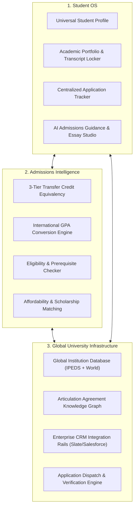

# Global University Application Platform

> **"One Student Profile. Every University. One Global Platform."**<br/>
> *AI-powered global university discovery and application infrastructure.*

A next-generation, global operating system for higher education admissions, course equivalency, and academic mobility. Designed to unify first-year admissions, transfer pathways, and international academic evaluation under one single platform.

---

## 🌍 Platform Overview

Higher education admissions and transfer systems operate as fragmented, regional monopolies characterized by extreme information asymmetry, siloed institutional software, and manual evaluation bottlenecks.

The **Global University Application Platform** addresses these challenges through three interconnected product pillars:



---

## ⚡ Key Differentiator: Transfer Credit Intelligence

In the United States alone, over **1.2 million students transfer institutions each year**, losing an average of **43% of their accumulated academic credits**—costing students and families over \$12 billion annually in redundant tuition.

This platform introduces an industry-first, student-facing **Transfer Intelligence Architecture** featuring a three-tier course equivalency engine:
1. **Tier 1 (Verified):** Official published articulation agreements and state feeds (e.g., California ASSIST.org).
2. **Tier 2 (Observed):** Aggregated historical institutional transfer decisions.
3. **Tier 3 (Predicted):** NLP & vector similarity matching of course syllabi and prerequisite catalogs, explicitly labeled with confidence scores.

---

## 📁 Repository Structure & Documentation Map

The repository contains the foundation specifications completed to date (8 of 15 core specifications complete, plus 3 deep-dive editions and 1 historical archive), with the remaining 7 specifications queued for upcoming development phases:

```
Global-University-Application-Platform/
├── README.md                                       # Platform overview and architectural summary
├── .gitignore                                      # Comprehensive security & environment filter
├── .env.example                                    # Sanitized developer environment variable template
└── docs/
    ├── 01_PROJECT_STATUS_AND_GAP_ANALYSIS.md       # Pre-development gap analysis and status [Complete]
    ├── 02_REVISED_STRATEGIC_ANALYSIS.md            # Strategic assessment & market sizing [Complete]
    ├── 03_BRAND_IDENTITY_AND_NAMING_REPORT.md      # Brand candidate evaluations & trademark check [Complete]
    ├── 04_GO_TO_MARKET_STRATEGY.md                 # 5-phase wedge go-to-market plan [Complete]
    ├── 05_UNIVERSAL_STUDENT_PROFILE_SPECIFICATION.md# Canonical student data model & schema [Complete]
    ├── 06_GLOBAL_UNIVERSITY_DATABASE_ARCHITECTURE.md# Institution schema & articulation graph [Complete]
    ├── 07_APPLICATION_REQUIREMENT_ENGINE.md        # Deterministic requirements & validation [Complete]
    ├── 08_TRANSFER_INTELLIGENCE_ARCHITECTURE.md    # 3-tier transfer equivalency technical spec [Complete]
    ├── deep-dives/
    │   ├── REVISED_STRATEGIC_ANALYSIS_FULL.md      # Master execution plan & financial model (78 KB)
    │   ├── GO_TO_MARKET_STRATEGY_FULL.md           # GTM & university onboarding playbook (63 KB)
    │   └── UNIVERSAL_STUDENT_PROFILE_SPECIFICATION_FULL.md # PostgreSQL DDL & REST API schemas (85 KB)
    └── history/
        └── UNIVIA-Strategic-Analysis.md            # Archived foundational report (preliminary working name)

### 📋 Specification Roadmap (15 Core Documents)
- ✅ **01.** Project Status and Gap Analysis
- ✅ **02.** Revised Strategic Analysis (Executive + Deep-Dive)
- ✅ **03.** Brand Identity and Naming Report
- ✅ **04.** Go-to-Market Strategy (Executive + Deep-Dive)
- ✅ **05.** Universal Student Profile Specification (Executive + Deep-Dive)
- ✅ **06.** Global University Database Architecture
- ✅ **07.** Application Requirement Engine
- ✅ **08.** Transfer Intelligence Architecture
- ⏳ **09.** International Education Intelligence *(Pending - Batch 3)*
- ⏳ **10.** University Matching Engine *(Pending - Batch 4)*
- ⏳ **11.** AI Counselor and Agent Architecture *(Pending - Batch 4)*
- ⏳ **12.** Global Scholarship and Financial Engine *(Pending - Batch 4)*
- ⏳ **13.** Security and Privacy Architecture *(Pending - Batch 5)*
- ⏳ **14.** System Architecture *(Pending - Batch 5)*
- ⏳ **15.** Development Roadmap *(Pending - Batch 5)*
```

---

## 🛠️ Target Technology Stack

| Layer | Technologies | Rationale |
|---|---|---|
| **Frontend** | Next.js 14+ (App Router), TypeScript, Tailwind CSS, shadcn/ui | Server components, high performance, accessible UI |
| **Backend Services** | Python 3.12+ (FastAPI), Pydantic v2 | High-throughput async API, native data science & AI tooling |
| **Database** | PostgreSQL 16+ with `pgvector` | Relational integrity for student records + vector similarity |
| **Caching / Queuing** | Redis 7.2+ | Rate-limiting, session management, semantic query caching |
| **Object Storage** | S3-Compatible Encrypted Storage (Cloudflare R2) | Zero egress fees, client-side encryption for transcripts |
| **Authentication** | Clerk / Auth0 | SOC2 Type II, FERPA/GDPR compliance, multi-factor auth |

---

## 🔒 Security, Privacy & Compliance

- **FERPA & GDPR Compliance:** Strict role-based access control (RBAC), student consent management, and audit logs.
- **Data Protection:** Zero plain-text storage of sensitive personally identifiable information (PII). Transcripts and academic records are stored in encrypted object storage with short-lived presigned URLs.
- **Repository Hygiene:** All API keys, credentials, tokens, environment configurations, and applicant data are strictly excluded via `.gitignore`.

---

## 📄 License & Confidentiality

Proprietary and confidential. All rights reserved.
Unauthorized copying, distribution, or deployment of this repository or its contents is strictly prohibited.
