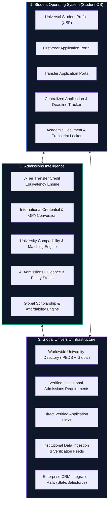

# Global University Application & Admissions Intelligence Platform

> **"One Student Profile. Every University. One Global Platform."**<br/>
> *AI-powered global university discovery, application management, and transfer intelligence infrastructure.*

---

## 🌍 Platform Overview

Higher education admissions and transfer systems operate as fragmented, regional monopolies characterized by extreme information asymmetry, siloed institutional software, and manual evaluation bottlenecks. Students worldwide are forced to navigate conflicting admission requirements, repetitive application forms, opaque transfer articulation agreements, and exorbitant credential evaluation fees.

The **Global University Application & Admissions Intelligence Platform** is architected as the world's first unified global admissions operating system. Its mission is to make higher education accessible, transparent, and navigable to students worldwide through a centralized application management and admissions intelligence ecosystem.

The platform is built around one core architectural principle:
> **A student should never have to navigate the complexity of the global higher education system alone.**

---

## 🏛️ Core Product Pillars



### 1. Student Operating System (Student OS)
* **Universal Student Profile:** Canonical academic identity containing personal demographics, educational history, standardized coursework, extracurricular activities, and verified transcripts.
* **First-Year Application Portal:** Tailored application pathways for secondary school graduates, supporting holistic admissions criteria, essays, and recommendation letter tracking.
* **Transfer Application Portal:** Dedicated workflow for community college and university transfer students, tracking earned college credits, prerequisites, and general education completion.
* **Application & Deadline Tracker:** Real-time visibility into application statuses, upcoming deadlines, document submission checklists, and institutional decisions.
* **Academic Document Organization:** Encrypted document locker for high school transcripts, college transcripts, syllabi, test score reports, and financial aid paperwork.

### 2. Admissions Intelligence
* **Transfer Credit Intelligence:** A three-tier equivalency engine (Verified official articulation, Observed historical transfers, and AI-Predicted syllabus similarity) solving the 43% credit loss problem.
* **International Credential & GPA Interpretation:** Country-specific academic conversion scales (e.g., French Baccalauréat, UK A-Levels, Indian CBSE/ICSE, Haitian Baccalauréat) normalized to standard benchmarks.
* **University Matching Engine:** Multi-dimensional compatibility scoring balancing academic profile, affordability, transfer articulation pathways, campus environment, and career goals.
* **AI College Counselor:** RAG-grounded conversational agent providing real-time admissions advice with strict institutional citations and ethical guardrails preventing hallucination.
* **Global Scholarship & Affordability Analysis:** Personalized net price calculation, institutional merit scholarship eligibility, and international student financial readiness modeling (I-20 / visa verification).

### 3. Global University Infrastructure
* **Worldwide University Directory:** Comprehensive database covering over 4,000 US degree-granting institutions and expanding to major higher education institutions worldwide.
* **Verified Institutional Records:** Standardized curriculum requirements, minimum GPA thresholds, prerequisite coursework, and standardized testing policies.
* **Official Application Links:** Direct routing to official university admissions portals, avoiding misleading third-party aggregators.
* **Institutional Ingestion & Verification Rails:** Data pipelines consuming public datasets (IPEDS, ASSIST.org), state transfer databases, and institutional feeds.
* **Enterprise Integration (Future):** Authorized API connectors for institutional CRMs (Slate, Salesforce Education Cloud) for verified data dispatch.

---

## 🛠️ Technology Architecture

> [!NOTE]
> The specifications below outline the **planned technology architecture**. No runtime software code has been installed or deployed yet. Software implementation will follow the [Development Roadmap](docs/15_DEVELOPMENT_ROADMAP.md).

```
+-----------------------------------------------------------------------------------+
|                         CLIENT LAYER (Planned: Next.js 14+)                       |
|   App Router | TypeScript | Tailwind CSS | shadcn/ui | React Hook Form | TanStack |
+------------------------------------------+----------------------------------------+
                                           | HTTPS / WSS
                                           v
+-----------------------------------------------------------------------------------+
|                     API GATEWAY & BACKEND (Planned: FastAPI)                      |
|       Python 3.12+ | Pydantic v2 | AsyncIO | SQLAlchemy 2.0 | Celery Tasks        |
+---------------------+--------------------+--------------------+-------------------+
                      |                    |                    |
                      v                    v                    v
+-------------------------------+ +------------------+ +----------------------------+
|  RELATIONAL & VECTOR STORE    | |  MESSAGE & CACHE | |      OBJECT STORAGE        |
|  PostgreSQL 16+ with pgvector | |    Redis 7.2+    | | Encrypted S3 / Cloudflare  |
|  (ACID Records + Similarity)  | |  (Tokens, Queue) | | R2 (Transcripts & Documents|
+-------------------------------+ +------------------+ +----------------------------+
```

| Layer | Planned Technology | Implementation State | Architectural Purpose |
|---|---|---|---|
| **Frontend** | Next.js 14+ (App Router), TypeScript, Tailwind CSS | Planned | Server components, responsive accessible UI, SEO optimization |
| **Backend** | Python 3.12+ (FastAPI), Pydantic v2 | Planned | High-throughput asynchronous REST API, data validation |
| **Database** | PostgreSQL 16+ with `pgvector` | Planned | Relational schema integrity for student records and vector search |
| **Caching / Queue** | Redis 7.2+ | Planned | Rate limiting, session tokens, Celery asynchronous task brokering |
| **Object Storage** | Cloudflare R2 / AWS S3 | Planned | Zero-egress encrypted object storage for transcripts and portfolios |
| **Auth** | Clerk / Auth0 | Planned | SOC2 Type II, FERPA/GDPR compliance, Multi-Factor Authentication |
| **AI / Inference** | Gemini API / Claude API | Planned | Transcript OCR extraction, semantic search, cited AI counseling |

---

## 📊 Development Status

To maintain rigorous transparency between architectural planning and functioning software, the platform tracks work across distinct verification states:

| Status Category | Current State | Description |
|---|---|---|
| **1. Strategic & Technical Documentation** | ✅ **Complete (15/15)** | All 15 foundational specifications and 3 deep-dive models are completed and synchronized. |
| **2. Architecture Approval** | 🟡 **Approved for Phase 1** | Monorepo, database schema, and security architecture reviewed. |
| **3. Workspace Infrastructure** | ✅ **Complete** | Private Git repository initialized, `.gitignore` secured, and progress tracking established. |
| **4. Features Under Development** | ⏳ **Phase 1 Queued** | Monorepo scaffolding, database migration tooling, and authentication setup. |
| **5. Features Implemented** | ❌ **None (Pre-Code)** | No software code, database migrations, or live services are currently active. |
| **6. Features Tested** | ❌ **None** | Automated unit, integration, and security testing will commence in Phase 1. |

---

## 📚 Master Documentation Index

All 15 master strategic and technical specifications are located in the [`docs/`](docs/) directory:

### Foundation & Strategy (Batch 1)
* [01. Project Status and Gap Analysis](docs/01_PROJECT_STATUS_AND_GAP_ANALYSIS.md) — Comprehensive pre-development inventory and workstream audit.
* [02. Revised Strategic Analysis](docs/02_REVISED_STRATEGIC_ANALYSIS.md) — Market opportunity, competitive landscape, and economic model. *(Deep-Dive: [Full Strategic Analysis](docs/deep-dives/REVISED_STRATEGIC_ANALYSIS_FULL.md))*
* [03. Brand Identity and Naming Report](docs/03_BRAND_IDENTITY_AND_NAMING_REPORT.md) — Evaluation of 25 name candidates across 5 naming archetypes with trademark clearance roadmap.

### Core Architecture & Strategy (Batch 2)
* [04. Go-to-Market Strategy](docs/04_GO_TO_MARKET_STRATEGY.md) — 5-phase wedge go-to-market plan prioritizing US community college transfers. *(Deep-Dive: [Full GTM Playbook](docs/deep-dives/GO_TO_MARKET_STRATEGY_FULL.md))*
* [05. Universal Student Profile Specification](docs/05_UNIVERSAL_STUDENT_PROFILE_SPECIFICATION.md) — Canonical student data model and projection layer. *(Deep-Dive: [Full SQL & API Specification](docs/deep-dives/UNIVERSAL_STUDENT_PROFILE_SPECIFICATION_FULL.md))*
* [06. Global University Database Architecture](docs/06_GLOBAL_UNIVERSITY_DATABASE_ARCHITECTURE.md) — Higher education database schema, IPEDS integration, and global institution entities.

### Engines & Intelligence (Batch 3)
* [07. Application Requirement Engine](docs/07_APPLICATION_REQUIREMENT_ENGINE.md) — Deterministic requirement parser, eligibility matrix, and validation rules.
* [08. Transfer Intelligence Architecture](docs/08_TRANSFER_INTELLIGENCE_ARCHITECTURE.md) — 3-tier transfer credit equivalency engine tackling the 43% credit loss problem.
* [09. International Education Intelligence](docs/09_INTERNATIONAL_EDUCATION_INTELLIGENCE.md) — Global academic credential interpretation, foreign grade scales, and secondary diplomas.

### AI, Matching & Financials (Batch 4)
* [10. University Compatibility & Matching Engine](docs/10_UNIVERSITY_MATCHING_ENGINE.md) — Multi-dimensional compatibility scoring and strategic reach/target/safety balancing.
* [11. AI Counselor & Agent Architecture](docs/11_AI_COUNSELOR_AND_AGENT_ARCHITECTURE.md) — RAG-based AI counselor with institutional source citations and ethical guardrails.
* [12. Global Scholarship & Financial Engine](docs/12_GLOBAL_SCHOLARSHIP_AND_FINANCIAL_ENGINE.md) — Institutional aid benchmarking, Net Price calculation, and visa proof-of-funds (I-20) readiness.

### Infrastructure & Roadmap (Batch 5)
* [13. Security & Privacy Architecture](docs/13_SECURITY_AND_PRIVACY_ARCHITECTURE.md) — FERPA/GDPR compliance, encryption at rest/transit, RBAC, and threat mitigation.
* [14. System Architecture Specification](docs/14_SYSTEM_ARCHITECTURE.md) — End-to-end cloud infrastructure, monorepo design, database topology, and scaling tiers.
* [15. Development Roadmap](docs/15_DEVELOPMENT_ROADMAP.md) — Phased engineering delivery plan across 5 milestones from MVP foundation to global launch.

### Historical Documentation
* [UNIVIA Strategic Analysis (Archive)](docs/history/UNIVIA-Strategic-Analysis.md) — Initial foundational report retained solely for historical documentation.

---

## 🗺️ Upcoming Engineering Roadmap

| Phase | Milestone | Primary Deliverables | Target Horizon |
|---|---|---|---|
| **Phase 1** | **Foundational Architecture** | Monorepo setup, Auth (Clerk/Auth0), Core PostgreSQL schema, Universal Student Profile CRUD | Month 1–2 |
| **Phase 2** | **Directory & Requirements** | IPEDS data ingestion (4,000+ US institutions), deterministic requirement validation engine | Month 2–3 |
| **Phase 3** | **Transfer Intelligence MVP** | California ASSIST.org ingestion, Tier 1/2 course equivalency lookup, OCR transcript parser | Month 3–4 |
| **Phase 4** | **AI Counselor & Affordability** | RAG-grounded AI counselor, Net Price calculator, scholarship discovery matching | Month 4–5 |
| **Phase 5** | **Global Readiness & Beta** | International credential engine (UK, France, India), security audit, pilot beta launch | Month 5–6 |

---

## 🔒 Security, Privacy & Repository Governance

* **Private Repository:** This repository contains proprietary architecture, data models, and business logic. Visibility must remain **PRIVATE**.
* **FERPA & GDPR Compliance:** Strict consent-based data sharing, end-to-end document encryption, zero plain-text PII storage, and immutable audit logs.
* **Repository Hygiene:** All API keys, credentials, local environment files (`.env*`), applicant uploads, and database files are strictly ignored via [`.gitignore`](.gitignore).
* **Progress Tracking:** All active engineering tasks, dependencies, and verification criteria are tracked in [`PROJECT_PROGRESS.md`](PROJECT_PROGRESS.md).

---

## 📄 License & Confidentiality

Proprietary and confidential. Copyright © 2026 Jonathan Germain (`Jonathan0926x`). All rights reserved.
Unauthorized reproduction, distribution, or public transmission of this codebase or its specifications is strictly prohibited.
