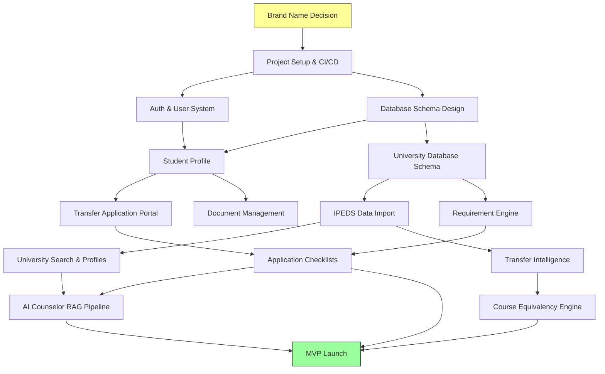

# Project Status and Gap Analysis

> **Date:** November 23, 2026
> **Status:** Pre-Development — Documentation Phase
> **Project:** Global University Application & Admissions Intelligence Platform

---

## 1. Current State Assessment

### Existing Assets

| Asset | Status | Location | Notes |
|---|---|---|---|
| UNIVIA Strategic Analysis v1 | ✅ Complete (outdated) | `UNIVIA-Strategic-Analysis.md` | Brand name abandoned; competitive landscape and strategy still largely valid |
| Brand research data | ✅ In memory | Conversation context | Trademark conflicts identified for UNIVIA and 12+ alternative names |
| Market research data | ✅ In memory | Conversation context | Transfer market, international students, edtech market sizing |
| Competitive intelligence | ✅ In memory | Conversation context | CourseWise, EdVisorly, ASSIST.org, Common App, etc. |
| Source code | ❌ None | — | No application code exists |
| Database schemas | ❌ None | — | No schemas designed |
| UI/UX designs | ❌ None | — | No wireframes, mockups, or design system |
| Infrastructure | ❌ None | — | No hosting, CI/CD, or environments |
| Data assets | ❌ None | — | No university data, scholarship data, or articulation data |

### Assessment of Previous Strategic Analysis

| Element | Verdict | Notes |
|---|---|---|
| UNIVIA naming conflict identification | ✅ Correct | UNIVIA.AI (HEC Paris/Station F) is a direct competitor using the same name |
| Competitive landscape mapping | ✅ Correct, needs expansion | Missing ASSIST.org, Transferology, and deeper transfer credit startup analysis |
| Transfer-first market entry | ✅ Correct | Validated by market data: 480K annual transfers, 43% credit loss |
| MVP scope | ⚠️ Needs revision | Original MVP excluded first-year architecture; architecture must support both from day one |
| Financial model | ⚠️ Needs revision | Pre-seed estimate ($500K-800K) is reasonable but infrastructure costs underestimated for AI-heavy product |
| Tech stack recommendations | ✅ Correct | Next.js + FastAPI + PostgreSQL + pgvector is well-suited |
| Timeline (3-9 months for MVP) | ⚠️ Aggressive | 6-month MVP is possible with focused scope and 3-4 person team, but requires ruthless prioritization |

---

## 2. Gap Analysis by Product

### Product A: Student OS

| Component | Status | Complexity | Dependencies | Priority |
|---|---|---|---|---|
| Authentication & onboarding | ❌ Not started | Medium | Auth provider selection (Clerk vs Auth0) | P0 — Phase 1 |
| Universal student profile | ❌ Not started | High | Database schema, international education systems | P0 — Phase 1 |
| Student dashboard | ❌ Not started | Medium | Profile, applications, deadlines | P0 — Phase 1 |
| First-year application portal | ❌ Not started | High | Profile, university requirements | P1 — Phase 1 (architecture only), Phase 4 (full UI) |
| Transfer application portal | ❌ Not started | Very High | Profile, transfer intelligence, university requirements | P0 — Phase 1 |
| Application management & tracker | ❌ Not started | High | University database, requirement engine | P0 — Phase 2 |
| Document management | ❌ Not started | Medium | Object storage, virus scanning | P0 — Phase 1 |
| Deadline management | ❌ Not started | Medium | University database, notification system | P1 — Phase 2 |
| Application readiness scoring | ❌ Not started | Medium | Requirement engine, profile completeness | P1 — Phase 2 |
| Admission decision center | ❌ Not started | Medium | Application tracker | P2 — Phase 4 |

### Product B: Admissions Intelligence

| Component | Status | Complexity | Dependencies | Priority |
|---|---|---|---|---|
| International GPA conversion | ❌ Not started | Very High | Educational system database, conversion methodologies | P1 — Phase 4 |
| Credential recognition database | ❌ Not started | High | Country database, qualification database | P2 — Phase 4 |
| Transfer eligibility evaluation | ❌ Not started | High | University database, transfer requirements | P0 — Phase 3 |
| Course equivalency engine | ❌ Not started | Very High | Course catalog, NLP/embeddings, articulation data | P0 — Phase 3 |
| University matching engine | ❌ Not started | High | University database, profile, scoring algorithm | P1 — Phase 3 |
| AI college counselor | ❌ Not started | Very High | RAG pipeline, university data, profile integration | P0 — Phase 3 |
| AI application agent | ❌ Not started | Very High | Counselor, all other intelligence systems | P2 — Phase 5 |
| Scholarship eligibility matching | ❌ Not started | Medium | Scholarship database, profile | P1 — Phase 4 |

### Product C: Global University Infrastructure

| Component | Status | Complexity | Dependencies | Priority |
|---|---|---|---|---|
| University database schema | ❌ Not started | High | Country database, institution taxonomy | P0 — Phase 2 |
| US institution data (IPEDS seed) | ❌ Not started | Medium | Database schema, IPEDS data download | P0 — Phase 2 |
| Application portal directory | ❌ Not started | Medium | University database | P0 — Phase 2 |
| Requirement engine | ❌ Not started | High | University database, requirement taxonomy | P0 — Phase 2 |
| Data ingestion pipeline | ❌ Not started | High | Scraping framework, verification workflow | P1 — Phase 2 |
| Data verification system | ❌ Not started | Medium | Ingestion pipeline, admin tools | P1 — Phase 2 |
| Scholarship database | ❌ Not started | High | Data ingestion, eligibility schema | P1 — Phase 4 |
| Country & education system database | ❌ Not started | High | Research, structured data entry | P1 — Phase 4 |
| Knowledge graph | ❌ Not started | Very High | All databases, relationship modeling | P2 — Phase 5 |
| University API (institutional integrations) | ❌ Not started | Very High | All infrastructure, partnerships | P2 — Phase 5 |

---

## 3. Technical Decisions Required Before Coding

| Decision | Options | Recommendation | Status |
|---|---|---|---|
| **Brand name** | See naming report | — | ⏳ Pending founder decision |
| **Auth provider** | Clerk vs Auth0 vs custom | Clerk (faster DX, better Next.js integration) | ⏳ Pending |
| **Backend framework** | FastAPI (Python) vs Node.js | FastAPI (better for AI/ML ecosystem, type safety with Pydantic) | 📋 Recommended |
| **Database** | PostgreSQL + pgvector vs PostgreSQL + Pinecone | PostgreSQL + pgvector (fewer moving parts, sufficient for MVP) | 📋 Recommended |
| **Search** | PostgreSQL FTS vs OpenSearch | PostgreSQL FTS for MVP, migrate to OpenSearch when needed | 📋 Recommended |
| **AI provider** | OpenAI vs Anthropic vs Google vs multi-provider | Multi-provider abstraction layer, start with OpenAI (GPT-4o) | 📋 Recommended |
| **Object storage** | AWS S3 vs Cloudflare R2 vs GCP Cloud Storage | Cloudflare R2 (no egress fees, S3-compatible) | 📋 Recommended |
| **Hosting (frontend)** | Vercel vs Cloudflare Pages | Vercel (best Next.js support) | 📋 Recommended |
| **Hosting (backend)** | Railway vs Render vs Fly.io vs AWS | Railway (simple, good DX, containerized) | 📋 Recommended |
| **Database hosting** | Neon vs Supabase vs AWS RDS | Neon (serverless PostgreSQL, pgvector support, generous free tier) | 📋 Recommended |
| **OCR provider** | Tesseract vs Google Vision vs AWS Textract | Google Vision API (best multilingual support) | ⏳ Pending |
| **Monorepo tool** | Turborepo vs Nx vs none | Turborepo (lighter weight, Next.js aligned) | 📋 Recommended |
| **i18n framework** | next-intl vs react-i18next | next-intl (App Router native) | 📋 Recommended |

---

## 4. Critical Path

**Parallelizable work streams after database schema is finalized:**
- Stream 1: Student profile + transfer portal + document management
- Stream 2: University database + IPEDS import + search
- Stream 3: Design system + UI components

**Sequential dependencies:**
- Requirement engine requires university database
- AI counselor requires university data embeddings
- Application checklists require both profile and requirement engine

---

## 5. Decision Log

| # | Decision | Status | Date | Notes |
|---|---|---|---|---|
| 1 | Abandon "UNIVIA" brand name | ✅ Decided | 2026-11-22 | Conflicts with UNIVIA.AI, univia.world, Univia Education |
| 2 | Transfer-first market entry | ✅ Decided | 2026-11-22 | Architecture supports both first-year and transfer |
| 3 | Architecture must support both applicant types from day one | ✅ Decided | 2026-11-23 | First-year UI can be Phase 4, but data model is universal |
| 4 | Tech stack: Next.js + FastAPI + PostgreSQL | 📋 Recommended | 2026-11-22 | Pending final confirmation |
| 5 | New brand name | ⏳ Pending | — | See Brand Identity Report |
| 6 | Auth provider selection | ⏳ Pending | — | Clerk recommended |
| 7 | Cloud infrastructure provider | ⏳ Pending | — | Multi-provider recommended |
| 8 | MVP feature scope | ⏳ Pending | — | See Development Roadmap |
| 9 | Funding strategy | ⏳ Pending | — | Bootstrap vs pre-seed |
| 10 | Legal incorporation | ⏳ Pending | — | Delaware C-Corp recommended if seeking US VC |

---

## 6. Timeline Assessment

### Original Estimate: 6-Month MVP (Months 3–9)

**Assessment: Achievable but tight with a 3-4 person team.**

| Phase | Duration | Realistic? | Risk |
|---|---|---|---|
| Phase 0: Foundation | 6 weeks | ✅ Yes | Low — standard project setup |
| Phase 1: Core Student Platform | 12 weeks | ⚠️ Tight | Medium — profile complexity for international support |
| Phase 2: University Infrastructure | 12 weeks | ⚠️ Tight | High — data acquisition and verification |
| Phase 3: AI Intelligence | 12 weeks | ⚠️ Tight | High — RAG quality, document processing reliability |
| Phase 4: Financial & International | 14 weeks | ✅ Reasonable | Medium — builds on existing infrastructure |
| Phase 5: Global Ecosystem | 6+ months | N/A | Long-term |

**What to cut from MVP (without compromising architecture):**
- University matching engine (Phase 3 → Phase 4)
- Scholarship database (Phase 4)
- International GPA conversion (Phase 4)
- Counselor/recommender portals (Phase 5)
- Advanced AI application agent (Phase 5)
- Knowledge graph (Phase 5)

**MVP (Phases 0–2, ~30 weeks):**
Student profile + transfer portal + university database (US, IPEDS-seeded) + requirement engine + document management + basic AI counselor + application tracker

---

## 7. Document Tracker

| # | Document | Status | File | Notes |
|---|---|---|---|---|
| 1 | Project Status and Gap Analysis | ✅ Complete | `01_PROJECT_STATUS_AND_GAP_ANALYSIS.md` | Inventory and gap analysis |
| 2 | Revised Strategic Analysis | ✅ Complete | `02_REVISED_STRATEGIC_ANALYSIS.md` | Executive + deep-dive edition |
| 3 | Brand Identity and Naming Report | ✅ Complete | `03_BRAND_IDENTITY_AND_NAMING_REPORT.md` | 25 candidates across 5 archetypes |
| 4 | Go-to-Market Strategy | ✅ Complete | `04_GO_TO_MARKET_STRATEGY.md` | Wedge strategy + deep-dive playbook |
| 5 | Universal Student Profile Specification | ✅ Complete | `05_UNIVERSAL_STUDENT_PROFILE_SPECIFICATION.md` | Canonical schema + deep-dive DDL/API |
| 6 | Global University Database Architecture | ✅ Complete | `06_GLOBAL_UNIVERSITY_DATABASE_ARCHITECTURE.md` | IPEDS + global institution schema |
| 7 | Application Requirement Engine | ✅ Complete | `07_APPLICATION_REQUIREMENT_ENGINE.md` | Deterministic eligibility & parsing |
| 8 | Transfer Intelligence Architecture | ✅ Complete | `08_TRANSFER_INTELLIGENCE_ARCHITECTURE.md` | 3-tier equivalency architecture |
| 9 | International Education Intelligence | ✅ Complete | `09_INTERNATIONAL_EDUCATION_INTELLIGENCE.md` | Foreign credential conversion & benchmarking |
| 10 | University Matching Engine | ✅ Complete | `10_UNIVERSITY_MATCHING_ENGINE.md` | Multi-dimensional scoring & strategy |
| 11 | AI Counselor and Agent Architecture | ✅ Complete | `11_AI_COUNSELOR_AND_AGENT_ARCHITECTURE.md` | RAG-grounded counseling & verification guardrails |
| 12 | Global Scholarship and Financial Engine | ✅ Complete | `12_GLOBAL_SCHOLARSHIP_AND_FINANCIAL_ENGINE.md` | Net price estimation & visa readiness |
| 13 | Security and Privacy Architecture | ✅ Complete | `13_SECURITY_AND_PRIVACY_ARCHITECTURE.md` | FERPA/GDPR compliance, RBAC & threat defense |
| 14 | System Architecture | ✅ Complete | `14_SYSTEM_ARCHITECTURE.md` | Monorepo, Next.js, FastAPI, PostgreSQL/pgvector |
| 15 | Development Roadmap | ✅ Complete | `15_DEVELOPMENT_ROADMAP.md` | Phased implementation blueprint (Phases 1–5) |

---

> [!IMPORTANT]
> **Specification Inventory Status:** All 15 of 15 master strategic and technical specifications are complete and synchronized (including 3 deep-dive implementations in `docs/deep-dives/` and 1 historical analysis in `docs/history/`). The project is fully prepared for Phase 1 foundational software implementation.
