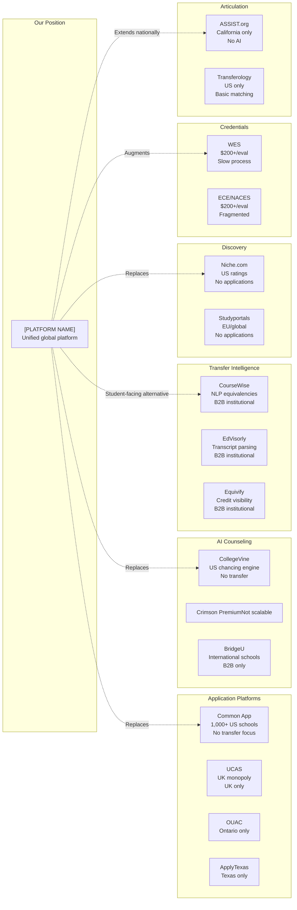

# Revised Strategic Analysis

> **Date:** November 23, 2026
> **Version:** 2.0 — Replaces UNIVIA-Strategic-Analysis.md
> **Status:** Pre-Development Strategic Assessment

---

## 1. Executive Summary

A fragmented global higher education admissions landscape presents an opportunity to build a category-defining platform that unifies five currently separate industries: application platforms, college counseling, credential evaluation, transfer articulation, and scholarship databases.

**The opportunity is real and quantifiable:**
- 1.2 million US students transfer institutions annually, losing 43% of their credits on average
- International students contribute \$43–56 billion annually to the US economy but face byzantine application processes
- The US higher education technology market is \$7.47 billion and growing at 14.8% CAGR toward \$19.6 billion by 2030
- No single platform serves both first-year and transfer applicants globally with AI-powered guidance

**The recommended strategy:** Launch with US community college transfer students (the most underserved, highest-pain segment), build defensible data assets (course equivalencies, institutional requirements, academic credentials), then expand internationally.

**The long-term vision:** Become the "Stripe of University Applications" — the infrastructure layer connecting students, universities, and admissions systems worldwide.

---

## 2. Market Analysis

### 2.1 Total Addressable Market (TAM)

| Segment | Annual Volume | Description |
|---|---|---|
| Global higher education applicants | ~200 million | Students applying to post-secondary education worldwide |
| US higher ed tech spending | \$7.47B (2026) → \$19.6B (2030) | Software, platforms, AI tools for higher education |
| International student mobility | ~6 million | Students studying outside their home country |

**TAM estimate:** \$5–10 billion (student-facing edtech + institutional admissions infrastructure globally)

### 2.2 Serviceable Addressable Market (SAM)

| Segment | Annual Volume | Estimated Revenue Potential |
|---|---|---|
| US transfer students | 1.2 million | \$120M (at \$100/student annual blend of free + premium) |
| US first-year applicants | 3.7 million | \$370M |
| International students → US | ~1 million applicants | \$200M (higher willingness to pay) |
| International students → UK/Canada/EU | ~3 million applicants | \$300M |
| Institutional subscriptions (US) | ~4,000 institutions | \$200M (at \$50K average) |

**SAM estimate:** \$1–1.2 billion

### 2.3 Serviceable Obtainable Market (SOM) — Year 1–3

| Year | Target Segment | Users | Revenue Estimate |
|---|---|---|---|
| Year 1 | US CC transfer students (California focus) | 20,000–50,000 | \$200K–600K |
| Year 2 | US transfer + first-year + international | 150,000–300,000 | \$2M–5M |
| Year 3 | US + Canada + early international | 500,000–1M | \$8M–15M |

> [!NOTE]
> All revenue projections are assumptions based on comparable SaaS edtech pricing. These require validation through market testing.

### 2.4 Market Timing — Why Now?

1. **AI capability inflection:** LLMs enable document understanding (transcripts, essays), multilingual counseling, and intelligent matching that was impossible 3 years ago
2. **Transfer credit crisis:** 43% average credit loss is a \$10+ billion waste of student time and money annually — public awareness is growing
3. **International enrollment volatility:** 9% decline in international enrollment and 15% drop in first-time international students creates urgency for better tools
4. **Post-COVID digital expectation:** Students expect digital-first experiences; paper-based admissions processes feel antiquated
5. **Common App stagnation:** Common App has expanded to 1,000+ institutions but hasn't meaningfully innovated in transfer, international credentials, or AI

---

## 3. Competitive Landscape

### Key Competitive Gaps We Fill

| Gap | Current State | Our Solution |
|---|---|---|
| **No unified transfer + first-year platform** | Common App is first-year focused; transfer is an afterthought | Dedicated transfer portal with equal investment |
| **No student-facing transfer intelligence** | CourseWise, EdVisorly, Equivify are all B2B institutional tools | Student-facing course equivalency explorer and eligibility checker |
| **No national articulation database** | ASSIST.org is California-only; nothing exists nationally | Build the national (then global) articulation intelligence layer |
| **No AI-powered credential interpretation** | WES charges \$200+ and takes weeks | Instant AI-powered approximate credential analysis (not replacing WES, augmenting with speed) |
| **No global university discovery with application routing** | Niche is US-only ratings; Studyportals has no application integration | Global discovery → requirement matching → official application routing |
| **No multilingual AI counselor** | CollegeVine is English-only, US-only | Multilingual, context-aware, international |

### Competitive Advantages to Build

1. **Data network effect:** Every student interaction improves course equivalency data, requirement accuracy, and matching quality
2. **Universal profile lock-in:** Once a student builds their profile, switching costs are high
3. **Two-sided marketplace potential:** Students attract universities; universities attract students
4. **Multilingual moat:** Supporting Haitian Creole, Hindi, Swahili creates markets incumbents ignore
5. **Transfer-first differentiation:** No incumbent owns transfer at scale

---

## 4. Strategic Positioning

### Position Statement

> [PLATFORM NAME] is the global operating system for university admissions — a single platform where any student, anywhere, can discover universities, understand requirements, prepare applications, and navigate the complexity of higher education.

### Three-Product Architecture

| Product | What It Solves | Strategic Role |
|---|---|---|
| **Student OS** | Organizes the entire application journey | Core product, user acquisition |
| **Admissions Intelligence** | Understands qualifications and requirements | Competitive advantage, AI differentiation |
| **Global University Infrastructure** | Connects universities, systems, and databases | Long-term moat, network effects |

### Long-Term Vision: The "Stripe of University Applications"

**Year 1–2:** Student-facing platform (application preparation, tracking, AI guidance)
**Year 3–4:** Institutional API (universities receive standardized application data through authorized integrations)
**Year 5+:** Infrastructure layer (the rails connecting students, universities, credential evaluators, and scholarship providers globally)

This follows the Stripe playbook: start with a simple, developer-friendly interface (student-friendly in our case), then become the infrastructure everyone builds on.

---

## 5. Go-to-Market Sequence

| Phase | Market | Rationale | Timeline |
|---|---|---|---|
| **Phase 1** | California CC → UC/CSU transfers | ASSIST.org data model exists; largest state transfer system; highest data availability | Months 1–12 |
| **Phase 2** | Other US state transfers | Expand articulation data state by state; Texas, New York, Florida, Illinois next | Months 9–18 |
| **Phase 3** | International students → US | High willingness to pay; leverage existing US university database | Months 12–24 |
| **Phase 4** | Canada and UK | OUAC and UCAS integrations; English-language markets | Months 18–30 |
| **Phase 5** | Europe, Caribbean, developing world | Social mission alignment; multilingual capability | Months 24–36+ |

---

## 6. Business Model

### Revenue Streams

| Stream | Pricing | Target | Timeline |
|---|---|---|---|
| **Free tier** | \$0 | All students | Launch |
| **Premium student** | \$9.99–19.99/month | Students wanting advanced AI, document analysis, matching | Month 6+ |
| **Counselor/advisor** | \$29–99/month per seat | Independent counselors, school counselors | Month 12+ |
| **Institutional** | \$10K–100K/year | Universities wanting analytics, recruitment tools | Month 18+ |
| **API access** | Usage-based | Institutions integrating with the platform | Month 24+ |

### Free Tier (never paywalled)
- Student account and profile
- University discovery and search
- Basic application tracking (up to 5 applications)
- University comparisons
- Basic scholarship search
- Limited AI counselor (5 messages/day)

### Premium Tier
- Unlimited AI counselor
- Document analysis (transcript parsing, essay review)
- Advanced university matching
- Unlimited application tracking
- Course equivalency explorer
- Application readiness scoring
- Financial affordability calculator
- Priority support

### Revenue Projection (Assumptions)

| Year | Free Users | Paid Users | Conversion | ARPU | ARR |
|---|---|---|---|---|---|
| 1 | 30K | 1,500 | 5% | \$120 | \$180K |
| 2 | 200K | 16,000 | 8% | \$144 | \$2.3M |
| 3 | 700K | 70,000 | 10% | \$156 | \$10.9M |
| 4 | 1.5M | 180,000 | 12% | \$168 | \$30.2M |
| 5 | 3M | 420,000 | 14% | \$180 | \$75.6M |

> [!WARNING]
> These projections are assumptions, not forecasts. They require validation through actual market testing. Conversion rates above 10% assume strong product-market fit and significant AI differentiation.

---

## 7. Risk Matrix

| Risk | Likelihood | Impact | Mitigation |
|---|---|---|---|
| **Data accuracy at scale** | High | Critical | Start with verified IPEDS data; build ingestion + verification before scaling; never publish unverified data as fact |
| **AI hallucination in high-stakes advice** | High | Critical | RAG-only architecture; mandatory source citations; never generate unsourced institutional facts; human review for edge cases |
| **Common App competitive response** | Medium | High | Move fast in transfer (Common App's weakest area); build data moats before they respond |
| **University partnership acquisition** | High | High | Start with open/public data; earn partnerships through student volume and demonstrated value |
| **Regulatory complexity (GDPR, FERPA)** | Medium | High | Privacy-first architecture; hire specialized counsel; design for strictest jurisdiction |
| **Revenue before scale** | High | Medium | B2B revenue (counselor tools, institutional analytics) can precede B2C scale |
| **Engineering complexity** | Medium | Medium | Modular monolith; avoid premature microservices; hire strong senior engineers |
| **Student acquisition cost** | Medium | Medium | SEO/content strategy (transfer guides rank well); community college partnerships; organic TikTok/YouTube |
| **Credential evaluation legal risk** | Low | High | Never claim to provide official credential evaluations; always refer to WES/ECE/NACES for official evaluations |
| **International expansion complexity** | Medium | Medium | Modular country/education system architecture; expand only when data quality meets standards |

---

## 8. Funding Strategy

| Round | Amount | Timing | Milestones Required |
|---|---|---|---|
| **Pre-seed** | \$500K–800K | Before/during MVP | Founding team, brand, initial product architecture |
| **Seed** | \$2M–4M | After MVP + early traction | 10K+ users, working transfer intelligence, university partnerships |
| **Series A** | \$10M–20M | After product-market fit | 100K+ users, revenue, institutional partnerships, international expansion ready |

### Pre-Seed Sources
- Angel investors (edtech-focused)
- Accelerators: Y Combinator, Techstars, Imagine K12, GSV Ventures
- Grants: Gates Foundation (education access), Schmidt Futures, Lumina Foundation
- Pre-seed funds: Precursor Ventures, Hustle Fund

### Key Investor Narrative
"We're building the Stripe of university applications. The \$7.5B US higher ed tech market is fragmented across dozens of siloed tools. Students lose 43% of their credits when transferring because no one has built the intelligence layer connecting educational systems. We start with the most underserved segment — transfer students — and expand to become the global infrastructure for admissions."

---

> [!IMPORTANT]
> **Strategic decisions requiring founder input:**
> 1. Brand name selection (see Brand Identity Report)
> 2. Funding approach (bootstrap → pre-seed vs. immediate fundraising)
> 3. Incorporation jurisdiction and structure
> 4. MVP scope confirmation
> 5. First hire priorities (engineer vs. designer vs. edtech domain expert)
