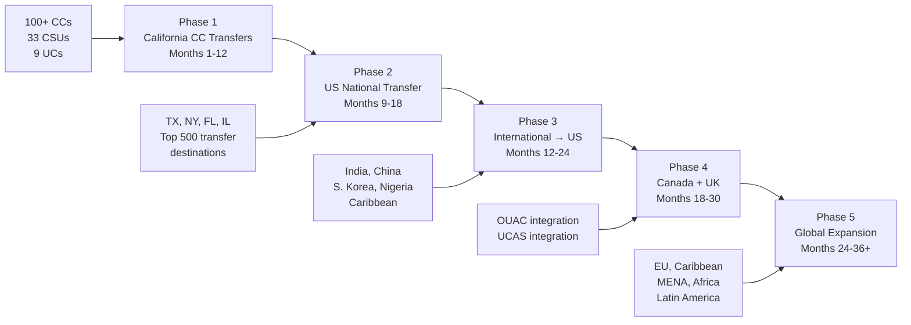

# Go-to-Market Strategy

> **Date:** November 23, 2026
> **Status:** Pre-Launch Planning
> **Dependencies:** Brand name decision, MVP completion

---

## 1. Market Segmentation

### Segment A: US Community College → Four-Year Transfer Students

| Metric | Value |
|---|---|
| **Annual transfer volume** | 480,000–500,000 students (CC → 4-year) |
| **Total CC enrollment** | 10.5 million (6.4M credit-bearing) |
| **Average credit loss** | 43% of accumulated credits |
| **Transfer rate** | 34% of CC starters eventually transfer (6-year window) |
| **Transfer destinations** | 73% to public/regional institutions; 7.7% to highly selective |
| **Growth rate** | 4–4.4% year-over-year |

**Pain points:**
1. **Credit loss:** Students lose nearly half their credits — equivalent to wasting 1–2 years of tuition and time
2. **Fragmented articulation data:** Only California (ASSIST.org) has a comprehensive state-level system
3. **Complex multi-institution transcripts:** Students often attend 2–3 institutions before transferring
4. **Information asymmetry:** Transfer requirements are buried across institutional websites
5. **No dedicated transfer tools:** Common App treats transfer as an afterthought

**Acquisition cost estimate:** Low (\$5–15 CAC). High organic search intent ("how to transfer from [CC] to [University]"). Community college partnerships provide free distribution.

**Why this is Segment #1:** Largest addressable transfer pool, highest pain intensity, lowest competition, strong SEO opportunity, excellent data availability (IPEDS + state articulation databases).

### Segment B: US Four-Year to Four-Year Transfer Students

| Metric | Value |
|---|---|
| **Annual transfer volume** | ~720,000 (remainder of 1.2M total minus CC transfers) |
| **Growth** | Stable to growing (stop-out students returning post-COVID) |

**Pain points:** Similar to Segment A but with additional complexity — credit evaluation is more institution-specific and less standardized than CC→4-year pathways.

**Acquisition:** Moderate CAC (\$15–30). Less organic search volume but higher willingness to pay.

### Segment C: International Students Applying to US Universities

| Metric | Value |
|---|---|
| **Annual applicant volume** | ~1 million+ |
| **Economic contribution** | \$43–56 billion annually |
| **Recent trend** | 9% overall enrollment decline; 15% drop in first-time international students |
| **Top source countries** | India, China, South Korea, Vietnam, Canada |

**Pain points:**
1. **Credential evaluation costs:** WES/ECE charge \$200+ per evaluation
2. **Application complexity:** Different requirements for every institution
3. **Financial opacity:** True cost unclear; most ineligible for US federal aid
4. **Language barriers:** Application terminology is US-specific
5. **Visa process anxiety:** F-1 visa requires proof of full financial coverage

**Acquisition cost estimate:** Medium (\$20–50 CAC). International student forums, education agencies, embassy partnerships.

**Why this is Segment #3 (not #1):** Higher CAC, requires international credential database (Phase 4), and international students have alternative pathways (education agents, Crimson Education). Better to enter after the US platform is proven.

### Segment D: Caribbean and Haitian Students

| Metric | Value |
|---|---|
| **US Haitian diaspora** | ~859,000 (concentrated in FL, NY) |
| **Direct applicants from Haiti** | Small but extremely underserved |
| **Key barriers** | Financial, visa processing, testing access, transcript availability |

**Pain points:**
1. **Extreme financial barriers:** Haitian GDP per capita severely limits affordability
2. **Visa bottlenecks:** US Embassy in Port-au-Prince frequently suspends services
3. **Testing access:** SAT/TOEFL testing centers scarce and disrupted
4. **Transcript challenges:** Academic records may be incomplete due to political instability
5. **No targeted platforms:** Zero tools designed for Caribbean → US/Canada/EU pathways

**Acquisition cost estimate:** Very low (\$2–5 CAC). Community-driven, NGO partnerships, high social media virality potential.

**Strategic value:** Social mission alignment; demonstrates platform's global accessibility commitment; strong story for press and investor narrative; potential for foundation/grant funding.

---

## 2. Recommended Market Entry Sequence

### Phase 1: California Community College Transfer (Months 1–12)

**Why California first:**
- **ASSIST.org provides the data model:** 100+ CCs articulated against UC/CSU system
- **Largest state transfer pipeline:** California has the most community college students in the US
- **Established transfer culture:** ADT (Associate Degree for Transfer) is widely understood
- **Concentrated geography:** Marketing can target specific campuses
- **Regulatory support:** California's transfer infrastructure is the most mature in the US

**Initial institution scope:**
- 115 California Community Colleges
- 23 CSU campuses
- 9 UC campuses
- Top 20 private California universities accepting transfers

**Key actions:**
- Seed university database with IPEDS data for California institutions
- Import/model ASSIST.org articulation data
- Partner with 3–5 CC counseling offices for beta testing
- Create SEO content: "Transfer from [CC] to [University] Guide" for every CC→UC/CSU pathway

### Phase 2: US National Transfer Expansion (Months 9–18)

**Expansion priority (by transfer volume and data availability):**
1. **Texas** — ApplyTexas system; large CC transfer pipeline
2. **New York** — SUNY/CUNY transfer pathways; large international population
3. **Florida** — 2+2 articulation mandate; well-documented transfer policies
4. **Illinois** — iTransfer.org provides state-level articulation data
5. **North Carolina, Virginia, Ohio, Michigan** — High CC enrollment states

**Key actions:**
- Expand university database to top 500 transfer-receiving US institutions
- Build state-by-state articulation data coverage
- Launch first-year application portal (leveraging same architecture)
- Begin content marketing nationally

### Phase 3: International Students → US (Months 12–24)

**Key actions:**
- Build international credential database (top 10 educational systems)
- Launch GPA conversion tools
- Add multilingual support (Spanish, French, Haitian Creole, Hindi, Chinese)
- Partner with international education agencies
- Build international financial aid and scholarship database

### Phase 4: Canada + UK (Months 18–30)

**Key actions:**
- Add Canadian institutions (OUAC for Ontario, direct applications for other provinces)
- Add UK institutions (UCAS system)
- Expand credential recognition for Canadian and UK qualifications

### Phase 5: Global Expansion (Months 24–36+)

**Key actions:**
- European institutions (Germany, France, Netherlands — many with English programs)
- Caribbean institutions and partnerships
- Middle East and Africa
- Latin America
- Asia-Pacific

---

## 3. Customer Acquisition Strategy

### Phase 1 Acquisition Channels

| Channel | Strategy | Estimated CAC | Volume |
|---|---|---|---|
| **SEO/Content** | "How to transfer from [CC] to [University]" guides for every CA pathway | \$3–5 | High |
| **Community college partnerships** | Embed in orientation, counseling offices, student resource centers | \$0–2 | Medium |
| **Social media (organic)** | TikTok transfer advice, YouTube walkthroughs, Instagram student stories | \$5–10 | High |
| **Reddit/Discord** | Participate in r/TransferStudents, r/CollegeTransfer, transfer Discord servers | \$0 | Low-Medium |
| **Student ambassadors** | Recruit CC students as campus ambassadors (comp: free premium) | \$5 | Medium |
| **Google Ads** | Target "transfer to [University]" keywords | \$15–25 | Medium |
| **College counselor referrals** | Train CC counselors to recommend the platform | \$0–5 | Medium |

### Content Marketing Strategy

**Pillar content (SEO):**
- "Complete Guide to Transferring from [CC] to [University]" (create for top 200 CC→University pathways)
- "How Many Credits Transfer from [CC] to [CSU/UC]?"
- "Transfer Application Deadlines [Year]"
- "GPA Requirements for Transfer to [University]"
- "Best Scholarships for Transfer Students [Year]"

**Social content:**
- Student transfer success stories (TikTok, Instagram Reels)
- "What Your Counselor Won't Tell You About Transferring" (viral education content)
- "I Got Accepted: Transfer Decision Reactions" (engagement content)
- Weekly deadline reminders during application season

---

## 4. Pricing Strategy

### Price Sensitivity Analysis

| Audience | Willingness to Pay | Recommended Price |
|---|---|---|
| US CC transfer students | Low-Medium (cost-sensitive demographic) | Free tier must be robust; premium \$9.99/mo |
| US four-year transfer students | Medium | \$9.99–14.99/mo |
| International students → US | Medium-High (high stakes, high cost of alternatives) | \$14.99–19.99/mo |
| Parents | High (willing to pay for child's education) | Family plan at \$14.99–19.99/mo |
| Independent counselors | High (business expense) | \$29–99/mo per seat |

### Conversion Strategy
- Free tier must be genuinely useful (not crippled demo)
- Premium upgrade triggers: AI counselor message limit hit, document analysis needed, more than 5 applications
- Application season urgency: October–January is peak conversion window
- Offer annual plans at discount (e.g., \$99/year vs \$9.99/mo)

---

## 5. Partnership Strategy

| Partner Type | Value Proposition | Priority |
|---|---|---|
| **Community college counseling offices** | Free tools that make their job easier; student success metrics | P0 — Phase 1 |
| **State articulation database operators** | Data partnerships; platform extends their reach | P0 — Phase 1 |
| **College access nonprofits** | Free platform access for underserved students; impact metrics | P1 — Phase 1 |
| **WES / credential evaluation orgs** | Referral partnerships; platform directs students to their services when official evaluation is needed | P1 — Phase 3 |
| **University admissions offices** | Analytics on prospective transfer pipeline; recruitment tools | P2 — Phase 4 |
| **Education agencies (international)** | Platform as counseling tool; co-marketing | P2 — Phase 3 |

---

## 6. Key Metrics and Milestones

| Milestone | Month | Target |
|---|---|---|
| MVP launch (private beta) | Month 6 | Functional platform with 50 beta users |
| Public launch | Month 9 | 500 users; 50 California institutions with verified data |
| Product-market fit signal | Month 12 | 5,000 users; 20% weekly active rate; NPS > 40 |
| Paid conversion | Month 12 | 5% free-to-paid conversion rate |
| Revenue milestone | Month 15 | \$10K MRR |
| Seed fundraise ready | Month 15 | 10K+ users; growing revenue; institutional partnerships |
| National expansion | Month 18 | 20K users; 500+ institutions; multi-state coverage |
| International launch | Month 24 | 100K users; 5 countries; \$100K+ MRR |

---

## 7. Competitive Moat Development

| Timeline | Moat Element | Description |
|---|---|---|
| **Month 6** | Content moat | SEO content covering transfer pathways (hard to replicate at scale) |
| **Month 12** | Data moat (requirements) | Verified application requirements for 500+ institutions |
| **Month 18** | Data moat (equivalencies) | Course equivalency database growing with every user interaction |
| **Month 24** | Network effects | Student profiles attract universities; university data attracts students |
| **Month 30** | Switching costs | Students have invested hours building profiles and application materials |
| **Month 36** | Infrastructure moat | API integrations with institutions make the platform the "rails" |

The platform becomes increasingly defensible over time. The data assets (verified requirements, course equivalencies, credential recognition rules) are expensive and time-consuming to replicate. Each new student interaction improves the intelligence layer.
