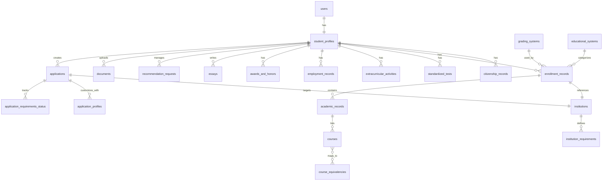

# Universal Student Profile Specification

> **Date:** November 23, 2026
> **Status:** Technical Specification — Pre-Implementation
> **Dependencies:** Database infrastructure, authentication system

---

## 1. Design Principles

1. **One profile, unlimited applications** — Students enter information once and reuse it across any number of university applications
2. **Global-first data model** — Flexible enough for any country's educational system; never force international data into US-centric structures
3. **Privacy by default** — Sensitive fields are opt-in and purpose-limited; students control what gets shared with each application
4. **Both applicant types from day one** — The same schema supports first-year and transfer students without separate profile architectures
5. **Review before reuse** — Students must approve information before it is submitted to any application; never automatically submit
6. **Incremental completion** — Students can build their profile over time; partial profiles are useful

---

## 2. Entity Relationship Diagram



---

## 3. Database Schema

### 3.1 Core User and Profile

```sql
-- Authentication user (managed by Clerk/Auth0, mirrored locally)
CREATE TABLE users (
    id UUID PRIMARY KEY DEFAULT gen_random_uuid(),
    external_auth_id VARCHAR(255) UNIQUE NOT NULL,  -- Clerk/Auth0 user ID
    email VARCHAR(255) UNIQUE NOT NULL,
    email_verified BOOLEAN DEFAULT FALSE,
    created_at TIMESTAMPTZ DEFAULT NOW(),
    updated_at TIMESTAMPTZ DEFAULT NOW(),
    last_login_at TIMESTAMPTZ,
    account_status VARCHAR(20) DEFAULT 'active'  -- active, suspended, deleted
        CHECK (account_status IN ('active', 'suspended', 'deleted')),
    preferred_language VARCHAR(10) DEFAULT 'en',
    timezone VARCHAR(50) DEFAULT 'UTC',
    deletion_requested_at TIMESTAMPTZ  -- GDPR right to erasure tracking
);

-- Core student profile
CREATE TABLE student_profiles (
    id UUID PRIMARY KEY DEFAULT gen_random_uuid(),
    user_id UUID UNIQUE NOT NULL REFERENCES users(id) ON DELETE CASCADE,

    -- Legal name
    first_name VARCHAR(100),
    middle_name VARCHAR(100),
    last_name VARCHAR(100),
    suffix VARCHAR(20),  -- Jr., Sr., III, etc.

    -- Name display preferences (international name handling)
    preferred_first_name VARCHAR(100),
    preferred_last_name VARCHAR(100),
    name_format VARCHAR(20) DEFAULT 'western',  -- western (first last), eastern (last first), single_name
    full_name_native_script VARCHAR(200),  -- Name in native script (e.g., Chinese, Arabic, Japanese)

    -- Demographics
    date_of_birth DATE,
    gender VARCHAR(30),  -- Stored only when required by applications; student controls visibility
    pronouns VARCHAR(50),

    -- Contact
    phone_country_code VARCHAR(5),
    phone_number VARCHAR(20),
    address_line_1 VARCHAR(200),
    address_line_2 VARCHAR(200),
    city VARCHAR(100),
    state_province VARCHAR(100),
    postal_code VARCHAR(20),
    country_code CHAR(2),  -- ISO 3166-1 alpha-2

    -- Residency
    country_of_residence CHAR(2),
    residency_status VARCHAR(50),  -- citizen, permanent_resident, temporary_resident, visa_holder, undocumented

    -- Application context
    applicant_type VARCHAR(20) NOT NULL DEFAULT 'undecided'
        CHECK (applicant_type IN ('first_year', 'transfer', 'both', 'undecided')),
    intended_enrollment_term VARCHAR(20),  -- e.g., 'Fall 2027'
    intended_enrollment_year INTEGER,
    intended_major VARCHAR(200),
    intended_degree_level VARCHAR(30) DEFAULT 'bachelors',

    -- Profile completion
    profile_completion_pct SMALLINT DEFAULT 0,

    created_at TIMESTAMPTZ DEFAULT NOW(),
    updated_at TIMESTAMPTZ DEFAULT NOW()
);

CREATE INDEX idx_profiles_user ON student_profiles(user_id);
CREATE INDEX idx_profiles_applicant_type ON student_profiles(applicant_type);
```

### 3.2 Citizenship

```sql
CREATE TABLE citizenship_records (
    id UUID PRIMARY KEY DEFAULT gen_random_uuid(),
    profile_id UUID NOT NULL REFERENCES student_profiles(id) ON DELETE CASCADE,
    country_code CHAR(2) NOT NULL,  -- ISO 3166-1
    citizenship_type VARCHAR(30) DEFAULT 'citizen'
        CHECK (citizenship_type IN ('citizen', 'dual_citizen', 'national', 'permanent_resident')),
    is_primary BOOLEAN DEFAULT FALSE,
    created_at TIMESTAMPTZ DEFAULT NOW()
);
```

### 3.3 Educational History

```sql
-- Reference table for educational systems
CREATE TABLE educational_systems (
    id UUID PRIMARY KEY DEFAULT gen_random_uuid(),
    country_code CHAR(2) NOT NULL,
    system_name VARCHAR(200) NOT NULL,  -- e.g., "US High School", "French Baccalauréat", "Indian CBSE"
    system_type VARCHAR(50),  -- secondary, post_secondary, vocational
    description TEXT,
    official_source_url TEXT
);

-- Reference table for grading systems
CREATE TABLE grading_systems (
    id UUID PRIMARY KEY DEFAULT gen_random_uuid(),
    educational_system_id UUID REFERENCES educational_systems(id),
    name VARCHAR(100) NOT NULL,  -- e.g., "US 4.0 Scale", "French 0-20", "UK A*-E"
    scale_type VARCHAR(30) NOT NULL,  -- numeric, letter, percentage, descriptive
    scale_min DECIMAL(5,2),
    scale_max DECIMAL(5,2),
    passing_grade VARCHAR(20),
    grade_descriptors JSONB,  -- {"A": {"min": 93, "max": 100, "gpa": 4.0}, ...}
    is_gpa_convertible BOOLEAN DEFAULT FALSE,
    conversion_notes TEXT
);

-- Student enrollment at educational institutions
CREATE TABLE enrollment_records (
    id UUID PRIMARY KEY DEFAULT gen_random_uuid(),
    profile_id UUID NOT NULL REFERENCES student_profiles(id) ON DELETE CASCADE,
    institution_id UUID REFERENCES institutions(id),  -- NULL if institution not in our DB
    institution_name_manual VARCHAR(300),  -- Fallback if institution not in DB
    institution_country CHAR(2),
    institution_city VARCHAR(100),

    educational_system_id UUID REFERENCES educational_systems(id),
    grading_system_id UUID REFERENCES grading_systems(id),

    enrollment_type VARCHAR(30) NOT NULL
        CHECK (enrollment_type IN ('secondary', 'community_college', 'undergraduate', 'graduate', 'vocational', 'other')),
    enrollment_status VARCHAR(30) DEFAULT 'current'
        CHECK (enrollment_status IN ('current', 'completed', 'transferred', 'withdrawn', 'dismissed', 'leave_of_absence')),

    start_date DATE,
    end_date DATE,  -- NULL if current
    expected_graduation DATE,

    degree_type VARCHAR(50),  -- e.g., "High School Diploma", "Associate of Arts", "Bachelor of Science"
    major VARCHAR(200),
    minor VARCHAR(200),
    academic_standing VARCHAR(30),  -- good_standing, probation, dean_list, honors

    -- Aggregate academic performance
    cumulative_gpa DECIMAL(4,2),
    gpa_scale DECIMAL(4,2),  -- e.g., 4.0, 5.0, 10.0
    total_credits_attempted DECIMAL(6,1),
    total_credits_earned DECIMAL(6,1),
    class_rank INTEGER,
    class_size INTEGER,

    is_current_institution BOOLEAN DEFAULT FALSE,
    display_order INTEGER DEFAULT 0,  -- For UI ordering

    created_at TIMESTAMPTZ DEFAULT NOW(),
    updated_at TIMESTAMPTZ DEFAULT NOW()
);

CREATE INDEX idx_enrollment_profile ON enrollment_records(profile_id);
CREATE INDEX idx_enrollment_institution ON enrollment_records(institution_id);
```

### 3.4 Courses

```sql
CREATE TABLE courses (
    id UUID PRIMARY KEY DEFAULT gen_random_uuid(),
    enrollment_id UUID NOT NULL REFERENCES enrollment_records(id) ON DELETE CASCADE,

    course_code VARCHAR(50),  -- e.g., "CS 101", "MATH 2A"
    course_name VARCHAR(300) NOT NULL,
    department VARCHAR(200),
    description TEXT,

    -- Academic details
    credit_hours DECIMAL(4,1),
    credit_type VARCHAR(20) DEFAULT 'semester_hour'
        CHECK (credit_type IN ('semester_hour', 'quarter_hour', 'ects', 'unit', 'other')),
    grade VARCHAR(20),  -- Raw grade as reported: "A", "3.7", "14/20", "First"
    grade_points DECIMAL(4,2),  -- Numeric GPA points if applicable
    course_level VARCHAR(20),  -- 100-level, 200-level, AP, honors, etc.

    -- Status
    status VARCHAR(20) DEFAULT 'completed'
        CHECK (status IN ('completed', 'in_progress', 'planned', 'withdrawn', 'repeated', 'failed', 'pass_fail')),

    academic_term VARCHAR(30),  -- "Fall 2025", "Spring 2026"
    academic_year VARCHAR(9),  -- "2025-2026"

    -- Transfer tracking
    is_ap_ib_dual BOOLEAN DEFAULT FALSE,
    ap_ib_score VARCHAR(10),
    is_transferable BOOLEAN,  -- Marked after equivalency check

    created_at TIMESTAMPTZ DEFAULT NOW(),
    updated_at TIMESTAMPTZ DEFAULT NOW()
);

CREATE INDEX idx_courses_enrollment ON courses(enrollment_id);
```

### 3.5 Standardized Tests

```sql
CREATE TABLE standardized_tests (
    id UUID PRIMARY KEY DEFAULT gen_random_uuid(),
    profile_id UUID NOT NULL REFERENCES student_profiles(id) ON DELETE CASCADE,

    test_type VARCHAR(50) NOT NULL,  -- SAT, ACT, TOEFL, IELTS, GRE, AP, IB, A_LEVEL, GAOKAO, CBSE, WAEC, etc.
    test_name VARCHAR(200),  -- Full name: "SAT Reasoning Test"
    test_date DATE,

    -- Scores (flexible for different test formats)
    total_score VARCHAR(20),
    score_scale VARCHAR(50),  -- "400-1600", "1-36", "0-120", etc.
    section_scores JSONB,  -- {"math": 780, "reading_writing": 720} or {"reading": 35, "math": 36, ...}

    -- Verification
    score_reporting_status VARCHAR(30) DEFAULT 'self_reported'
        CHECK (score_reporting_status IN ('self_reported', 'officially_sent', 'verified')),

    is_superscore_eligible BOOLEAN,
    registration_number VARCHAR(50),

    created_at TIMESTAMPTZ DEFAULT NOW()
);

CREATE INDEX idx_tests_profile ON standardized_tests(profile_id);
CREATE INDEX idx_tests_type ON standardized_tests(test_type);
```

### 3.6 Extracurricular Activities, Employment, Awards

```sql
CREATE TABLE extracurricular_activities (
    id UUID PRIMARY KEY DEFAULT gen_random_uuid(),
    profile_id UUID NOT NULL REFERENCES student_profiles(id) ON DELETE CASCADE,

    category VARCHAR(50) NOT NULL
        CHECK (category IN ('club_organization', 'leadership', 'athletics', 'arts', 'volunteer',
            'research', 'entrepreneurship', 'personal_project', 'community_service', 'other')),
    activity_name VARCHAR(300) NOT NULL,
    organization VARCHAR(300),
    role_title VARCHAR(200),
    description TEXT,

    start_date DATE,
    end_date DATE,  -- NULL if ongoing
    is_ongoing BOOLEAN DEFAULT FALSE,
    hours_per_week SMALLINT,
    weeks_per_year SMALLINT,

    -- Significance markers
    is_leadership BOOLEAN DEFAULT FALSE,
    is_paid BOOLEAN DEFAULT FALSE,
    achievement_highlights TEXT,

    display_order INTEGER DEFAULT 0,
    created_at TIMESTAMPTZ DEFAULT NOW(),
    updated_at TIMESTAMPTZ DEFAULT NOW()
);

CREATE TABLE employment_records (
    id UUID PRIMARY KEY DEFAULT gen_random_uuid(),
    profile_id UUID NOT NULL REFERENCES student_profiles(id) ON DELETE CASCADE,

    employer_name VARCHAR(300) NOT NULL,
    job_title VARCHAR(200) NOT NULL,
    description TEXT,
    start_date DATE,
    end_date DATE,
    is_current BOOLEAN DEFAULT FALSE,
    hours_per_week SMALLINT,
    is_related_to_field BOOLEAN DEFAULT FALSE,

    display_order INTEGER DEFAULT 0,
    created_at TIMESTAMPTZ DEFAULT NOW()
);

CREATE TABLE awards_and_honors (
    id UUID PRIMARY KEY DEFAULT gen_random_uuid(),
    profile_id UUID NOT NULL REFERENCES student_profiles(id) ON DELETE CASCADE,

    award_name VARCHAR(300) NOT NULL,
    issuing_organization VARCHAR(300),
    award_level VARCHAR(30),  -- school, district, state, national, international
    date_received DATE,
    description TEXT,

    display_order INTEGER DEFAULT 0,
    created_at TIMESTAMPTZ DEFAULT NOW()
);

CREATE INDEX idx_activities_profile ON extracurricular_activities(profile_id);
CREATE INDEX idx_employment_profile ON employment_records(profile_id);
CREATE INDEX idx_awards_profile ON awards_and_honors(profile_id);
```

### 3.7 Application Materials

```sql
-- Essays (versioned, tagged per application)
CREATE TABLE essays (
    id UUID PRIMARY KEY DEFAULT gen_random_uuid(),
    profile_id UUID NOT NULL REFERENCES student_profiles(id) ON DELETE CASCADE,

    title VARCHAR(300),
    essay_type VARCHAR(50) NOT NULL
        CHECK (essay_type IN ('personal_statement', 'supplemental', 'transfer_statement',
            'why_this_school', 'diversity', 'activity', 'additional_info', 'other')),
    prompt TEXT,  -- The essay prompt
    content TEXT,  -- The essay content
    word_count INTEGER,

    -- Versioning
    version INTEGER DEFAULT 1,
    parent_essay_id UUID REFERENCES essays(id),  -- Link to previous version

    -- Application linkage
    is_universal BOOLEAN DEFAULT TRUE,  -- Can be reused across applications
    application_id UUID REFERENCES applications(id),  -- NULL if universal

    status VARCHAR(20) DEFAULT 'draft'
        CHECK (status IN ('draft', 'review', 'final', 'submitted')),

    created_at TIMESTAMPTZ DEFAULT NOW(),
    updated_at TIMESTAMPTZ DEFAULT NOW()
);

-- Recommendation tracking
CREATE TABLE recommendation_requests (
    id UUID PRIMARY KEY DEFAULT gen_random_uuid(),
    profile_id UUID NOT NULL REFERENCES student_profiles(id) ON DELETE CASCADE,

    recommender_name VARCHAR(200) NOT NULL,
    recommender_email VARCHAR(255),
    recommender_title VARCHAR(200),
    recommender_institution VARCHAR(300),
    relationship VARCHAR(100),  -- "Professor - Intro to CS", "Employer - Summer Internship"
    recommender_type VARCHAR(30)
        CHECK (recommender_type IN ('teacher', 'professor', 'counselor', 'employer', 'advisor', 'other')),

    status VARCHAR(30) DEFAULT 'draft'
        CHECK (status IN ('draft', 'invited', 'accepted', 'declined', 'in_progress', 'submitted', 'received')),

    date_requested DATE,
    date_due DATE,
    date_submitted DATE,
    notes TEXT,

    -- Privacy: the actual letter content is NOT stored in the student's profile
    -- It is handled through the recommender portal with confidentiality controls

    created_at TIMESTAMPTZ DEFAULT NOW(),
    updated_at TIMESTAMPTZ DEFAULT NOW()
);

-- Uploaded documents
CREATE TABLE documents (
    id UUID PRIMARY KEY DEFAULT gen_random_uuid(),
    profile_id UUID NOT NULL REFERENCES student_profiles(id) ON DELETE CASCADE,

    document_type VARCHAR(50) NOT NULL
        CHECK (document_type IN ('transcript', 'test_scores', 'recommendation', 'resume',
            'portfolio', 'financial', 'identification', 'credential_evaluation',
            'translation', 'other')),
    file_name VARCHAR(255) NOT NULL,
    file_type VARCHAR(20),  -- pdf, docx, jpg, png, etc.
    file_size_bytes BIGINT,
    storage_key VARCHAR(500) NOT NULL,  -- S3/R2 object key
    storage_bucket VARCHAR(100),

    description VARCHAR(300),
    source_institution VARCHAR(300),  -- Which institution issued this document
    is_official BOOLEAN DEFAULT FALSE,
    is_translated BOOLEAN DEFAULT FALSE,
    original_language VARCHAR(10),

    -- AI processing
    ocr_processed BOOLEAN DEFAULT FALSE,
    extracted_data JSONB,  -- Structured data extracted from the document
    extraction_confidence DECIMAL(3,2),

    -- Security
    encryption_key_id VARCHAR(100),
    virus_scan_status VARCHAR(20) DEFAULT 'pending'
        CHECK (virus_scan_status IN ('pending', 'clean', 'infected', 'error')),

    created_at TIMESTAMPTZ DEFAULT NOW(),
    updated_at TIMESTAMPTZ DEFAULT NOW()
);

CREATE INDEX idx_essays_profile ON essays(profile_id);
CREATE INDEX idx_recommendations_profile ON recommendation_requests(profile_id);
CREATE INDEX idx_documents_profile ON documents(profile_id);
CREATE INDEX idx_documents_type ON documents(document_type);
```

---

## 4. Field Mapping Engine

### Problem

University A requests "Leadership Experience" and "Community Involvement." University B requests "Extracurricular Activities" and "Research Experience." Both can be partially satisfied by the same profile data.

### Solution: Requirement Field Mapping

```sql
-- Maps university requirement fields to profile data sources
CREATE TABLE requirement_field_mappings (
    id UUID PRIMARY KEY DEFAULT gen_random_uuid(),
    requirement_field_name VARCHAR(200) NOT NULL,  -- "Leadership Experience"
    requirement_field_category VARCHAR(100),  -- "Activities"
    profile_source_table VARCHAR(100) NOT NULL,  -- "extracurricular_activities"
    profile_source_filter JSONB,  -- {"category": ["leadership", "club_organization"]}
    mapping_confidence DECIMAL(3,2),  -- 0.0-1.0 how well this maps
    is_exact_match BOOLEAN DEFAULT FALSE,  -- vs. partial/approximate match
    notes TEXT
);
```

### Mapping Algorithm

```
INPUT: student_profile_id, institution_id, applicant_type
OUTPUT: mapped_data { requirement_field → [matching_profile_items] }

1. Fetch all requirements for institution + applicant_type
2. For each requirement:
   a. Look up field_mappings for the requirement's field_name
   b. Query the mapped profile_source_table with the source_filter
   c. Return matching records with mapping_confidence
3. Present to student for review:
   - Auto-matched items (confidence > 0.8): pre-selected, student can deselect
   - Suggested items (confidence 0.5-0.8): shown as suggestions
   - Unmatched requirements: flagged as needing manual input
4. Student approves/modifies selections
5. Store approved mappings in application_profiles
```

---

## 5. Application-Specific Customization Layer

```sql
-- Per-application customization (which profile data to use for each application)
CREATE TABLE application_profiles (
    id UUID PRIMARY KEY DEFAULT gen_random_uuid(),
    application_id UUID NOT NULL REFERENCES applications(id) ON DELETE CASCADE,

    -- Override or select specific profile data for this application
    selected_activities JSONB,  -- Array of extracurricular_activity IDs to include
    selected_employment JSONB,  -- Array of employment_record IDs
    selected_awards JSONB,  -- Array of award IDs
    selected_tests JSONB,  -- Array of standardized_test IDs

    -- Application-specific fields
    intended_major_override VARCHAR(200),  -- May differ per application
    additional_information TEXT,  -- Application-specific additional info

    -- Approval tracking
    student_reviewed BOOLEAN DEFAULT FALSE,
    student_approved_at TIMESTAMPTZ,

    created_at TIMESTAMPTZ DEFAULT NOW(),
    updated_at TIMESTAMPTZ DEFAULT NOW()
);
```

---

## 6. REST API Design

### Profile Endpoints

| Method | Endpoint | Description |
|---|---|---|
| `GET` | `/api/v1/profile` | Get current user's complete profile |
| `PATCH` | `/api/v1/profile` | Update profile fields |
| `GET` | `/api/v1/profile/completion` | Get profile completion percentage and missing fields |
| `GET` | `/api/v1/profile/export` | Export profile data (GDPR data portability) |
| `DELETE` | `/api/v1/profile` | Delete profile and all associated data |

### Section Endpoints

| Method | Endpoint | Description |
|---|---|---|
| `GET/POST` | `/api/v1/profile/enrollments` | List/create enrollment records |
| `PATCH/DELETE` | `/api/v1/profile/enrollments/{id}` | Update/delete enrollment |
| `GET/POST` | `/api/v1/profile/enrollments/{id}/courses` | List/create courses for enrollment |
| `GET/POST` | `/api/v1/profile/tests` | List/create standardized tests |
| `GET/POST` | `/api/v1/profile/activities` | List/create extracurricular activities |
| `GET/POST` | `/api/v1/profile/employment` | List/create employment records |
| `GET/POST` | `/api/v1/profile/awards` | List/create awards |
| `GET/POST` | `/api/v1/profile/essays` | List/create essays |
| `GET/POST` | `/api/v1/profile/recommendations` | List/create recommendation requests |
| `GET/POST` | `/api/v1/profile/documents` | List/upload documents |

### Application Profile Endpoints

| Method | Endpoint | Description |
|---|---|---|
| `GET` | `/api/v1/applications/{id}/profile-view` | View profile as mapped for a specific application |
| `PATCH` | `/api/v1/applications/{id}/profile-customization` | Customize which profile data to use |
| `POST` | `/api/v1/applications/{id}/profile-approve` | Approve profile data for this application |

---

## 7. Privacy Controls

```sql
CREATE TABLE profile_privacy_settings (
    id UUID PRIMARY KEY DEFAULT gen_random_uuid(),
    profile_id UUID UNIQUE NOT NULL REFERENCES student_profiles(id) ON DELETE CASCADE,

    -- Field-level visibility
    show_gender BOOLEAN DEFAULT FALSE,
    show_date_of_birth BOOLEAN DEFAULT TRUE,
    show_citizenship BOOLEAN DEFAULT TRUE,
    show_financial_info BOOLEAN DEFAULT FALSE,

    -- Sharing controls
    counselor_access_enabled BOOLEAN DEFAULT FALSE,
    parent_access_enabled BOOLEAN DEFAULT FALSE,
    recommender_can_see_other_recs BOOLEAN DEFAULT FALSE,

    -- Data processing
    ai_document_processing_consent BOOLEAN DEFAULT FALSE,
    analytics_opt_in BOOLEAN DEFAULT FALSE,

    updated_at TIMESTAMPTZ DEFAULT NOW()
);

CREATE TABLE profile_access_grants (
    id UUID PRIMARY KEY DEFAULT gen_random_uuid(),
    profile_id UUID NOT NULL REFERENCES student_profiles(id) ON DELETE CASCADE,
    granted_to_user_id UUID REFERENCES users(id),
    granted_to_email VARCHAR(255),  -- For invitations before user registers
    access_role VARCHAR(30) NOT NULL
        CHECK (access_role IN ('counselor', 'parent', 'recommender', 'advisor')),
    access_scope JSONB,  -- Which sections they can see
    granted_at TIMESTAMPTZ DEFAULT NOW(),
    expires_at TIMESTAMPTZ,
    revoked_at TIMESTAMPTZ
);
```

---

## 8. International Considerations

### Name Handling
- **Western order** (given name + family name): US, Europe, Latin America
- **Eastern order** (family name + given name): China, Japan, Korea, Vietnam
- **Single name**: Some Indonesian names; some Afghani names
- **Patronymics**: Iceland (not a surname in the traditional sense)
- **Multiple family names**: Spanish-speaking countries (paternal + maternal)

The `name_format` field and `full_name_native_script` handle these variations. The UI adapts field labels based on the selected format.

### Date Handling
- All dates stored as ISO 8601 (YYYY-MM-DD) in UTC
- Display localized according to user's `preferred_language` and `timezone`
- Academic terms mapped to calendar dates per educational system

### Grading Systems
- **Never store a "converted GPA" as the primary grade** — always store the original grade in the student's grading system
- Conversion is a computed view, not stored data
- The `grading_systems` table defines how to interpret each grade
- Multiple grading systems within a single country are supported (e.g., India: CBSE 10-point CGPA vs. percentage-based state boards)

### Credit Systems
- US semester hours, US quarter hours, ECTS (European Credit Transfer System), and institution-specific unit systems are all supported via the `credit_type` field
- Cross-system credit comparison is handled by the Transfer Intelligence Engine, not the profile schema

---

> [!NOTE]
> This schema is designed for PostgreSQL 15+ with the `pgcrypto` extension (for `gen_random_uuid()`). All `TIMESTAMPTZ` fields store timezone-aware timestamps. JSONB fields provide flexibility for varying data structures across countries and educational systems while maintaining queryability.
