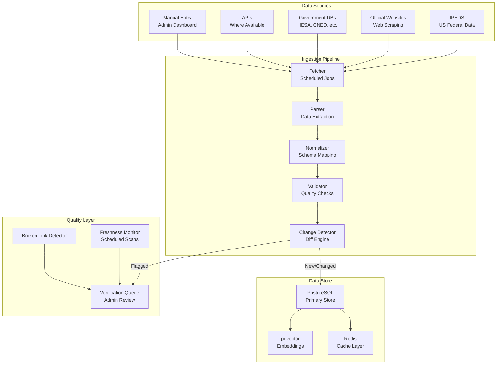

# Global University Database Architecture

> **Date:** November 23, 2026
> **Status:** Technical Specification — Pre-Implementation
> **Dependencies:** Database infrastructure, data ingestion pipeline

---

## 1. Architecture Overview

The Global University Database is the platform's core institutional data asset. It stores verified information about educational institutions worldwide and their admission requirements, programs, costs, deadlines, and application procedures.



---

## 2. Database Schema

### 2.1 Countries and Regions

```sql
CREATE TABLE countries (
    code CHAR(2) PRIMARY KEY,  -- ISO 3166-1 alpha-2
    name VARCHAR(200) NOT NULL,
    name_local VARCHAR(200),  -- Name in local language
    region VARCHAR(100),  -- e.g., "North America", "Western Europe"
    subregion VARCHAR(100),
    currency_code CHAR(3),  -- ISO 4217
    primary_languages JSONB,  -- ["en", "fr"]
    higher_ed_ministry VARCHAR(300),  -- Ministry of Education name
    higher_ed_ministry_url TEXT,
    accreditation_body VARCHAR(300),
    education_system_notes TEXT
);
```

### 2.2 Institutions

```sql
CREATE TABLE institutions (
    id UUID PRIMARY KEY DEFAULT gen_random_uuid(),

    -- Identity
    official_name VARCHAR(500) NOT NULL,
    alternative_names JSONB DEFAULT '[]',  -- ["UCLA", "University of California, Los Angeles"]
    abbreviation VARCHAR(50),

    -- Location
    country_code CHAR(2) NOT NULL REFERENCES countries(code),
    state_province VARCHAR(100),
    city VARCHAR(200),
    postal_code VARCHAR(20),
    latitude DECIMAL(10, 7),
    longitude DECIMAL(10, 7),

    -- Classification
    institution_type VARCHAR(50) NOT NULL
        CHECK (institution_type IN ('university', 'liberal_arts_college', 'community_college',
            'technical_college', 'vocational', 'specialized', 'online', 'branch_campus', 'other')),
    control_type VARCHAR(30)  -- public, private_nonprofit, private_forprofit
        CHECK (control_type IN ('public', 'private_nonprofit', 'private_forprofit')),
    carnegie_classification VARCHAR(100),  -- US institutions only

    -- Official presence
    official_website TEXT,
    admissions_website TEXT,
    financial_aid_website TEXT,
    international_admissions_website TEXT,

    -- Accreditation
    accreditation_status VARCHAR(50),
    accrediting_body VARCHAR(300),
    accreditation_details JSONB,

    -- Size and demographics
    total_enrollment INTEGER,
    undergraduate_enrollment INTEGER,
    graduate_enrollment INTEGER,
    acceptance_rate DECIMAL(5, 2),
    student_faculty_ratio VARCHAR(20),

    -- External identifiers
    ipeds_unit_id VARCHAR(20),  -- US IPEDS identifier
    ope_id VARCHAR(20),  -- US Office of Postsecondary Education ID
    ucas_code VARCHAR(20),  -- UK UCAS institution code
    external_ids JSONB DEFAULT '{}',  -- Flexible for other country-specific IDs

    -- Data quality
    data_completeness_score DECIMAL(3, 2) DEFAULT 0.0,  -- 0.0-1.0
    last_verified_at TIMESTAMPTZ,
    is_verified BOOLEAN DEFAULT FALSE,
    is_published BOOLEAN DEFAULT FALSE,  -- Only verified institutions are public

    created_at TIMESTAMPTZ DEFAULT NOW(),
    updated_at TIMESTAMPTZ DEFAULT NOW()
);

CREATE INDEX idx_institutions_country ON institutions(country_code);
CREATE INDEX idx_institutions_type ON institutions(institution_type);
CREATE INDEX idx_institutions_name_trgm ON institutions USING gin(official_name gin_trgm_ops);
CREATE INDEX idx_institutions_ipeds ON institutions(ipeds_unit_id) WHERE ipeds_unit_id IS NOT NULL;
CREATE INDEX idx_institutions_location ON institutions USING gist(
    ll_to_earth(latitude, longitude)
) WHERE latitude IS NOT NULL;
```

### 2.3 Academic Programs

```sql
CREATE TABLE academic_programs (
    id UUID PRIMARY KEY DEFAULT gen_random_uuid(),
    institution_id UUID NOT NULL REFERENCES institutions(id) ON DELETE CASCADE,

    program_name VARCHAR(500) NOT NULL,
    degree_level VARCHAR(50) NOT NULL
        CHECK (degree_level IN ('certificate', 'associate', 'bachelors', 'masters', 'doctoral', 'professional', 'other')),
    degree_type VARCHAR(100),  -- "Bachelor of Science", "Associate of Arts", etc.
    department VARCHAR(300),

    cip_code VARCHAR(20),  -- US Classification of Instructional Programs
    duration_years DECIMAL(3, 1),
    credit_requirements INTEGER,

    language_of_instruction VARCHAR(10) DEFAULT 'en',
    delivery_mode VARCHAR(30) DEFAULT 'in_person'
        CHECK (delivery_mode IN ('in_person', 'online', 'hybrid')),

    program_url TEXT,
    is_accepting_applications BOOLEAN DEFAULT TRUE,
    accepts_transfer_students BOOLEAN,

    academic_year VARCHAR(9),
    created_at TIMESTAMPTZ DEFAULT NOW(),
    updated_at TIMESTAMPTZ DEFAULT NOW()
);

CREATE INDEX idx_programs_institution ON academic_programs(institution_id);
CREATE INDEX idx_programs_level ON academic_programs(degree_level);
CREATE INDEX idx_programs_cip ON academic_programs(cip_code);
CREATE INDEX idx_programs_name_trgm ON academic_programs USING gin(program_name gin_trgm_ops);
```

### 2.4 Tuition and Costs

```sql
CREATE TABLE institution_costs (
    id UUID PRIMARY KEY DEFAULT gen_random_uuid(),
    institution_id UUID NOT NULL REFERENCES institutions(id) ON DELETE CASCADE,

    academic_year VARCHAR(9) NOT NULL,  -- "2026-2027"
    student_type VARCHAR(30) NOT NULL
        CHECK (student_type IN ('in_state', 'out_of_state', 'international', 'domestic')),
    degree_level VARCHAR(50) DEFAULT 'bachelors',

    tuition DECIMAL(10, 2),
    mandatory_fees DECIMAL(10, 2),
    room_board DECIMAL(10, 2),
    books_supplies DECIMAL(10, 2),
    personal_expenses DECIMAL(10, 2),
    transportation DECIMAL(10, 2),
    health_insurance DECIMAL(10, 2),
    total_estimated_cost DECIMAL(10, 2),
    currency CHAR(3) DEFAULT 'USD',

    -- Provenance
    source_url TEXT,
    retrieved_at TIMESTAMPTZ,
    verified_at TIMESTAMPTZ,
    verification_status VARCHAR(20) DEFAULT 'unverified',

    created_at TIMESTAMPTZ DEFAULT NOW()
);

CREATE INDEX idx_costs_institution ON institution_costs(institution_id);
```

### 2.5 Application Routes

```sql
CREATE TABLE application_routes (
    id UUID PRIMARY KEY DEFAULT gen_random_uuid(),
    institution_id UUID NOT NULL REFERENCES institutions(id) ON DELETE CASCADE,

    applicant_type VARCHAR(30) NOT NULL
        CHECK (applicant_type IN ('first_year', 'transfer', 'international_first_year',
            'international_transfer', 'graduate', 'readmission')),

    application_provider VARCHAR(100),  -- "Common App", "UCAS", "Direct", "ApplyTexas", etc.
    application_url TEXT NOT NULL,
    application_instructions_url TEXT,

    application_fee DECIMAL(8, 2),
    fee_currency CHAR(3) DEFAULT 'USD',
    fee_waiver_available BOOLEAN,
    fee_waiver_details TEXT,

    -- Integration level
    integration_level SMALLINT DEFAULT 1
        CHECK (integration_level BETWEEN 1 AND 4),
    -- 1 = Information only (redirect to portal)
    -- 2 = Guided preparation (organize materials)
    -- 3 = Authorized integration (API exchange)
    -- 4 = Verified submission status

    academic_year VARCHAR(9),

    -- Provenance
    source_url TEXT,
    verified_at TIMESTAMPTZ,
    verification_status VARCHAR(20) DEFAULT 'unverified',
    link_check_status VARCHAR(20) DEFAULT 'unchecked',
    link_last_checked_at TIMESTAMPTZ,

    created_at TIMESTAMPTZ DEFAULT NOW(),
    updated_at TIMESTAMPTZ DEFAULT NOW()
);

CREATE INDEX idx_routes_institution ON application_routes(institution_id);
CREATE INDEX idx_routes_type ON application_routes(applicant_type);
```

### 2.6 Deadlines

```sql
CREATE TABLE deadlines (
    id UUID PRIMARY KEY DEFAULT gen_random_uuid(),
    institution_id UUID NOT NULL REFERENCES institutions(id) ON DELETE CASCADE,

    applicant_type VARCHAR(30) NOT NULL,
    deadline_type VARCHAR(50) NOT NULL
        CHECK (deadline_type IN ('early_decision', 'early_decision_ii', 'early_action',
            'restrictive_early_action', 'regular_decision', 'rolling', 'priority',
            'transfer_fall', 'transfer_spring', 'transfer_summer',
            'scholarship', 'financial_aid', 'housing', 'orientation')),

    deadline_date DATE,
    deadline_time TIME,
    timezone VARCHAR(50),
    is_firm BOOLEAN DEFAULT TRUE,  -- FALSE for rolling/priority

    notification_date DATE,  -- When decisions are released
    enrollment_deposit_deadline DATE,

    academic_year VARCHAR(9) NOT NULL,
    notes TEXT,

    -- Provenance
    source_url TEXT,
    verified_at TIMESTAMPTZ,
    verification_status VARCHAR(20) DEFAULT 'unverified',

    created_at TIMESTAMPTZ DEFAULT NOW()
);

CREATE INDEX idx_deadlines_institution ON deadlines(institution_id);
CREATE INDEX idx_deadlines_date ON deadlines(deadline_date);
CREATE INDEX idx_deadlines_type ON deadlines(deadline_type);
```

---

## 3. Data Provenance System

Every important institutional data point must track its origin.

```sql
CREATE TABLE data_provenance (
    id UUID PRIMARY KEY DEFAULT gen_random_uuid(),
    entity_type VARCHAR(50) NOT NULL,  -- 'institution', 'program', 'cost', 'deadline', etc.
    entity_id UUID NOT NULL,
    field_name VARCHAR(100),  -- Specific field, or NULL for entire record

    source_type VARCHAR(30) NOT NULL
        CHECK (source_type IN ('ipeds', 'official_website', 'government_db', 'api',
            'manual_entry', 'user_report', 'partner_feed')),
    source_url TEXT,
    source_name VARCHAR(200),

    retrieved_at TIMESTAMPTZ NOT NULL,
    verified_at TIMESTAMPTZ,
    verified_by UUID REFERENCES users(id),  -- Admin who verified
    academic_year VARCHAR(9),

    confidence_level VARCHAR(20) DEFAULT 'unverified'
        CHECK (confidence_level IN ('verified', 'likely_accurate', 'unverified', 'outdated', 'disputed')),

    data_hash VARCHAR(64),  -- SHA-256 of the data for change detection
    previous_value JSONB,  -- What the data was before this update

    created_at TIMESTAMPTZ DEFAULT NOW()
);

CREATE INDEX idx_provenance_entity ON data_provenance(entity_type, entity_id);
CREATE INDEX idx_provenance_confidence ON data_provenance(confidence_level);
```

---

## 4. Data Ingestion Pipeline

### Phase 1: IPEDS Seed (US Institutions)

**Source:** Integrated Postsecondary Education Data System (IPEDS) — free federal data from the National Center for Education Statistics.

**What IPEDS provides:**
- Institution name, address, type, control, Carnegie classification
- Enrollment figures
- Tuition and fees (in-state, out-of-state)
- Graduation rates
- Financial aid statistics
- CIP codes for academic programs
- IPEDS Unit ID (stable identifier)

**What IPEDS does NOT provide:**
- Specific admission requirements
- Application URLs and portals
- Deadlines
- Scholarship details
- Transfer credit policies
- International student requirements
- Course catalogs

**Ingestion process:**
1. Download IPEDS Data Center CSV files (annual release)
2. Parse and normalize into platform schema
3. Import ~4,000 Title IV institutions (degree-granting, accredited)
4. Mark all data as `source_type: 'ipeds'` with `confidence_level: 'verified'`
5. Set `is_published: false` until supplementary data (application URLs, deadlines) is added

### Phase 2: Supplementary Web Scraping

For top 500 transfer-receiving institutions:

```python
# Conceptual scraping pipeline structure
class InstitutionScraper:
    async def scrape_institution(self, institution_id: str, url: str):
        """Scrape admission requirements, deadlines, and application URLs."""
        # 1. Fetch page (Playwright for JS-rendered pages)
        # 2. Extract structured data using LLM-assisted parsing
        # 3. Validate against expected schema
        # 4. Store with provenance (source_url, retrieved_at)
        # 5. Queue for human verification if confidence < threshold

    async def check_links(self, institution_id: str):
        """Verify that stored application URLs are still valid."""
        # HEAD request to each stored URL
        # Flag broken links for review
        # Update link_check_status and link_last_checked_at
```

### Phase 3: Ongoing Maintenance

- **Daily:** Broken link detection for top 500 institutions
- **Weekly:** Re-scrape deadline pages during application season (Aug–Jan)
- **Monthly:** Tuition and fee verification
- **Annually:** Full IPEDS data refresh; comprehensive deadline and requirement updates

---

## 5. Data Quality System

```sql
CREATE TABLE data_quality_flags (
    id UUID PRIMARY KEY DEFAULT gen_random_uuid(),
    entity_type VARCHAR(50) NOT NULL,
    entity_id UUID NOT NULL,

    flag_type VARCHAR(50) NOT NULL
        CHECK (flag_type IN ('broken_link', 'expired_deadline', 'stale_data',
            'missing_required_field', 'conflicting_data', 'unverified_scholarship',
            'suspicious_value', 'user_reported')),

    severity VARCHAR(20) DEFAULT 'warning'
        CHECK (severity IN ('info', 'warning', 'error', 'critical')),

    description TEXT,
    auto_detected BOOLEAN DEFAULT TRUE,
    resolved BOOLEAN DEFAULT FALSE,
    resolved_by UUID REFERENCES users(id),
    resolved_at TIMESTAMPTZ,

    created_at TIMESTAMPTZ DEFAULT NOW()
);

CREATE INDEX idx_quality_flags_unresolved ON data_quality_flags(entity_type, entity_id)
    WHERE resolved = FALSE;
```

**Automated quality rules:**
- Flag any institution cost data older than 12 months as `stale_data`
- Flag any deadline in the past as `expired_deadline`
- Flag any application URL returning 4xx/5xx as `broken_link`
- Flag any institution without at least one application route as `missing_required_field`
- Flag tuition values deviating >50% from previous year as `suspicious_value`

---

## 6. Search Infrastructure

### MVP: PostgreSQL Full-Text Search

```sql
-- Add search vector column to institutions
ALTER TABLE institutions ADD COLUMN search_vector tsvector;

-- Generate search vector from multiple fields
CREATE OR REPLACE FUNCTION institutions_search_vector_update() RETURNS trigger AS $$
BEGIN
    NEW.search_vector :=
        setweight(to_tsvector('english', COALESCE(NEW.official_name, '')), 'A') ||
        setweight(to_tsvector('english', COALESCE(NEW.abbreviation, '')), 'A') ||
        setweight(to_tsvector('english', COALESCE(NEW.city, '')), 'B') ||
        setweight(to_tsvector('english', COALESCE(NEW.state_province, '')), 'B') ||
        setweight(to_tsvector('english',
            COALESCE(array_to_string(ARRAY(SELECT jsonb_array_elements_text(NEW.alternative_names)), ' '), '')), 'A');
    RETURN NEW;
END;
$$ LANGUAGE plpgsql;

CREATE TRIGGER trig_institutions_search_vector
    BEFORE INSERT OR UPDATE ON institutions
    FOR EACH ROW EXECUTE FUNCTION institutions_search_vector_update();

CREATE INDEX idx_institutions_search ON institutions USING gin(search_vector);
```

### Filter Architecture

```
GET /api/v1/institutions/search?
    q=computer+science              # Full-text search
    &country=US                     # Country filter
    &state=CA                       # State filter
    &type=community_college         # Institution type
    &tuition_max=15000              # Maximum tuition
    &accepts_transfer=true          # Transfer acceptance
    &has_program=computer_science   # Academic program
    &deadline_after=2027-01-01      # Deadline filter
    &sort=relevance                 # Sort order
    &page=1&limit=20               # Pagination
```

---

## 7. Initial Data Strategy

| Phase | Institutions | Source | Timeline |
|---|---|---|---|
| **Phase 1** | ~4,000 US institutions (IPEDS seed) | IPEDS Data Center | Month 1–2 |
| **Phase 1b** | Top 200 transfer-receiving (enriched) | Web scraping + manual | Month 2–4 |
| **Phase 2** | Top 500 US institutions (fully enriched) | Web scraping + manual | Month 4–8 |
| **Phase 3** | ~100 Canadian universities | Government data + scraping | Month 9–12 |
| **Phase 4** | ~150 UK institutions | UCAS data + scraping | Month 12–18 |
| **Phase 5** | European institutions | Government data + Studyportals | Month 18–24 |

> [!WARNING]
> **A database with 500 verified, complete institution profiles is far more valuable than 50,000 with missing application URLs and outdated deadlines.** Quality over quantity at every stage.

---

## 8. Scaling Strategy

| Scale | Strategy |
|---|---|
| **0–10K institutions** | Single PostgreSQL instance; full-text search |
| **10K–50K institutions** | Read replicas; Redis caching for popular profiles; consider OpenSearch for faceted search |
| **50K–200K institutions** | Table partitioning by country; dedicated search cluster; CDN for static institution data |
| **200K+ institutions** | Regional database deployments; event-driven data sync; dedicated ingestion infrastructure |
