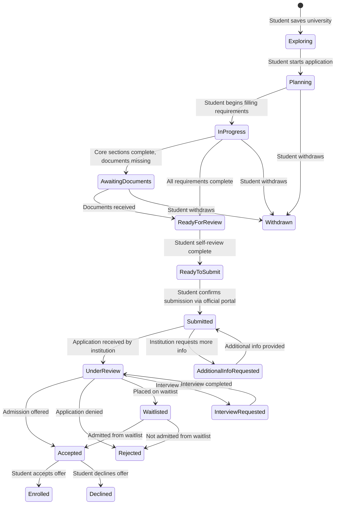

# Application Requirement Engine

> **Date:** November 24, 2026
> **Status:** Phase 3 Milestone 3 Implemented & Tested (Normalized Schema rev `84eae1d08b41`, `94` Verified Requirements across `21` Universities in `9` Countries, `25` Deadlines, `11` Country Qualifications, Dynamic Checklist Engine, Grounded Counselor Integration)
> **Dependencies:** Universal Student Profile (doc 05), Global University Database (doc 06)

---

## 1. Purpose

The Application Requirement Engine compares a student's Universal Profile against each university's specific requirements and generates actionable, per-application checklists. It is the bridge between "what the student has" and "what each university needs."

---

## 2. Requirement Taxonomy

### Document Requirements

| Requirement Type | Subtypes | Applicant Types |
|---|---|---|
| `official_transcript` | high_school, college, all_attended | First-year, Transfer |
| `standardized_test` | SAT, ACT, TOEFL, IELTS, GRE, AP, IB, A-level | Both |
| `recommendation_letter` | teacher, counselor, professor, employer | Both |
| `personal_statement` | common_app_essay, coalition_essay, institutional | Both |
| `supplemental_essay` | why_this_school, major_specific, activity, diversity | Both |
| `resume_cv` | — | Both |
| `portfolio` | art, architecture, music, writing | Specialized programs |
| `financial_documentation` | CSS_profile, FAFSA, bank_statements, sponsor_letter | Both |
| `credential_evaluation` | WES, ECE, NACES_member | International |
| `certified_translation` | — | International |
| `midterm_report` | college_report, instructor_report | Transfer |
| `course_descriptions` | syllabi, catalog_descriptions | Transfer |

### Academic Requirements

| Requirement Type | Description |
|---|---|
| `minimum_gpa` | Overall, program-specific, or last-60-credits |
| `prerequisite_courses` | Specific courses required before admission |
| `minimum_credits` | Minimum earned credits (for transfer eligibility) |
| `maximum_credits` | Maximum credits to qualify as transfer (vs. graduate) |
| `specific_coursework` | Math, lab science, foreign language, writing, etc. |
| `test_minimum_scores` | Minimum SAT/ACT/TOEFL scores |
| `english_proficiency` | TOEFL/IELTS/Duolingo English Test requirements |

### Administrative Requirements

| Requirement Type | Description |
|---|---|
| `application_fee` | Payment required |
| `application_form` | Complete the institution's application form |
| `interview` | required, recommended, optional, by_invitation |
| `campus_visit` | required, recommended |
| `enrollment_deposit` | Deposit to confirm enrollment |
| `housing_application` | Separate housing application |

---

## 3. Data Model

```sql
-- Reusable requirement definitions
CREATE TABLE requirement_templates (
    id UUID PRIMARY KEY DEFAULT gen_random_uuid(),
    requirement_type VARCHAR(50) NOT NULL,  -- From taxonomy above
    requirement_subtype VARCHAR(100),
    display_name VARCHAR(300) NOT NULL,  -- Human-readable name
    description TEXT,
    category VARCHAR(50) NOT NULL
        CHECK (category IN ('document', 'academic', 'administrative')),
    default_importance VARCHAR(20) DEFAULT 'required'
        CHECK (default_importance IN ('required', 'recommended', 'optional')),
    can_be_satisfied_from_profile BOOLEAN DEFAULT FALSE,
    profile_source_table VARCHAR(100),  -- Which profile table satisfies this
    profile_source_filter JSONB,
    created_at TIMESTAMPTZ DEFAULT NOW()
);

-- Institution-specific requirements
CREATE TABLE institution_requirements (
    id UUID PRIMARY KEY DEFAULT gen_random_uuid(),
    institution_id UUID NOT NULL REFERENCES institutions(id) ON DELETE CASCADE,
    requirement_template_id UUID NOT NULL REFERENCES requirement_templates(id),

    applicant_type VARCHAR(30) NOT NULL
        CHECK (applicant_type IN ('first_year', 'transfer', 'international_first_year',
            'international_transfer', 'all')),

    importance VARCHAR(20) NOT NULL DEFAULT 'required'
        CHECK (importance IN ('required', 'strongly_recommended', 'recommended', 'optional', 'conditional')),

    -- Specifics for this institution
    institution_specific_notes TEXT,  -- e.g., "Must be from math or science teacher"
    quantity INTEGER DEFAULT 1,  -- e.g., "2 recommendation letters"
    minimum_value VARCHAR(50),  -- e.g., "3.0" for GPA, "80" for TOEFL
    maximum_value VARCHAR(50),

    academic_year VARCHAR(9) NOT NULL,

    -- Provenance
    source_url TEXT,
    verified_at TIMESTAMPTZ,
    verification_status VARCHAR(20) DEFAULT 'unverified',

    created_at TIMESTAMPTZ DEFAULT NOW(),
    updated_at TIMESTAMPTZ DEFAULT NOW()
);

-- Conditional requirements (e.g., "TOEFL required IF native language ≠ English")
CREATE TABLE requirement_conditions (
    id UUID PRIMARY KEY DEFAULT gen_random_uuid(),
    requirement_id UUID NOT NULL REFERENCES institution_requirements(id) ON DELETE CASCADE,

    condition_type VARCHAR(50) NOT NULL,  -- 'language', 'country', 'credits', 'gpa', 'age'
    condition_field VARCHAR(100) NOT NULL,  -- Profile field to check
    condition_operator VARCHAR(20) NOT NULL
        CHECK (condition_operator IN ('equals', 'not_equals', 'in', 'not_in',
            'greater_than', 'less_than', 'between')),
    condition_value JSONB NOT NULL,  -- The comparison value

    result_importance VARCHAR(20) NOT NULL,  -- What the requirement becomes if condition is met
    -- e.g., condition: language != 'en', result: 'required' (TOEFL becomes required)
    -- e.g., condition: credits < 30, result: 'not_applicable' (midterm report not needed)

    created_at TIMESTAMPTZ DEFAULT NOW()
);

-- Per-student, per-application requirement tracking
CREATE TABLE application_requirement_status (
    id UUID PRIMARY KEY DEFAULT gen_random_uuid(),
    application_id UUID NOT NULL REFERENCES applications(id) ON DELETE CASCADE,
    requirement_id UUID NOT NULL REFERENCES institution_requirements(id),

    status VARCHAR(30) NOT NULL DEFAULT 'pending'
        CHECK (status IN ('completed', 'in_progress', 'pending', 'not_applicable',
            'waived', 'needs_verification', 'missing')),

    satisfied_by_document_id UUID REFERENCES documents(id),
    satisfied_by_profile_field VARCHAR(200),  -- Which profile data satisfies this
    student_notes TEXT,
    auto_matched BOOLEAN DEFAULT FALSE,  -- Was this auto-detected from profile?

    updated_at TIMESTAMPTZ DEFAULT NOW()
);

CREATE UNIQUE INDEX idx_app_req_unique ON application_requirement_status(application_id, requirement_id);
```

---

## 4. Comparison Algorithm

```
FUNCTION generate_checklist(student_id, institution_id, applicant_type):

    // 1. Fetch all requirements for this institution + applicant type
    requirements = QUERY institution_requirements
        WHERE institution_id = institution_id
        AND applicant_type IN (applicant_type, 'all')
        AND academic_year = current_academic_year

    // 2. Fetch student profile
    profile = QUERY student_profiles WHERE id = student_id
    enrollments = QUERY enrollment_records WHERE profile_id = student_id
    courses = QUERY courses WHERE enrollment_id IN enrollments
    tests = QUERY standardized_tests WHERE profile_id = student_id
    documents = QUERY documents WHERE profile_id = student_id
    activities = QUERY extracurricular_activities WHERE profile_id = student_id

    checklist = []

    // 3. Evaluate each requirement
    FOR EACH requirement IN requirements:

        // 3a. Evaluate conditions
        effective_importance = requirement.importance
        IF requirement HAS conditions:
            FOR EACH condition IN requirement.conditions:
                profile_value = GET_PROFILE_VALUE(profile, condition.condition_field)
                IF EVALUATE(profile_value, condition.operator, condition.value):
                    effective_importance = condition.result_importance

        IF effective_importance == 'not_applicable':
            checklist.ADD({requirement, status: 'not_applicable'})
            CONTINUE

        // 3b. Check if requirement is satisfied
        status = 'pending'
        satisfied_by = NULL

        SWITCH requirement.category:
            CASE 'document':
                matching_docs = documents.FILTER(type == requirement.requirement_type)
                IF matching_docs.LENGTH >= requirement.quantity:
                    status = 'completed'
                    satisfied_by = matching_docs
                ELIF matching_docs.LENGTH > 0:
                    status = 'in_progress'

            CASE 'academic':
                IF requirement.type == 'minimum_gpa':
                    student_gpa = GET_RELEVANT_GPA(enrollments, requirement)
                    IF student_gpa >= requirement.minimum_value:
                        status = 'completed'
                    ELSE:
                        status = 'missing'  // GPA below minimum

                IF requirement.type == 'prerequisite_courses':
                    // Check if student has completed required courses
                    // Uses course equivalency engine for cross-institution matching
                    matched = MATCH_PREREQUISITES(courses, requirement)
                    status = matched.status

                IF requirement.type == 'minimum_credits':
                    total_credits = SUM(enrollments.total_credits_earned)
                    IF total_credits >= requirement.minimum_value:
                        status = 'completed'

            CASE 'administrative':
                // These generally can't be auto-verified
                status = 'pending'

        checklist.ADD({
            requirement,
            effective_importance,
            status,
            satisfied_by,
            auto_matched: (status != 'pending')
        })

    // 4. Calculate readiness score
    required_items = checklist.FILTER(importance == 'required')
    completed_required = required_items.FILTER(status == 'completed')
    readiness_pct = (completed_required.LENGTH / required_items.LENGTH) * 100

    RETURN {checklist, readiness_pct}
```

---

## 5. Application Status State Machine



---

## 6. Application Workspace

Each application gets its own workspace containing:

```sql
CREATE TABLE applications (
    id UUID PRIMARY KEY DEFAULT gen_random_uuid(),
    profile_id UUID NOT NULL REFERENCES student_profiles(id) ON DELETE CASCADE,
    institution_id UUID NOT NULL REFERENCES institutions(id),

    applicant_type VARCHAR(30) NOT NULL,
    application_route_id UUID REFERENCES application_routes(id),

    status VARCHAR(30) DEFAULT 'exploring'
        CHECK (status IN ('exploring', 'planning', 'in_progress', 'awaiting_documents',
            'ready_for_review', 'ready_to_submit', 'submitted', 'under_review',
            'additional_info_requested', 'interview_requested', 'accepted',
            'rejected', 'waitlisted', 'enrolled', 'declined', 'withdrawn')),

    intended_major VARCHAR(200),
    intended_term VARCHAR(20),
    academic_year VARCHAR(9),

    -- Submission tracking
    submitted_at TIMESTAMPTZ,
    submitted_via VARCHAR(100),  -- "Common App", "Direct Portal", etc.
    confirmation_number VARCHAR(100),
    student_confirmed_submission BOOLEAN DEFAULT FALSE,

    -- Decision tracking
    decision_received_at TIMESTAMPTZ,
    decision_deadline TIMESTAMPTZ,  -- Enrollment decision deadline
    financial_aid_package JSONB,

    -- Readiness
    readiness_pct SMALLINT DEFAULT 0,
    notes TEXT,

    created_at TIMESTAMPTZ DEFAULT NOW(),
    updated_at TIMESTAMPTZ DEFAULT NOW()
);

CREATE INDEX idx_applications_profile ON applications(profile_id);
CREATE INDEX idx_applications_institution ON applications(institution_id);
CREATE INDEX idx_applications_status ON applications(status);
```

---

## 7. Limitations and Honesty

1. **Requirements change annually** — The engine tracks `academic_year` and flags stale requirements
2. **Ambiguous requirements** — Some requirements are subjective ("strong academic record"); these are flagged with `needs_verification`
3. **Never claim satisfaction without evidence** — `auto_matched: true` only when profile data clearly satisfies the requirement
4. **"Document uploaded" ≠ "Document verified"** — The platform confirms the student uploaded a file, not that the institution received/accepted it
5. **Submission confirmation** — Implemented in Phase 3 Milestone 7 (`alembic` `61d97d129fb9`) as a strict 6-state honest external lifecycle (`not_started` -> `preparing` -> `ready_to_apply` -> `redirected_to_external_portal` -> `student_reported_submitted` -> `submission_confirmed`). Clicking an external portal records only `redirected_to_external_portal`; student self-report moves only to `student_reported_submitted`; `submission_confirmed` requires RBAC-restricted verifier acceptance (`admin` / `data_verifier`) backed by Document Vault confirmation evidence (`application_submission_evidence`) and logged in `application_status_history`.
