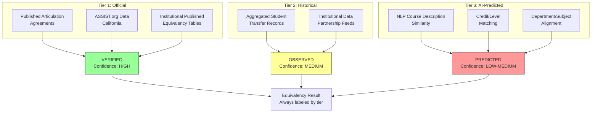

# Transfer Intelligence Architecture

> **Date:** November 24, 2026
> **Status:** Phase 3 Milestone 4 Implemented & Tested (Alembic rev `a70efe4e6454`, 3-Tier Equivalency Matrix, `pgvector` HNSW `384d` Embeddings, Degree Applicability Engine, ASSIST EULA Connector, Upgraded `/transfer` Dashboard)
> **Dependencies:** Universal Student Profile (doc 05), Global University Database (doc 06)

---

## 1. The Transfer Problem

| Statistic | Value | Source |
|---|---|---|
| Annual US transfers | ~1.2 million students | National Student Clearinghouse |
| CC → 4-year transfers | 480,000–500,000 annually | NSCRC |
| Average credit loss | **43%** of accumulated credits | Federal studies |
| Credit loss (public in-state) | ~22% (better but still significant) | NSCRC |
| Transfer rate from CC | 34% of CC starters (6-year window) | Research.com |
| Bachelor's completion post-transfer | 65–66% within 6 years | Student Clearinghouse |

**Why transfer intelligence is the key differentiator:** No student-facing platform exists that helps students understand what credits will transfer before they apply. The existing tools (CourseWise, EdVisorly, Equivify) are B2B institutional products. ASSIST.org is California-only. There is no national — let alone global — student-facing transfer intelligence platform.

---

## 2. Three-Tier Equivalency Architecture



> [!CAUTION]
> **Never present an AI-predicted equivalency as an official credit transfer decision.** Every result must display its tier, confidence level, source, and a disclaimer that official transfer credit decisions are made solely by the receiving institution.

---

## 3. Data Model

### Course Catalog

```sql
-- Normalized course catalog across institutions
CREATE TABLE course_catalog (
    id UUID PRIMARY KEY DEFAULT gen_random_uuid(),
    institution_id UUID NOT NULL REFERENCES institutions(id),

    course_code VARCHAR(50) NOT NULL,
    course_name VARCHAR(500) NOT NULL,
    department VARCHAR(200),
    description TEXT,

    credit_hours DECIMAL(4,1),
    credit_type VARCHAR(20) DEFAULT 'semester_hour',
    course_level VARCHAR(20),  -- 100, 200, 300, 400, graduate
    is_lab BOOLEAN DEFAULT FALSE,
    prerequisites TEXT,

    -- For NLP matching
    description_embedding vector(1536),  -- pgvector: text-embedding-3-large dimension

    catalog_year VARCHAR(9),
    source_url TEXT,
    retrieved_at TIMESTAMPTZ,

    created_at TIMESTAMPTZ DEFAULT NOW(),
    updated_at TIMESTAMPTZ DEFAULT NOW(),

    UNIQUE(institution_id, course_code, catalog_year)
);

CREATE INDEX idx_catalog_institution ON course_catalog(institution_id);
CREATE INDEX idx_catalog_code ON course_catalog(course_code);
CREATE INDEX idx_catalog_embedding ON course_catalog USING ivfflat(description_embedding vector_cosine_ops) WITH (lists = 100);
```

### Equivalency Records

```sql
CREATE TABLE course_equivalencies (
    id UUID PRIMARY KEY DEFAULT gen_random_uuid(),

    source_institution_id UUID NOT NULL REFERENCES institutions(id),
    source_course_id UUID REFERENCES course_catalog(id),
    source_course_code VARCHAR(50),
    source_course_name VARCHAR(500),

    target_institution_id UUID NOT NULL REFERENCES institutions(id),
    target_course_id UUID REFERENCES course_catalog(id),
    target_course_code VARCHAR(50),
    target_course_name VARCHAR(500),

    -- Equivalency classification
    equivalency_tier SMALLINT NOT NULL
        CHECK (equivalency_tier BETWEEN 1 AND 3),
    -- 1 = Official (published articulation agreement)
    -- 2 = Historical (observed in transfer records)
    -- 3 = AI-predicted (NLP similarity match)

    equivalency_type VARCHAR(30) DEFAULT 'direct'
        CHECK (equivalency_type IN ('direct', 'partial', 'combined', 'elective_only', 'no_equivalent')),
    -- direct: Course A = Course B
    -- partial: Course A covers some of Course B
    -- combined: Courses A+B together = Course C
    -- elective_only: Transfers as elective credit, not major requirement

    confidence_score DECIMAL(3,2),  -- 0.00-1.00

    -- Credits
    source_credits DECIMAL(4,1),
    target_credits DECIMAL(4,1),
    credits_transferable DECIMAL(4,1),

    -- Provenance
    source_type VARCHAR(50) NOT NULL,  -- 'assist_org', 'institution_website', 'student_report', 'ai_prediction'
    source_url TEXT,
    articulation_agreement_id UUID,
    verified_at TIMESTAMPTZ,
    academic_year VARCHAR(9),

    created_at TIMESTAMPTZ DEFAULT NOW(),
    updated_at TIMESTAMPTZ DEFAULT NOW()
);

CREATE INDEX idx_equiv_source ON course_equivalencies(source_institution_id, source_course_code);
CREATE INDEX idx_equiv_target ON course_equivalencies(target_institution_id, target_course_code);
CREATE INDEX idx_equiv_pair ON course_equivalencies(source_institution_id, target_institution_id);
CREATE INDEX idx_equiv_tier ON course_equivalencies(equivalency_tier);
```

### Articulation Agreements

```sql
CREATE TABLE articulation_agreements (
    id UUID PRIMARY KEY DEFAULT gen_random_uuid(),
    source_institution_id UUID NOT NULL REFERENCES institutions(id),
    target_institution_id UUID NOT NULL REFERENCES institutions(id),

    agreement_type VARCHAR(50),  -- 'general', 'program_specific', 'guaranteed_transfer'
    program_name VARCHAR(300),  -- NULL for general agreements
    effective_date DATE,
    expiration_date DATE,

    source_url TEXT NOT NULL,
    document_storage_key VARCHAR(500),  -- Stored copy of agreement
    retrieved_at TIMESTAMPTZ,
    verified_at TIMESTAMPTZ,

    created_at TIMESTAMPTZ DEFAULT NOW()
);
```

---

## 4. Transfer Eligibility Checker

### Input

```json
{
    "current_institution_id": "uuid",
    "target_institution_id": "uuid",
    "intended_major": "Computer Science",
    "credits_completed": 45,
    "cumulative_gpa": 3.2,
    "gpa_scale": 4.0,
    "applicant_type": "transfer"
}
```

### Evaluation Logic

```
FUNCTION check_transfer_eligibility(input):

    // 1. Fetch target institution's transfer requirements
    requirements = QUERY institution_requirements
        WHERE institution_id = input.target_institution_id
        AND applicant_type IN ('transfer', 'all')

    results = []

    // 2. Check each requirement
    FOR EACH req IN requirements:

        IF req.type == 'minimum_gpa':
            IF input.cumulative_gpa >= req.minimum_value:
                results.ADD({req, status: 'SATISFIED', detail: "GPA {input.gpa} ≥ {req.min}"})
            ELSE:
                gap = req.minimum_value - input.cumulative_gpa
                results.ADD({req, status: 'NOT_SATISFIED', detail: "GPA gap: {gap}"})

        IF req.type == 'minimum_credits':
            IF input.credits_completed >= req.minimum_value:
                results.ADD({req, status: 'SATISFIED'})
            ELSE:
                needed = req.minimum_value - input.credits_completed
                results.ADD({req, status: 'NOT_SATISFIED', detail: "Need {needed} more credits"})

        IF req.type == 'maximum_credits':
            IF input.credits_completed <= req.maximum_value:
                results.ADD({req, status: 'SATISFIED'})
            ELSE:
                results.ADD({req, status: 'WARNING', detail: "May exceed max transfer credits"})

        IF req.type == 'prerequisite_courses':
            // Cross-reference with student's completed courses
            // Use equivalency engine to match across institutions
            match_result = CHECK_PREREQUISITES(input, req)
            results.ADD(match_result)

    // 3. Generate summary
    satisfied = results.FILTER(status == 'SATISFIED').LENGTH
    total_required = results.FILTER(importance == 'required').LENGTH

    RETURN {
        overall_eligibility: IF all_required_satisfied THEN 'LIKELY_ELIGIBLE' ELSE 'REQUIREMENTS_MISSING',
        requirements_checked: results,
        satisfied_count: satisfied,
        total_required: total_required,
        confidence: CALCULATE_CONFIDENCE(results, data_freshness),
        data_sources: COLLECT_SOURCES(results),
        disclaimer: "This is an informational assessment. Official eligibility is determined by the institution."
    }
```

### Output

```json
{
    "overall_eligibility": "LIKELY_ELIGIBLE",
    "confidence": 0.75,
    "requirements": [
        {
            "requirement": "Minimum GPA 2.5",
            "status": "SATISFIED",
            "detail": "Your GPA (3.2) exceeds the minimum (2.5)",
            "source": "university-website",
            "verified_at": "2026-09-15"
        },
        {
            "requirement": "Minimum 30 credits",
            "status": "SATISFIED",
            "detail": "45 credits completed ≥ 30 required"
        },
        {
            "requirement": "Calculus I prerequisite",
            "status": "NEEDS_VERIFICATION",
            "detail": "MATH 141 at your institution may satisfy this — verify with admissions"
        }
    ],
    "missing_documents": ["Official college transcript", "Transfer application essay"],
    "key_deadlines": [
        {"type": "transfer_fall", "date": "2027-03-01", "source": "verified"}
    ],
    "disclaimer": "This assessment is based on published requirements and is not an official admission decision."
}
```

---

## 5. AI-Predicted Equivalency Pipeline

For Tier 3 (AI-predicted) equivalencies when no official or historical data exists:

```
FUNCTION predict_equivalency(source_course, target_institution_id):

    // 1. Embed source course description
    source_embedding = EMBED(source_course.description + " " + source_course.name)

    // 2. Find similar courses at target institution using vector search
    candidates = QUERY course_catalog
        WHERE institution_id = target_institution_id
        ORDER BY description_embedding <=> source_embedding  // cosine distance
        LIMIT 10

    // 3. Apply secondary filters
    scored_candidates = []
    FOR EACH candidate IN candidates:
        score = 0.0

        // Semantic similarity (primary signal)
        cosine_sim = 1.0 - cosine_distance(source_embedding, candidate.embedding)
        score += cosine_sim * 0.50  // 50% weight

        // Credit hour match
        IF abs(source_course.credits - candidate.credits) <= 1:
            score += 0.20  // 20% weight

        // Course level match (100→100, 200→200)
        IF source_course.level == candidate.level:
            score += 0.15  // 15% weight

        // Department alignment
        IF SIMILAR_DEPARTMENT(source_course.department, candidate.department):
            score += 0.15  // 15% weight

        scored_candidates.ADD({candidate, score})

    // 4. Return top match if above threshold
    best = scored_candidates.SORT_DESC(score).FIRST

    IF best.score >= 0.70:
        RETURN {
            equivalency_tier: 3,
            equivalency_type: 'direct',
            confidence: best.score,
            target_course: best.candidate,
            explanation: "Based on course description similarity, credit alignment, and department match",
            disclaimer: "This is an AI-generated prediction. Verify with the receiving institution."
        }
    ELIF best.score >= 0.50:
        RETURN {
            equivalency_tier: 3,
            equivalency_type: 'partial',
            confidence: best.score,
            target_course: best.candidate,
            explanation: "Partial match detected. The courses cover overlapping but not identical material."
        }
    ELSE:
        RETURN {equivalency_type: 'no_equivalent', confidence: 0}
```

---

## 6. Data Acquisition Strategy

| Source | Coverage | Data Type | Access Method | Priority |
|---|---|---|---|---|
| **ASSIST.org** | California CCs ↔ UC/CSU | Tier 1 equivalencies | Web scraping (or negotiate API) | P0 |
| **Transferology (CollegeSource)** | National (US) | Tier 1-2 equivalencies | Partnership/API | P1 |
| **State articulation databases** | Per-state | Tier 1 equivalencies | State-specific APIs/scraping | P1 |
| **Institutional transfer credit pages** | Per-institution | Tier 1 equivalencies | Web scraping | P1 |
| **IPEDS** | All US Title IV | Institution metadata | CSV download | P0 (done in DB seeding) |
| **Student-reported transfers** | Organic growth | Tier 2 equivalencies | In-platform reporting | P2 |

### State Articulation Database Availability

| State | System | URL | Feasibility |
|---|---|---|---|
| California | ASSIST.org | assist.org | High — well-structured data |
| Illinois | iTransfer | itransfer.org | Medium — basic equivalency data |
| Florida | FLVC/FACTS | flvc.org | Medium — mandated 2+2 program |
| Texas | TCCNS | tccns.org | Medium — course numbering system |
| New York | SUNY Transfer | suny.edu/attend/get-started/transfer | Low — fragmented by campus |
| Ohio | OhioTransfer | ohiohighered.org/transfer | Medium |

---

## 7. Credit Transfer Analysis

Given a student's completed courses and a target institution, produce a comprehensive transfer credit report:

```json
{
    "source_institution": "City College of San Francisco",
    "target_institution": "San Francisco State University",
    "analysis_date": "2026-11-23",
    "total_credits_attempted": 60,
    "summary": {
        "likely_transferable": 45,
        "likely_not_transferable": 8,
        "uncertain": 7,
        "total_at_target_needed": 120,
        "estimated_remaining": 75
    },
    "course_analysis": [
        {
            "source_course": "CS 110 - Introduction to Computer Science",
            "source_credits": 3,
            "target_equivalent": "CSC 210 - Introduction to Computer Programming",
            "target_credits": 3,
            "equivalency_tier": 1,
            "confidence": 0.95,
            "source": "ASSIST.org",
            "status": "LIKELY_TRANSFERABLE"
        },
        {
            "source_course": "MATH 110A - Calculus I",
            "source_credits": 4,
            "target_equivalent": "MATH 226 - Calculus I",
            "target_credits": 4,
            "equivalency_tier": 1,
            "confidence": 0.95,
            "source": "ASSIST.org",
            "status": "LIKELY_TRANSFERABLE"
        },
        {
            "source_course": "MUS 10 - Music Appreciation",
            "source_credits": 3,
            "target_equivalent": null,
            "equivalency_tier": 3,
            "confidence": 0.40,
            "status": "UNCERTAIN",
            "note": "May transfer as general elective. Verify with admissions."
        }
    ]
}
```

---

## 8. Integration with Universal Student Profile

The student's `enrollment_records` and `courses` tables (defined in doc 05) are the input to the Transfer Intelligence Engine. Transfer-specific profile fields:

| Field | Location | Purpose |
|---|---|---|
| `enrollment_type: 'community_college'` | enrollment_records | Identifies CC enrollment |
| `cumulative_gpa` | enrollment_records | Per-institution GPA |
| `total_credits_earned` | enrollment_records | Credits completed |
| `courses.*` | courses table | Individual course records |
| `applicant_type: 'transfer'` | student_profiles | Flags transfer pathway |

The same schema supports students who have attended multiple institutions (a common transfer scenario) through multiple `enrollment_records`, each with their own set of `courses`.
