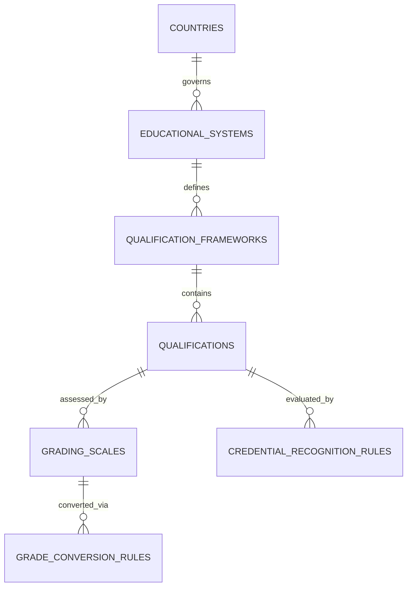
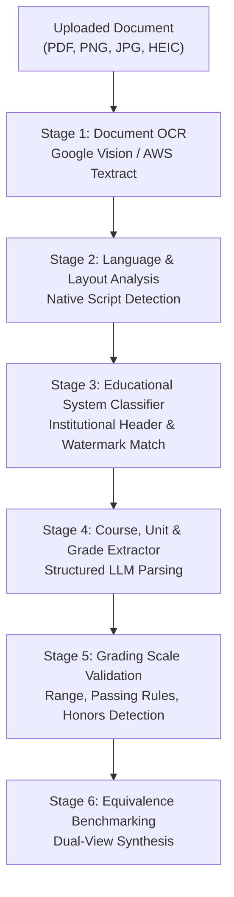

# International Education Intelligence

> **Date:** November 23, 2026
> **Status:** Technical Specification — Core Intelligence Layer
> **Dependencies:** Universal Student Profile (doc 05), Global University Database (doc 06)

---

## 1. Executive Summary & Philosophy

Higher education admissions across the globe suffer from severe credential fragmentation. Students educated in France (0–20 scale), India (CBSE 10-point CGPA or percentage marks), Haiti (Baccalauréat haïtien), the UK (A-Levels with $A^*–E$), or Germany (Abitur 1.0–5.0 with inverted scale) face systemic friction when applying across borders.

### Foundational Principles
1. **Never Force Universal 4.0 GPA Flattening:** Forcing every grading system into an American unweighted 4.0 GPA destroys pedagogical nuance, grade distributions, and relative selectivity.
2. **Dual-View Academic Representation:** Always maintain and display the **Original Native Record** alongside an **Informational Approximate Benchmark**.
3. **Transparent Methodology & Confidence Intervals:** Every calculated equivalency must cite its source methodology (e.g., WES, AACRAO EDGE, UK ENIC, or institutional published standards) and include statistical confidence ranges.
4. **Strict Boundary with Regulated Credential Evaluation:** The platform provides *guidance and preparation intelligence*, NOT legally binding credential evaluations. Clear guidance must direct students to NACES/AICE member evaluators or official bodies when mandated by destination universities.

---

## 2. Global Educational System Hierarchy



---

## 3. Top 20 International Educational Systems Matrix

| Country / Authority | Primary Qualifications | Native Grading Scale | Primary Academic Progression | Documentation Required |
|---|---|---|---|---|
| **United States** | High School Diploma, Associate (AA/AS), Bachelor (BA/BS) | Letter ($A–F$), $4.0$ Scale | $12$ yrs primary/secondary $\rightarrow$ $2$ or $4$ yr undergrad | Official Transcript, School Report |
| **Haiti** | Baccalauréat Haïtien (Philo / NSIV), Licence | $0–20$ ($10$ pass, $16+$ Mention Très Bien) | Enseignement Fondamental ($9$ yrs) $\rightarrow$ Secondaire ($4$ yrs) $\rightarrow$ Université ($4$ yrs) | Relevé de Notes Officiel, Diplôme d'État (MENFP) |
| **France** | Baccalauréat Général/Technologique, Licence, Master | $0–20$ ($10$ pass, $12–13.9$ Assez Bien, $14–15.9$ Bien, $16+$ Très Bien) | Collège $\rightarrow$ Lycée ($3$ yrs) $\rightarrow$ Licence ($3$ yrs / $180$ ECTS) | Bulletins trimestriels, Relevé de notes du Bac |
| **United Kingdom** | GCSEs, GCE A-Levels, Bachelor's Honours | A-Level: $A^*, A, B, C, D, E$ (Pass), $U$ (Ungraded). Degree: 1st, 2:1, 2:2, 3rd | $11$ yrs secondary $\rightarrow$ $2$ yrs Sixth Form $\rightarrow$ $3$ yr Bachelor's | Official Exam Certificates from Awarding Bodies (Edexcel, AQA, OCR) |
| **India** | CBSE / CISCE / State Boards (Class 10 & 12), Bachelor (BTech/BSc/BA) | Secondary: % Marks ($33\%$ pass); University: $10$-point CGPA | $10+2$ school structure $\rightarrow$ $3$ or $4$ yr Bachelor's | Mark Sheets for all years, Degree Certificate |
| **Canada** | Provincial High School Diplomas (OSSD, DES, BC Dogwood), Bachelor | Percentage ($0–100\%$) or $4.0/4.33$ Scale by province | $12$ yrs secondary (Quebec: CEGEP $2$ yrs) $\rightarrow$ $3–4$ yr Bachelor | Ministry or School Board Official Transcript |
| **Germany** | Abitur (Zeugnis der Allgemeinen Hochschulreife), Bachelor | $1.0$ (Best) to $4.0$ (Pass), $5.0/6.0$ (Fail); Oberstufe points $0–15$ | Grundschule $\rightarrow$ Gymnasium ($8–9$ yrs) $\rightarrow$ Universität | Abiturzeugnis with individual semester points |
| **Nigeria** | WAEC / WASSCE, NECO, National Diploma, Bachelor | $A1$ (Excellent) to $F9$ (Fail). $C6$ minimum credit | $6$ yrs primary $\rightarrow$ $3$ JSS $\rightarrow$ $3$ SSS $\rightarrow$ $4$ yr University | WASSCE Scratch Card/PIN for online verification |
| **South Africa** | National Senior Certificate (NSC), Bachelor | Levels $1–7$ (Level $7$: $80–100\%$, Level $4$: $50–59\%$ pass) | $12$ grades $\rightarrow$ Higher Certificate / Diploma / Bachelor degree | Umalusi certified Statement of Results |
| **Brazil** | Certificado de Conclusão do Ensino Médio, ENEM, Bacharelado | $0–10$ scale ($5.0$ or $6.0$ pass) or $0–100$ | $9$ yrs Ensino Fundamental $\rightarrow$ $3$ yrs Ensino Médio $\rightarrow$ Ensino Superior | Histórico Escolar com Certificado de Conclusão |
| **China** | Gaokao (National College Entrance Examination), Bachelor | Percentage / Raw scores (e.g., total $750$ points) | $6$ yrs primary $\rightarrow$ $3$ junior $\rightarrow$ $3$ senior high $\rightarrow$ $4$ yr Bachelor | Official Notarized Transcript, Graduation Certificate, CDGDC/CHESICC verification |
| **Japan** | Kotogakko Graduation, Common Test for University Admissions | Letter ($A/B/C/F$) or $5$-point / $100$-point scale | $6–3–3$ system $\rightarrow$ $4$ yr University ($2$ yr Junior College) | Official Chousasho (Student Record), Certificate of Graduation |
| **South Korea** | High School Diploma, CSAT (Suneung) | Stanine system ($1$ top $4\%$ to $9$ lowest) + raw percentile | $6–3–3$ system $\rightarrow$ $4$ yr University | High School Transcript, CSAT Score Report |
| **International (IBO)** | International Baccalaureate (IB) Diploma | Subjects $1–7$ ($7$ max), Core $3$ points, Total $45$ max ($24$ pass) | $2$-year pre-university diploma program | Official IBO Transcript sent via IBO portal |
| **Mexico** | Certificado de Bachillerato, Licenciatura | $0–10$ scale ($6.0$ minimum pass, sometimes $7.0$) | $6$ Primaria $\rightarrow$ $3$ Secundaria $\rightarrow$ $3$ Preparatoria $\rightarrow$ Licenciatura | Histórico de Calificaciones legalizado |
| **Australia** | Senior Secondary Certificate (HSC, VCE, etc.), ATAR, Bachelor | ATAR ($0.00–99.95$ percentile). University: HD, D, C, P, F | $12$ yrs primary/secondary $\rightarrow$ $3$ yr Bachelor | State authority Record of Achievement + ATAR advice |
| **Jamaica / CARICOM** | CSEC (O-Levels equiv), CAPE (A-Levels equiv) | CAPE: Roman numerals $I$ (Outstanding) to $VII$ | Primary $\rightarrow$ Secondary ($5$ yrs CSEC) $\rightarrow$ Sixth Form ($2$ yrs CAPE) | Official CXC (Caribbean Examinations Council) Certificate |
| **Saudi Arabia** | General Secondary Education Certificate (Tawjihi), Qudurat/Tahsili | Percentage ($0–100\%$) | $6$ Primary $\rightarrow$ $3$ Intermediate $\rightarrow$ $3$ Secondary $\rightarrow$ Bachelor | Official Transcript certified by Ministry of Education |
| **Philippines** | K to 12 Senior High School Diploma, Bachelor | Percentage ($75\%$ pass) or inverted $1.0$ (best) to $5.0$ (fail) | K to $12$ ($6$ Primary $\rightarrow$ $4$ JHS $\rightarrow$ $2$ SHS) $\rightarrow$ Tertiary | Form 137 / Form 138 (Permanent Record) |
| **Turkey** | Lise Diplomasi, YKS (Yükseköğretim Kurumları Sınavı) | $0–100$ scale ($50$ pass) | $4+4+4$ system ($12$ yrs) $\rightarrow$ Lisans ($4$ yrs) | Official Lise Transkripti certified by MEB |

---

## 4. International GPA & Credential Conversion Engine

### 4.1 Conversion Philosophy and Mathematical Models

Conversion is not a naive linear scalar multiplication. A $14/20$ in France is a rigorous "Mention Bien" achieved by approximately the top $10–15\%$ of students, whereas in a naive linear scaling ($14/20 = 70\% = C-$ in standard US grading), the student would be severely penalized.

The Conversion Engine utilizes three distinct evaluation methods:

#### Method A: Percentile / Distribution Mapping (Preferred)
Maps the native grade based on historical cohort distributions to destination benchmarks.
$$\text{Grade}_{\text{Dest}} = F^{-1}_{\text{Dest}}\left(F_{\text{Source}}(\text{Grade}_{\text{Native}})\right)$$

#### Method B: Modified Bavarian Formula (Standard for European / German Conversions)
$$\text{Grade}_{\text{Target}} = 1 + 3 \times \frac{N_{\text{max}} - N_{\text{actual}}}{N_{\text{max}} - N_{\text{min}}}$$
Where $N_{\text{max}}$ is the maximum attainable native grade, $N_{\text{min}}$ is the minimum passing native grade, and $N_{\text{actual}}$ is the student's earned native grade.

#### Method C: Criterion-Referenced Conversion Tables (AACRAO EDGE / WES Compatible)
Empirically vetted lookup brackets specific to country $\rightarrow$ destination university pairs.

```sql
-- Database schema for conversion rules
CREATE TABLE grade_conversion_rules (
    id UUID PRIMARY KEY DEFAULT gen_random_uuid(),
    source_grading_system_id UUID NOT NULL REFERENCES grading_systems(id),
    target_grading_system_id UUID NOT NULL REFERENCES grading_systems(id),

    source_grade_raw VARCHAR(20) NOT NULL,
    source_numeric_value DECIMAL(5,2),

    target_grade_equivalent VARCHAR(20) NOT NULL,
    target_gpa_low DECIMAL(4,2),
    target_gpa_high DECIMAL(4,2),
    target_gpa_point DECIMAL(4,2),

    methodology VARCHAR(100) NOT NULL, -- 'bavarian', 'distribution_percentile', 'wes_standard', 'aacrao_edge'
    methodology_citation TEXT NOT NULL,
    confidence_level VARCHAR(20) DEFAULT 'high', -- 'high', 'moderate', 'advisory'

    academic_level VARCHAR(30) DEFAULT 'undergraduate'
        CHECK (academic_level IN ('secondary', 'undergraduate', 'graduate')),

    created_at TIMESTAMPTZ DEFAULT NOW()
);

CREATE INDEX idx_grade_conv_lookup ON grade_conversion_rules(source_grading_system_id, target_grading_system_id, source_grade_raw);
```

### 4.2 Concrete Conversion Example: France to United States

| French Grade ($/20$) | French Mention | US Letter Equivalent | US 4.0 GPA Equivalent | Statistical Distribution Notes |
|---|---|---|---|---|
| $16.0 – 20.0$ | Très Bien | A+ / A | $4.00$ | Top $\sim 3–5\%$ of students |
| $14.0 – 15.9$ | Bien | A / A- | $3.70 – 3.85$ | Top $\sim 15\%$ |
| $12.0 – 13.9$ | Assez Bien | B+ / B | $3.30 – 3.50$ | Upper Middle |
| $10.0 – 11.9$ | Passable | B- / C+ | $2.70 – 3.00$ | Standard Pass |
| $8.0 – 9.9$ | Rattrapage (Conditional) | D | $1.00 – 1.70$ | Requires retake |
| $0.0 – 7.9$ | Ajourné (Fail) | F | $0.00$ | Fail |

---

## 5. Credential Recognition & Verification Database

International applicants must know the precise administrative gatekeeping criteria of destination countries before spending application fees.

```sql
CREATE TABLE credential_recognition_rules (
    id UUID PRIMARY KEY DEFAULT gen_random_uuid(),
    source_country_code CHAR(2) NOT NULL REFERENCES countries(code),
    source_qualification_id UUID REFERENCES educational_systems(id),

    destination_country_code CHAR(2) NOT NULL REFERENCES countries(code),
    destination_institution_id UUID REFERENCES institutions(id), -- NULL if national policy

    is_directly_recognized BOOLEAN DEFAULT TRUE,
    requires_external_evaluation BOOLEAN DEFAULT FALSE,
    accepted_evaluation_agencies JSONB, -- ["WES", "ECE", "IERF", "Josef_Silny"]

    requires_official_translation BOOLEAN DEFAULT FALSE,
    translation_requirements TEXT,

    requires_apostille_or_legalization BOOLEAN DEFAULT FALSE,
    requires_direct_institutional_dispatch BOOLEAN DEFAULT TRUE,

    standardized_test_waiver_policy JSONB,
    -- e.g., {"waive_toefl_if": ["english_medium_instruction_3_years", "grade_c_in_gcse_english"]}

    official_source_url TEXT NOT NULL,
    last_verified_at TIMESTAMPTZ NOT NULL,
    verification_status VARCHAR(20) DEFAULT 'verified',

    created_at TIMESTAMPTZ DEFAULT NOW(),
    updated_at TIMESTAMPTZ DEFAULT NOW()
);

CREATE INDEX idx_cred_recog_pair ON credential_recognition_rules(source_country_code, destination_country_code);
```

---

## 6. Transcript Intelligence Engine

When students upload international academic records, the system executes an automated 6-stage extraction and analysis pipeline.



### Stage Execution Details:
1. **OCR Pre-processing:** High-resolution deskewing, binarization, table boundary segmentation.
2. **System Identification:** Recognizes headers such as *Ministère de l'Éducation Nationale et de la Formation Professionnelle (Haiti)*, *Central Board of Secondary Education (India)*, or *Académie de Paris (France)*.
3. **Structured Tabular Extraction:** Extracts tabular schemas:
   ```json
   {
     "course_code": "MAT401",
     "course_title": "Mathématiques Générales",
     "native_grade": "15.5",
     "native_scale_max": "20.0",
     "coefficient_or_credits": "4.0",
     "term": "Semestre 1 - 2025"
   }
   ```
4. **Human-in-the-Loop Safeguard:** Any parsed document with an extraction confidence score below $0.85$ triggers an alert prompting the student to verify parsed course lines against the original scanned image.

---

## 7. Institutional Disclaimers & Regulatory Transparency

Every view, report, or exported sheet from the International Education Engine includes the following immutable legal disclosure:

> **LEGAL & INSTITUTIONAL ADVISORY DISCLAIMER:**
> Academic conversion calculations, course comparability estimates, and grade benchmarking generated by this platform are designed solely for academic planning, institutional discovery, and strategic guidance. They do not constitute certified foreign credential evaluations, legal apostilles, or binding institutional admissions decisions. Formal credential evaluations required for admission, visa issuance, transfer credits, or professional licensure must be obtained from the receiving university's internal admissions office or an accredited credential evaluation service (such as members of NACES, AICE, or national recognition bodies such as UK ENIC, NARIC, or ZAB) as required by the destination institution.
