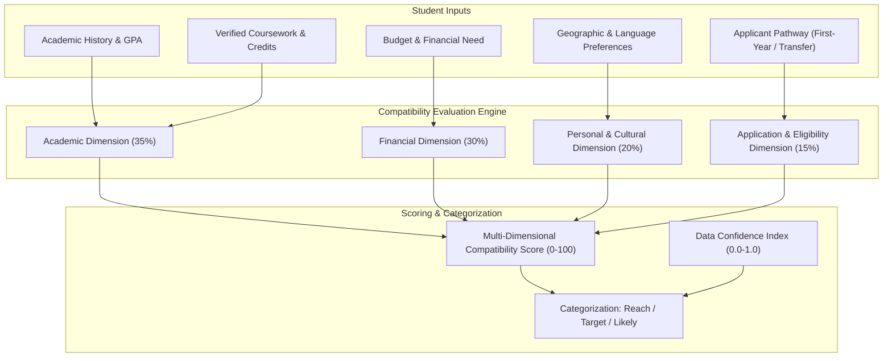
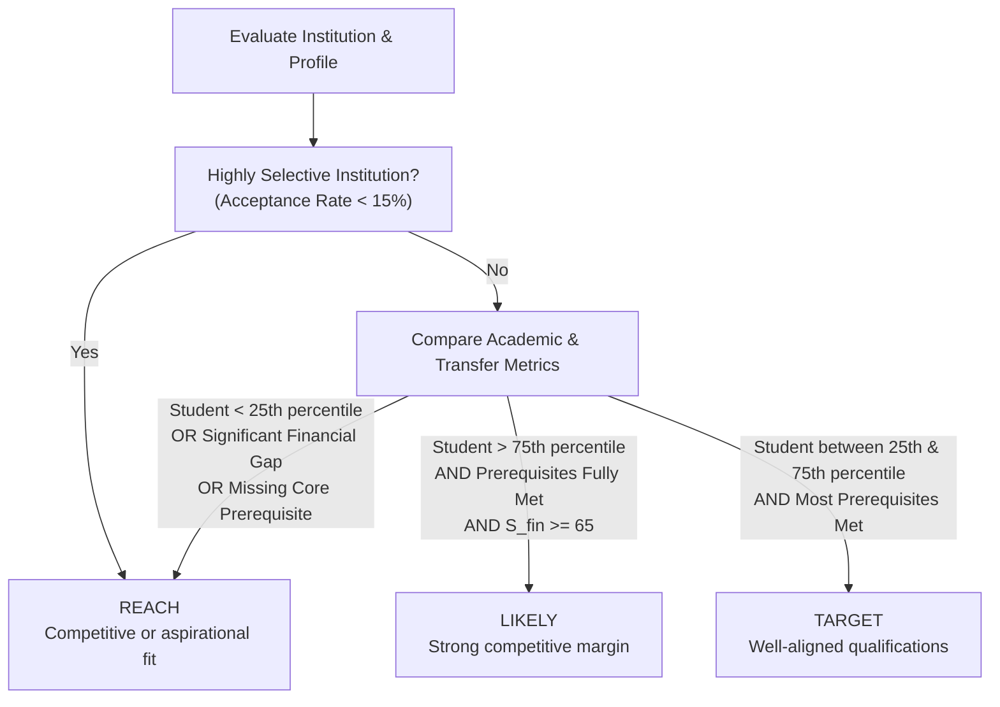

# University Compatibility & Matching Engine

> **Date:** November 23, 2026
> **Status:** Technical Specification — Admissions Intelligence Layer
> **Dependencies:** Universal Student Profile (doc 05), Global University Database (doc 06), International Education Intelligence (doc 09)

---

## 1. Foundational Philosophy & Ethical Standards

Traditional admissions calculators and "chancing engines" often generate deceptive, fabricated pseudo-probabilities (e.g., *"You have a 67.4% chance of admission to Cornell"*). In holistic admissions, such precision is fraudulent, irresponsible, and commercially misleading.

### Guiding Principles:
1. **Compatibility Over Probability:** The engine measures how closely a student's verified profile, finances, academic history, and personal preferences align with published institutional standards and historical cohorts.
2. **Deterministic & Explainable Scoring:** Every score must provide an auditable breakdown citing specific facts (e.g., *"Your GPA of 3.65 sits between the 25th percentile (3.50) and 75th percentile (3.85) of admitted transfer students in College of Engineering"*).
3. **Data Quality & Confidence Bounds:** Recommendations degrade gracefully when data is incomplete, explicitly reflecting uncertainty via a **Data Confidence Indicator**.
4. **Tri-Tier Classification:** Classifies institutions into **Reach**, **Target**, and **Likely** categories based on objective threshold criteria.

---

## 2. Multi-Dimensional Compatibility Model



---

## 3. Evaluation Dimensions & Mathematical Formulation

The composite compatibility score $S_{\text{compat}} \in [0, 100]$ is computed as a weighted sum of four dimension scores:

$$S_{\text{compat}} = w_{\text{acad}} S_{\text{acad}} + w_{\text{fin}} S_{\text{fin}} + w_{\text{pers}} S_{\text{pers}} + w_{\text{app}} S_{\text{app}}$$

Default weights:
* $w_{\text{acad}} = 0.35$ (Academic Compatibility)
* $w_{\text{fin}} = 0.30$ (Financial Compatibility & Affordability)
* $w_{\text{pers}} = 0.20$ (Personal, Cultural, & Career Compatibility)
* $w_{\text{app}} = 0.15$ (Application, Prerequisite, & Deadline Compatibility)

### 3.1 Academic Compatibility Score ($S_{\text{acad}}$)
Evaluates academic benchmarks relative to the institution's published distributions (IPEDS, Common Data Set, or official international admissions criteria).

For institutions reporting 25th ($P_{25}$) and 75th ($P_{75}$) percentiles for GPA or standardized exams:
* If $X_{\text{student}} < P_{25}$:
  $$S_{\text{metric}} = 50 \times \max\left(0, \frac{X_{\text{student}} - P_{\text{min}}}{P_{25} - P_{\text{min}}}\right)$$
* If $P_{25} \le X_{\text{student}} \le P_{75}$:
  $$S_{\text{metric}} = 50 + 35 \times \left(\frac{X_{\text{student}} - P_{25}}{P_{75} - P_{25}}\right)$$
* If $X_{\text{student}} > P_{75}$:
  $$S_{\text{metric}} = 85 + 15 \times \min\left(1, \frac{X_{\text{student}} - P_{75}}{P_{\text{max}} - P_{75}}\right)$$

For transfer applicants, major prerequisite completion takes precedence over high school records.

### 3.2 Financial Compatibility Score ($S_{\text{fin}}$)
Evaluates real out-of-pocket affordability against the student's declared maximum annual budget ($B_{\text{student}}$).

$$\text{Net Cost} = \text{Total Cost of Attendance (COA)} - \text{Expected Institutional / Merit Aid} - \text{Secured Scholarships}$$

* If $\text{Net Cost} \le B_{\text{student}}$:
  $$S_{\text{fin}} = 80 + 20 \times \left(1 - \frac{\text{Net Cost}}{B_{\text{student}}}\right)$$
* If $\text{Net Cost} > B_{\text{student}}$:
  $$S_{\text{fin}} = 80 \times \max\left(0, 1 - \frac{\text{Net Cost} - B_{\text{student}}}{0.5 \times B_{\text{student}}}\right)$$

If an international applicant requires full financial aid at an institution that is **need-aware for international students with limited international aid budgets**, $S_{\text{fin}}$ is penalized and the institution is automatically flagged as a Reach regardless of academic profile.

### 3.3 Personal & Cultural Compatibility ($S_{\text{pers}}$)
Measures alignment on:
* Country and region preference
* Language of instruction
* Institution type (community college, liberal arts, research university, technical institute)
* Campus environment (urban, suburban, rural)
* Size of student body

### 3.4 Application & Eligibility Compatibility ($S_{\text{app}}$)
Checks hard constraints:
* Are application deadlines still open for the intended term?
* Does the student satisfy hard transfer credit minimums?
* Does the institution accept international or undocumented students?
* Are required standardized test scores available?

---

## 4. Reach / Target / Likely Classification Matrix

Institutions are classified into one of three strategic tiers based on verified criteria:



| Category | Operational Definition | Tactical Purpose in Strategy |
|---|---|---|
| **Reach** | Institutions where published admissions median exceeds student's current profile, institutions with sub-15% acceptance rates regardless of scores, or institutions where international aid competition is severe. | High-ambition targets; encourage students to prepare standout essays and portfolios. |
| **Target** | Institutions where student metrics align squarely within the middle 50% ($P_{25}–P_{75}$) of admitted students, and key program prerequisites are met. | The core foundation of the application list; highest likelihood of reasonable match. |
| **Likely** | Institutions where student metrics exceed the 75th percentile, minimum transfer/first-year requirements are fully satisfied, and net costs are within budget. | Safety and guarantee layer; ensures student maintains viable enrollment options. |

---

## 5. Data Confidence Index ($DCI$)

Not all university database records have equal verification. When calculating matching scores, the engine calculates a Data Confidence Index:

$$DCI = \frac{1}{N} \sum_{i=1}^N \mu_i \cdot \text{Freshness}_i \cdot \text{VerificationWeight}_i$$

* **High Confidence ($DCI \ge 0.85$):** Full Common Data Set, verified current-year tuition, verified transfer agreements.
* **Medium Confidence ($0.60 \le DCI < 0.85$):** IPEDS data present, general admissions criteria verified, but specific departmental prerequisites self-reported or unconfirmed.
* **Low / Advisory ($DCI < 0.60$):** Historical or estimated data. Recommendation carries an advisory badge: *"Based on limited published data — verify prerequisites directly with admissions."*

---

## 6. Database Schema & Recommendation Engine Storage

```sql
CREATE TABLE matching_preferences (
    id UUID PRIMARY KEY DEFAULT gen_random_uuid(),
    profile_id UUID NOT NULL REFERENCES student_profiles(id) ON DELETE CASCADE,

    -- Financial boundaries
    max_annual_budget DECIMAL(10,2),
    currency CHAR(3) DEFAULT 'USD',
    requires_full_aid BOOLEAN DEFAULT FALSE,
    requires_merit_scholarships BOOLEAN DEFAULT FALSE,

    -- Geographic & cultural preferences
    preferred_countries JSONB DEFAULT '["US"]',
    preferred_states_provinces JSONB DEFAULT '[]',
    preferred_institution_types JSONB DEFAULT '["university", "liberal_arts_college"]',
    campus_setting_preference JSONB DEFAULT '["urban", "suburban"]',
    preferred_languages JSONB DEFAULT '["en"]',

    -- Weight customization (optional user overrides)
    weight_academic DECIMAL(3,2) DEFAULT 0.35,
    weight_financial DECIMAL(3,2) DEFAULT 0.30,
    weight_personal DECIMAL(3,2) DEFAULT 0.20,
    weight_application DECIMAL(3,2) DEFAULT 0.15,

    updated_at TIMESTAMPTZ DEFAULT NOW()
);

CREATE TABLE university_recommendations (
    id UUID PRIMARY KEY DEFAULT gen_random_uuid(),
    profile_id UUID NOT NULL REFERENCES student_profiles(id) ON DELETE CASCADE,
    institution_id UUID NOT NULL REFERENCES institutions(id) ON DELETE CASCADE,

    match_category VARCHAR(20) NOT NULL
        CHECK (match_category IN ('reach', 'target', 'likely')),

    composite_score DECIMAL(5,2) NOT NULL, -- 0.00 to 100.00
    score_academic DECIMAL(5,2) NOT NULL,
    score_financial DECIMAL(5,2) NOT NULL,
    score_personal DECIMAL(5,2) NOT NULL,
    score_application DECIMAL(5,2) NOT NULL,

    data_confidence_score DECIMAL(3,2) NOT NULL, -- 0.00 to 1.00

    explanation_breakdown JSONB NOT NULL,
    -- e.g., {"academic_rationale": "GPA 3.7 exceeds 25th percentile...", "financial_rationale": "Estimated net cost $18,400 fits budget"}

    outstanding_prerequisites JSONB DEFAULT '[]',
    estimated_net_cost DECIMAL(10,2),

    computed_at TIMESTAMPTZ DEFAULT NOW(),
    is_saved_by_student BOOLEAN DEFAULT FALSE,
    is_dismissed BOOLEAN DEFAULT FALSE
);

CREATE INDEX idx_recs_profile ON university_recommendations(profile_id);
CREATE INDEX idx_recs_category ON university_recommendations(match_category);
```

---

## 7. Application Strategy Generator

Based on the multi-dimensional compatibility assessment, the platform generates a balanced, personalized application strategy.

### Standard Strategy Portfolio (Recommended 10–12 Institutions):
* **2–3 Reach Institutions:** Ambitious, selective institutions where student has a reasonable fighting chance.
* **4–5 Target Institutions:** Solid institutional matches where qualifications align with admitted cohorts.
* **3–4 Likely Institutions:** High-probability academic and financial fits to guarantee viable enrollment outcomes.

### Customizable Strategy Profiles:
1. **Affordability-Maximized Strategy:** Prioritizes in-state community college transfer paths, generous need-based aid endowments, and automatic merit scholarship cutoffs.
2. **Selective / High-Ambition Strategy:** Emphasizes top research universities while enforcing balanced safety options.
3. **Global Mobility Strategy:** Discovers cross-border institutions in countries offering post-study work visas (e.g., Canada, Germany, UK) with low or subsidized tuition.

---

## Implementation Status (Phase 3, Milestone 5 — Implemented & Verified)

- **Schema & Migration:** `apps/api/app/models/matching.py` (`MatchingPreference`, `UniversityRecommendation`) via Alembic revision `84ea3bee96d4_milestone_5_matching_engine.py`.
- **Service (`apps/api/app/services/matching_engine.py`):** Evaluates Academic Fit (`0.30` default), Financial Compatibility (`0.25` default), Admissions Readiness (`0.25` default), and Transfer & Credit Compatibility (`0.20` default), re-normalizes weights proportionally when Transfer is `not_applicable` (`first_year` pathway), preserves international grading contexts (`0–20`, `0–100%`, German `1.0–6.0`, US `4.0`), separates published vs. estimated costs, and emits transparent `calculation_formula` + non-probability advisory disclaimers.
- **API Endpoints (`apps/api/app/api/v1/matching.py`):** `GET/PUT /api/v1/matching/preferences`, `POST /api/v1/matching/run`, `POST /api/v1/matching/evaluate/{institution_id}`, `POST /api/v1/matching/recommendations/{institution_id}/save`, `GET /api/v1/matching/shortlist`, and `POST /api/v1/matching/compare`.
- **Frontend UI:** `/matching` dashboard (`apps/web/src/app/matching/page.tsx`), `MatchExplanationPanel.tsx`, `ComparisonPanel.tsx`, global nav integration (`Header.tsx`), and 10-language i18n copy (`translations.ts`).
