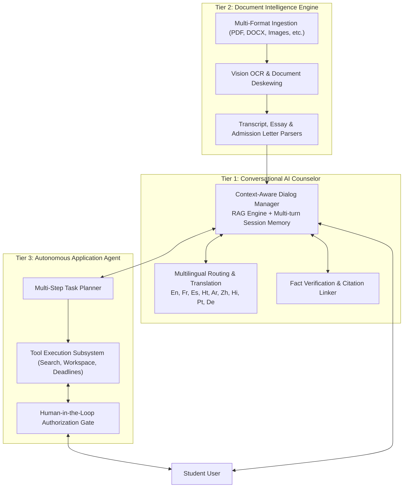
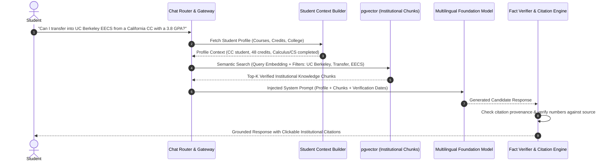
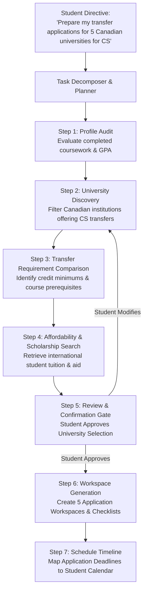
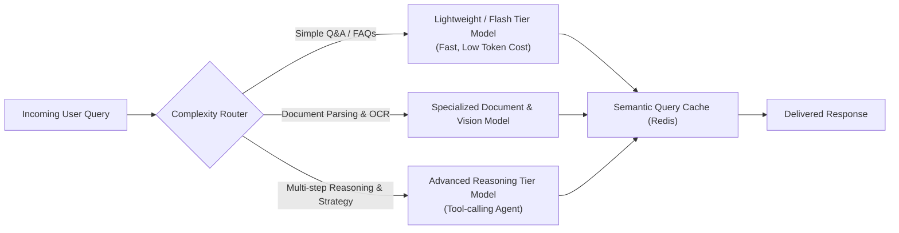

# AI Counselor & Agent Architecture

> **Date:** November 23, 2026
> **Status:** Technical Specification — Core AI & Agent Layer
> **Dependencies:** Universal Student Profile (doc 05), Global University Database (doc 06), Requirement Engine (doc 07)

---

## 1. System Overview & The Three AI Tiers

The platform's AI infrastructure avoids generic chat interfaces. It operates as an **integrated cognitive subsystem** with three synchronized layers:



---

## 2. Tier 1: Conversational AI Counselor & RAG Architecture

### 2.1 RAG (Retrieval-Augmented Generation) Pipeline
All institutional facts, tuition numbers, application deadlines, and admission requirements provided by the AI counselor must be grounded in verified database records.



### 2.2 System Prompt & Guardrail Guidelines
```text
YOU ARE THE PLATFORM ADMISSIONS COUNSELOR.
YOUR ROLE IS TO PROVIDE ACCURATE, CONTEXT-AWARE, AND COMPASSIONATE EDUCATIONAL GUIDANCE.

STRICT CONSTRAINTS:
1. Ground all university requirements, tuition numbers, and deadlines in the provided RETRIEVED CONTEXT.
2. If retrieved context does not contain the answer, state clearly: "I do not have verified institutional data for this requirement. Please verify directly with [Institution Admissions]."
3. NEVER fabricate admissions probabilities, acceptance chances, or guarantee admission.
4. When discussing essays, guide the student to structure and clarify THEIR OWN authentic voice. NEVER write essays for students or invent experiences.
5. In multilingual exchanges, respond in the student's active language while preserving the original official terminology of destination institutions (e.g., cite 'Associate Degree for Transfer (ADT)' with explanation in French or Haitian Creole).
```

### 2.3 Multilingual Processing
* **Automatic Detection:** Evaluates prompt language via fast text classification (e.g., `langdetect` or model token analysis).
* **Code-Switching Support:** Supports mixed-language inputs (common among diaspora and bilingual students).
* **Supported Languages:** English, French, Spanish, Portuguese, Haitian Creole (`ht`), Arabic, Mandarin Chinese, Japanese, Korean, German, Hindi, Bengali, Swahili, Russian, Turkish, Vietnamese, Italian, and Dutch.

---

## 3. Tier 2: Universal Document Intelligence

The platform accepts academic and financial documents across 13 common formats: `PDF`, `DOC`, `DOCX`, `TXT`, `RTF`, `JPG`, `JPEG`, `PNG`, `HEIC`, `XLS`, `XLSX`, `PPT`, `PPTX`, and `CSV`.

```sql
CREATE TABLE document_analyses (
    id UUID PRIMARY KEY DEFAULT gen_random_uuid(),
    document_id UUID NOT NULL REFERENCES documents(id) ON DELETE CASCADE,
    profile_id UUID NOT NULL REFERENCES student_profiles(id) ON DELETE CASCADE,

    analysis_type VARCHAR(50) NOT NULL
        CHECK (analysis_type IN ('transcript_parser', 'essay_review', 'admission_letter', 'financial_award_letter', 'syllabus_eval')),

    parsed_content JSONB NOT NULL,
    -- For transcript: courses, units, grades, GPA, institution, term breakdown
    -- For admission letter: decision, deadlines, conditions, financial aid breakdown
    -- For essay: readability, prompt_alignment, structural_critique, word_count

    ocr_confidence_score DECIMAL(3,2),
    flagged_for_human_review BOOLEAN DEFAULT FALSE,
    student_confirmed_accuracy BOOLEAN DEFAULT FALSE,

    processing_time_ms INTEGER,
    model_version VARCHAR(50),
    created_at TIMESTAMPTZ DEFAULT NOW()
);

CREATE INDEX idx_doc_analysis_doc ON document_analyses(document_id);
```

### 3.1 Transcript Extraction Pipeline
1. **OCR / Vision Preprocessing:** Deskewing, table extraction, and header identification.
2. **Entity Classification:** Maps raw table text to `course_code`, `course_title`, `credit_units`, and `grade`.
3. **Grading System Detection:** Recognizes native grading scales ($0–20$, percentage, letter grade, $10$-point CGPA).
4. **Interactive Validation:** Injected into `enrollment_records` and `courses` only after student visual confirmation.

### 3.2 Essay Feedback Intelligence
* **Prompt Alignment:** Checks whether essay paragraphs directly answer specific institutional prompts.
* **Structural Review:** Analyzes thesis clarity, paragraph transitions, and narrative momentum.
* **Voice Preservation:** Strictly flags artificial voice or clichés; encourages authentic student experiences.
* **Word & Character Constraints:** Displays live counts against institutional limits.

---

## 4. Tier 3: Autonomous Application Agent

The Application Agent goes beyond conversation to orchestrate multi-step admissions workflows on behalf of the student.



### 4.1 Tool Definitions & Execution Contract
The Agent interacts with platform capabilities through typed tool executions:

```python
class AgentToolRegistry:
    @tool
    def search_universities(self, country: str, major: str, max_tuition: float, accepts_transfer: bool) -> list[dict]:
        """Queries the verified global university database."""
        ...

    @tool
    def evaluate_transfer_eligibility(self, profile_id: str, institution_id: str) -> dict:
        """Runs the deterministic Transfer Intelligence Engine."""
        ...

    @tool
    def create_application_workspace(self, profile_id: str, institution_id: str, applicant_type: str) -> dict:
        """Initializes application workspace and checklist (Requires User Authorization)."""
        ...

    @tool
    def generate_application_timeline(self, application_ids: list[str]) -> dict:
        """Builds a backward-scheduled task timeline leading to application deadlines."""
        ...
```

### 4.2 Security & Human-in-the-Loop Authorization Gate
Agent actions are strictly segmented into three authorization tiers:

| Tier | Operation Type | Examples | Authorization Policy |
|---|---|---|---|
| **Tier 1: Read-Only** | Database queries, profile reads, search filters | Search universities, check deadlines | Automatic execution |
| **Tier 2: State Modification** | Workspace creation, checklist item updates, saving lists | Create application workspace, save universities | Student approval prompt in chat UI |
| **Tier 3: External Transmission** | Redirects to official portals, external credential submissions | Exporting application profile to external service | Explicit multi-step modal consent; never automated |

---

## 5. Token Cost Management & Model Routing

To maintain operational viability and prevent quota exhaustion:



* **Rate Limiting:** Free tier accounts receive 15 context-rich AI messages per day with unlimited database searches; Premium accounts receive elevated quotas.
* **Semantic Caching:** Frequently asked institutional requirement questions are cached via embedding similarity, reducing LLM API calls by an estimated 35–45%.

---

## 6. Student Privacy & Ethical AI Guarantees

1. **Zero External Model Training:** Uploaded student transcripts, essays, and personal identification documents are **never** utilized to train third-party foundation models.
2. **Encrypted Temporary Processing:** Documents processed for OCR and extraction reside in encrypted temporary storage and are removed or transferred to user-controlled vaults immediately post-processing.
3. **Session Purging:** Students can wipe chat histories and document analysis logs with a single click, fulfilling GDPR Right to Erasure mandates.
