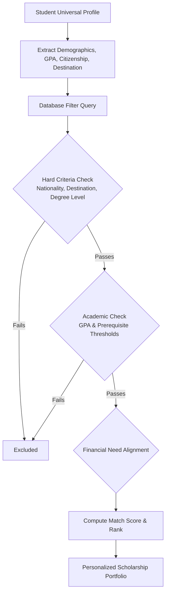
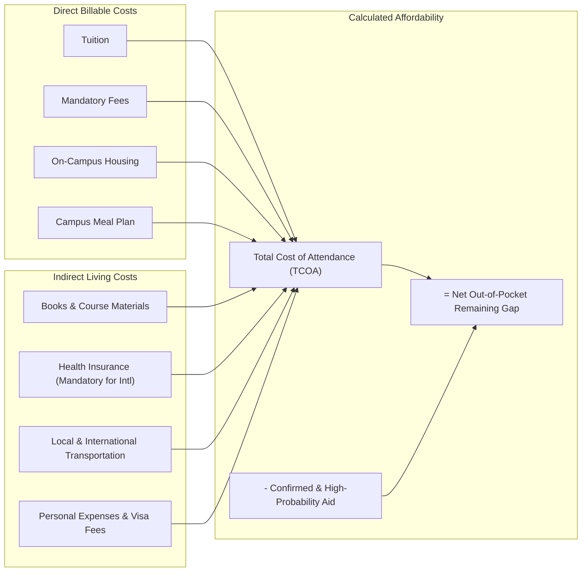
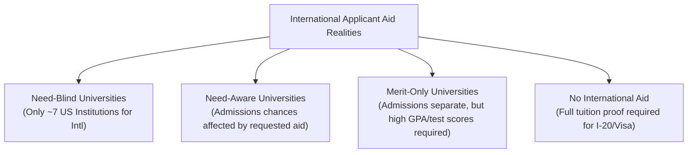

# Global Scholarship & Financial Intelligence Engine

> **Date:** November 23, 2026
> **Status:** Technical Specification — Admissions Intelligence Layer
> **Dependencies:** Universal Student Profile (doc 05), Global University Database (doc 06)

---

## 1. System Vision & Purpose

Financial opacity is the single greatest barrier to global higher education. International students are frequently blindsided by currency fluctuations, hidden mandatory fees, health insurance costs, and restrictions on off-campus employment. Simultaneously, millions of dollars in institutional and foundation scholarships go unawarded due to fragmented discovery.

The Global Scholarship & Financial Intelligence Engine provides:
1. A verified, structured international scholarship database.
2. A deterministic scholarship eligibility matching algorithm.
3. A granular Financial Affordability Calculator calculating Net Out-of-Pocket Cost.
4. Comprehensive global financial aid intelligence (FAFSA, CSS Profile, international student aid restrictions, post-study work regulations).

---

## 2. Global Scholarship Database Schema

```sql
CREATE TABLE scholarships (
    id UUID PRIMARY KEY DEFAULT gen_random_uuid(),

    name VARCHAR(500) NOT NULL,
    provider_name VARCHAR(300) NOT NULL,
    provider_type VARCHAR(50) NOT NULL
        CHECK (provider_type IN ('university', 'government', 'foundation', 'corporation', 'nonprofit', 'multilateral')),

    description TEXT,
    official_website_url TEXT NOT NULL,
    application_portal_url TEXT,

    -- Award financial taxonomy
    award_type VARCHAR(50) NOT NULL
        CHECK (award_type IN ('full_ride', 'full_tuition', 'fixed_amount', 'tuition_discount_pct', 'stipend', 'renewable_grant')),
    award_amount_min DECIMAL(12,2),
    award_amount_max DECIMAL(12,2),
    award_currency CHAR(3) DEFAULT 'USD',
    is_renewable BOOLEAN DEFAULT FALSE,
    renewal_criteria TEXT,

    -- Expenses covered
    covers_tuition BOOLEAN DEFAULT TRUE,
    covers_fees BOOLEAN DEFAULT FALSE,
    covers_housing BOOLEAN DEFAULT FALSE,
    covers_meals BOOLEAN DEFAULT FALSE,
    covers_books BOOLEAN DEFAULT FALSE,
    covers_health_insurance BOOLEAN DEFAULT FALSE,
    covers_international_travel BOOLEAN DEFAULT FALSE,
    provides_living_stipend BOOLEAN DEFAULT FALSE,

    -- Eligibility targets
    applicant_type VARCHAR(30) DEFAULT 'both'
        CHECK (applicant_type IN ('first_year', 'transfer', 'both', 'graduate')),
    degree_levels JSONB DEFAULT '["bachelors"]', -- associate, bachelors, masters, doctoral
    eligible_majors JSONB DEFAULT '[]', -- empty = open to all majors

    -- Deadlines
    application_deadline DATE,
    academic_year VARCHAR(9) NOT NULL,
    is_deadline_rolling BOOLEAN DEFAULT FALSE,

    -- Provenance & Verification
    source_url TEXT NOT NULL,
    last_verified_at TIMESTAMPTZ NOT NULL,
    verification_status VARCHAR(20) DEFAULT 'verified',

    created_at TIMESTAMPTZ DEFAULT NOW(),
    updated_at TIMESTAMPTZ DEFAULT NOW()
);

CREATE INDEX idx_scholarships_provider ON scholarships(provider_type);
CREATE INDEX idx_scholarships_award_type ON scholarships(award_type);
CREATE INDEX idx_scholarships_deadline ON scholarships(application_deadline);
```

### Granular Rule Engine for Eligibility

```sql
CREATE TABLE scholarship_eligibility_rules (
    id UUID PRIMARY KEY DEFAULT gen_random_uuid(),
    scholarship_id UUID NOT NULL REFERENCES scholarships(id) ON DELETE CASCADE,

    rule_dimension VARCHAR(50) NOT NULL
        CHECK (rule_dimension IN ('citizenship', 'residency', 'destination_country', 'destination_institution',
                                 'minimum_gpa', 'financial_need_level', 'gender', 'underrepresented_group', 'age')),

    rule_operator VARCHAR(20) NOT NULL
        CHECK (rule_operator IN ('equals', 'in', 'not_in', 'greater_than_or_equal', 'less_than_or_equal')),

    rule_value JSONB NOT NULL,
    -- e.g., {"citizenship_codes": ["HT", "JM", "DO"]}
    -- e.g., {"min_gpa": 3.5}
    -- e.g., {"destination_country": "US"}

    is_mandatory BOOLEAN DEFAULT TRUE, -- Mandatory rule vs. preference factor
    created_at TIMESTAMPTZ DEFAULT NOW()
);

CREATE INDEX idx_scholarship_rules ON scholarship_eligibility_rules(scholarship_id, rule_dimension);
```

---

## 3. Scholarship Matching Engine

The matching engine cross-references a student's Universal Profile against scholarship criteria:



### Output Ranking Criteria:
1. **Eligibility Alignment:** 100% hard criteria match.
2. **Award Impact:** Prioritizes Full-Ride and Full-Tuition opportunities over small one-time awards.
3. **Application Deadline Feasibility:** Highlights opportunities with adequate preparation time.

---

## 4. Financial Affordability Calculator

The Affordability Calculator establishes a realistic Total Cost of Attendance (TCOA) model that distinguishes **direct billable institutional charges** from **indirect living and travel expenses**.



### Detailed Cost Aggregation Formula

$$\text{TCOA} = (\text{Tuition} + \text{Mandatory Fees}) + (\text{Housing} + \text{Meals}) + (\text{Books} + \text{Health Insurance} + \text{Transportation} + \text{Personal})$$

$$\text{Net Annual Cost} = \text{TCOA} - (\text{Institutional Need Aid} + \text{Institutional Merit Aid} + \text{Pell Grant / Govt Aid} + \text{External Scholarships})$$

### Currency Conversion Engine
* Integrated with daily forex rates (ECB / OpenExchangeRates).
* Allows international students to view all budgets in their native currency (e.g., Haitian Gourde `HTG`, Euro `EUR`, Indian Rupee `INR`, Nigerian Naira `NGN`) alongside destination currency (`USD`, `CAD`, `GBP`, `EUR`).
* Automatically flags currency exchange volatility warnings for high-inflation home currencies.

---

## 5. Application Cost Planner

Beyond tuition, applying to universities entails significant up-front cash outflows. The platform aggregates an **Application Budget Forecast**:

| Application Cost Element | Typical Cost Range | Platform Intelligence & Fee Waiver Optimization |
|---|---|---|
| **Institutional Application Fees** | \$50 – \$90 per school | Auto-identifies institutions with no fee for transfer/international or Common App fee-waiver codes. |
| **Official Transcripts** | \$5 – \$20 per transcript | Recommends bundled official electronic delivery (National Student Clearinghouse, Parchment). |
| **Credential Evaluation (WES / ECE)** | \$150 – \$300 | Recommends institutions that conduct in-house evaluation, saving the student \$250+ per application. |
| **Certified Translations** | \$30 – \$75 per page | Identifies institutions accepting certified in-house school translations over notarized commercial services. |
| **Standardized Testing (SAT/ACT/TOEFL)** | \$100 – \$250 per exam | Highlights test-optional policies and Duolingo English Test (\$59) acceptance vs. TOEFL (\$220+). |
| **Score Sending Reports** | \$14 – \$35 per report | Identifies schools permitting self-reported test scores on application forms. |

---

## 6. Financial Aid Intelligence for International & Transfer Applicants



### Crucial Global Distinctions:
1. **US Federal Aid (FAFSA):** International students and non-citizens are ineligible for US federal grants (Pell) or direct loans. The platform guides eligible non-citizens (permanent residents, refugees, asylees) to complete FAFSA while ensuring international students do not waste effort on ineligible federal forms.
2. **Transfer Aid Penalties:** Many four-year institutions offer less generous institutional need-based aid to transfer students than first-year students. The platform explicitly benchmarks transfer-specific scholarship programs (e.g., Phi Theta Kappa - PTK Transfer Scholarships).
3. **Visa Proof of Funds (Form I-20 / DS-2019):** To secure an F-1 visa, international students must demonstrate liquid funds covering 100% of the first year's Cost of Attendance. The platform generates an **I-20 Readiness Summary** showing the gap between liquid family funds and university COA.

---

## 7. Provenance & Freshness Governance (Implemented `f1c9e4a2b870`)

`ScholarshipProgram` includes native currency/amount tracking (`native_amount_min`, `native_amount_max`, `award_fixed_usd`, `covers_travel`, `funding_duration_years`, `max_funding_periods`, `renewal_conditions`), sponsoring institution/source provenance (`sponsoring_institution`, `source_type`, `source_version`, `academic_year`, `verification_method`, `verified_by`, `claim_provenance`, `conflict_notes`), and non-destructive freshness classification (`verification_expires_at`, `freshness_status`, `requires_manual_review`).

- **Freshness Classifications (`freshness_governance.py`):** `current`, `approaching_expiration`, `expired`, `source_unavailable`, `conflicting_information`, `requires_manual_review`.
- **Differentiated Expiration Policies:**
  - Scholarship Deadlines: **90 days** (`approaching_window = 14 days`)
  - Scholarship Award Amounts: **120 days** (`approaching_window = 21 days`)
  - Scholarship Eligibility Rules: **180 days** (`approaching_window = 30 days`)
- **Historical Retention:** Expired awards remain in PostgreSQL (`freshness_status = 'expired'`, `is_current = FALSE`) and are never deleted or recommended as active verified aid. Legacy rows lacking explicit expiry or reviewer metadata default honestly to `source_type = 'unknown'` / `freshness_status = 'requires_manual_review'` rather than fabricated dates or reviewers.
