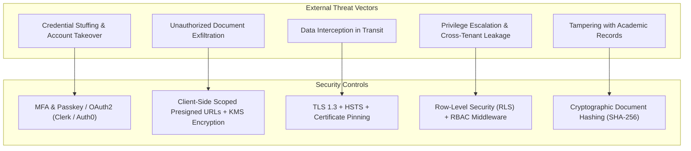
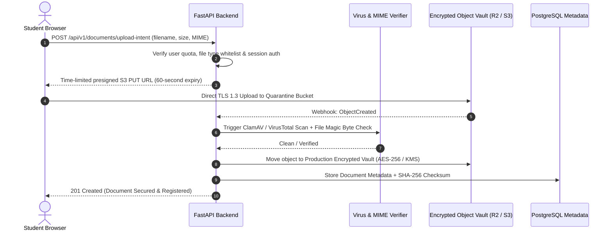
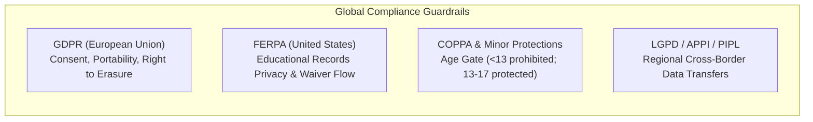

# Security & Privacy Architecture

> **Date:** November 23, 2026
> **Status:** Technical Specification — Core Infrastructure & Compliance
> **Dependencies:** Universal Student Profile (doc 05), System Architecture (doc 14)

---

## 1. Security Philosophy & Threat Model

The platform processes sensitive student records: official academic transcripts, disciplinary records, national identification numbers, financial statements, and confidential letters of recommendation. Compromise of these assets exposes vulnerable youth to identity theft, academic sabotage, or immigration jeopardy.

### Core Security Mandates:
1. **Students Own Their Data:** Students maintain cryptographic and policy control over who can inspect, download, or reference their academic materials.
2. **Confidential Recommendations are Sacred:** Recommendation letters must remain completely confidential and strictly inaccessible to the student when a FERPA/institutional confidentiality waiver is signed.
3. **No Commercial Data Monetization:** Student personal data, academic records, and search queries will **never** be sold, brokered, or used for commercial advertising.
4. **Zero AI Training on Private Assets:** Uploaded student files and chat dialogs are excluded from external LLM model training.



---

## 2. Authentication & Role-Based Access Control (RBAC)

### 2.1 Identity Provider Strategy
The platform utilizes **Clerk** (or Auth0 enterprise tier) to offload core identity security, avoiding custom authentication anti-patterns:
* Passkey (FIDO2 / WebAuthn) and Social OAuth2 (Google, Apple, Microsoft).
* Multi-Factor Authentication (TOTP authenticator app and SMS fallback).
* Adaptive anomaly detection (brute-force rate limiting, suspicious IP geofencing).
* Session token handling via secure `httpOnly`, `SameSite=Strict`, encrypted JWT cookies with automated rolling refresh tokens.

### 2.2 Permissions Matrix

| Resource | Student (Owner) | School Counselor | Recommender | Parent / Guardian | Platform Admin |
|---|---|---|---|---|---|
| **Student Profile Demographics** | Full (Read/Write) | Read-Only (if authorized) | None | Read-Only (if authorized) | Read-Only (Audit) |
| **Official Transcripts & Courses** | Full (Read/Write) | Read-Only (if authorized) | None | Read-Only (if authorized) | Read-Only (Audit) |
| **Confidential Letters of Rec** | Metadata Only (Submitted status) | Metadata Only | Full (Write/Upload) | None | Encrypted Storage |
| **Application Checklists & Notes**| Full (Read/Write) | Read/Write (Collaboration) | None | Read-Only (if authorized) | Read-Only |
| **Financial / Tax Documents** | Full (Read/Write) | None (Default restricted) | None | Read/Write (Co-funder) | Read-Only (Audit) |
| **University Database & Rules** | Read-Only | Read-Only | Read-Only | Read-Only | Full (Read/Write) |

---

## 3. Cryptographic Storage & Document Vaulting

Uploaded files are processed through a hardened pipeline before resting in isolated, encrypted cloud object storage (Cloudflare R2 or AWS S3):



### Accessing Private Documents:
No public object URLs exist. When a student or authorized counselor views a document:
1. Backend verifies role permissions via PostgreSQL Row-Level Security (RLS).
2. Generates an ephemeral **Presigned GET URL** with a maximum lifetime of **5 minutes**.
3. All document downloads are logged in immutable audit tables.

---

## 4. International Regulatory Compliance



### 4.1 GDPR (General Data Protection Regulation)
* **Lawful Basis:** Explicit affirmative consent for processing academic profiles; contractual necessity for admissions portal routing.
* **Right to Erasure (Article 17):** Students can execute a full account deletion. An asynchronous worker cascades deletions across profile tables, purges S3 files, anonymizes audit IDs, and issues a certified completion receipt within 72 hours.
* **Data Portability (Article 20):** One-click export bundles profile data into standardized JSON, and all uploaded transcripts into a secure ZIP archive.

### 4.2 FERPA (Family Educational Rights and Privacy Act)
* **Confidentiality Waiver Workflow:** When requesting recommendation letters, students must electronically complete a waiver stating whether they waive their legal right to review the submitted recommendation.
* If waived, the system cryptographically prevents the student from viewing the uploaded file, displaying only delivery timestamps.

### 4.3 Safeguards for Minors (Under 18)
* **Strict Minimum Age Gate:** The platform prohibits registration for children under 13 years old (COPPA compliance).
* **Ages 13–17 Default Privacy Profile:**
  * Profile visibility default is set to maximum privacy.
  * Public directory search is permanently disabled.
  * Parent/Guardian linking requires mutual dual-confirmation.

---

## 5. Audit Logging & Anomaly Detection

All security-sensitive operations generate immutable audit records:

```sql
CREATE TABLE audit_logs (
    id UUID PRIMARY KEY DEFAULT gen_random_uuid(),
    timestamp TIMESTAMPTZ DEFAULT NOW(),

    actor_id UUID REFERENCES users(id),
    actor_ip INET NOT NULL,
    user_agent TEXT,

    event_type VARCHAR(50) NOT NULL,
    -- 'auth.login_success', 'auth.failed_attempt', 'document.access', 'document.delete',
    -- 'profile.permission_grant', 'profile.permission_revoke', 'account.deletion_request'

    resource_type VARCHAR(50) NOT NULL,
    resource_id UUID NOT NULL,

    action_details JSONB DEFAULT '{}',
    is_suspicious BOOLEAN DEFAULT FALSE
);

CREATE INDEX idx_audit_actor ON audit_logs(actor_id, timestamp);
CREATE INDEX idx_audit_event ON audit_logs(event_type, timestamp);
```

### Automated Threat Triggers:
* **Brute-Force Rate Limiting:** Exceeding 5 failed login attempts in 10 minutes locks the IP and triggers MFA challenges.
* **Impossible Travel Anomaly:** Logins from geographically distant locations within impossible time intervals automatically invalidate active sessions and require email re-verification.
* **Mass Document Download Prevention:** Automated scraping detection blocks any session attempting to download more than 10 documents in under 60 seconds.
