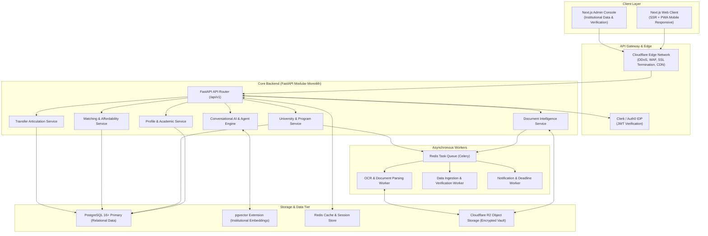
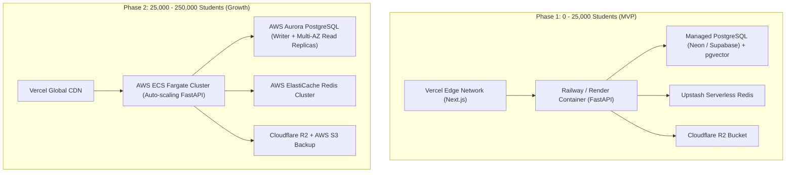

# System Architecture Specification

> **Date:** November 23, 2026
> **Status:** Core Technical Architecture Specification
> **Dependencies:** All previous specifications (docs 01–13)

---

## 1. Architectural Philosophy: The Modular Monolith

To avoid premature microservices complexity while ensuring future horizontal scaling, the platform adopts a **Modular Monolith** architecture:
* **Presentation Layer:** Next.js (App Router, Server-Side Rendering, React Server Components, TypeScript, Tailwind CSS, Radix UI).
* **Application & API Layer:** Python FastAPI (asynchronous, OpenAPI typed via Pydantic, modular service packages).
* **Primary Relational & Vector Datastore:** PostgreSQL 16+ with `pgvector` for unified relational and vector embeddings.
* **Cache & Message Broker:** Redis 7+ for low-latency session caching, rate-limiting counters, and task queue broker.
* **Background Processing:** Celery / Asyncio Worker pool for data ingestion, OCR document parsing, and email dispatches.
* **Encrypted Object Storage:** Cloudflare R2 (S3-compatible, zero egress costs) for document vaulting.



---

## 2. Frontend Architecture (Next.js App Router)

```text
frontend/
├── app/
│   ├── (marketing)/                 # Public high-conversion marketing pages
│   │   ├── page.tsx                 # Global University Discovery Homepage
│   │   ├── about/                   # Mission, Global Inclusivity & Transparency
│   │   ├── pricing/                 # Free vs. Premium Tiers
│   │   └── transfer-guide/          # SEO Pillar Landing Pages (CC to 4-year)
│   ├── (auth)/                      # Authentication integration (Clerk/Auth0)
│   │   ├── sign-in/[[...sign-in]]/
│   │   └── sign-up/[[...sign-up]]/
│   ├── (platform)/                  # Authenticated Student OS Workspace
│   │   ├── layout.tsx               # Persistent Sidebar, Universal Search, Top Nav
│   │   ├── dashboard/               # Application Progress, Deadlines, Widgets
│   │   ├── profile/                 # Universal Student Profile Editor (Sections 1-7)
│   │   ├── transfer/                # Dedicated Transfer Portal & Equivalency Explorer
│   │   ├── first-year/              # Dedicated First-Year Application Portal
│   │   ├── universities/            # Global Discovery Directory, Map View, Profiles
│   │   ├── applications/            # Per-University Application Workspaces
│   │   │   └── [applicationId]/     # Checklists, Supplemental Essays, Portal Links
│   │   ├── documents/               # Document Vault, Transcript Upload, OCR Status
│   │   ├── scholarships/            # Global Scholarship Search & Matching
│   │   ├── ai-counselor/            # Multilingual AI Guidance Chat Interface
│   │   └── settings/                # Security, FERPA/GDPR Export, Privacy Grants
│   ├── (admin)/                     # Institutional Data Ops & Verification Hub
│   │   └── admin/                   # Ingestion Queues, Broken Links, Verification
│   └── api/                         # BFF (Backend-For-Frontend) Edge Proxies
├── components/
│   ├── ui/                          # Radix UI primitives + Tailwind styling
│   ├── profile/                     # Specialized Profile Field Inputs (International)
│   ├── applications/                # Interactive Checklists, Progress Rings
│   ├── transfer/                    # Side-by-side Course Articulation Tables
│   └── ai/                          # Chat dialogs, Citation pills, Thinking spinners
└── lib/
    ├── api-client.ts                # Typed Fetch client with JWT injection
    ├── stores/                      # Zustand state stores (lightweight UI state)
    └── hooks/                       # TanStack Query custom hooks
```

---

## 3. Backend Architecture (Python FastAPI)

```text
backend/
├── app/
│   ├── main.py                      # FastAPI Application Lifecycle & Middleware
│   ├── config.py                    # Pydantic BaseSettings Environment Configurations
│   ├── api/
│   │   ├── v1/
│   │   │   ├── api_router.py        # Master API Router
│   │   │   ├── auth.py              # Identity & Session Validation
│   │   │   ├── profiles.py          # Universal Profile CRUD & Export
│   │   │   ├── institutions.py      # University Search, Detail, & Comparison
│   │   │   ├── transfer.py          # Equivalency Queries & Articulation Data
│   │   │   ├── applications.py      # Application Workspaces & Checklists
│   │   │   ├── documents.py         # Presigned URLs, Upload Handlers, OCR Triggers
│   │   │   ├── scholarships.py      # Scholarship Search & Eligibility Filters
│   │   │   ├── matching.py          # Compatibility Scoring Engine
│   │   │   ├── ai_counselor.py      # Streaming Chat & Tool-Using Agent
│   │   │   └── admin.py             # Data Verification & Provenance Controls
│   ├── core/
│   │   ├── security.py              # Cryptographic utilities & JWT validation
│   │   ├── rbac.py                  # Role-based policy checks
│   │   └── exceptions.py            # Domain-specific HTTP exceptions
│   ├── models/                      # SQLAlchemy 2.0 Async ORM Models
│   │   ├── user.py
│   │   ├── profile.py
│   │   ├── institution.py
│   │   ├── course.py
│   │   ├── application.py
│   │   └── scholarship.py
│   ├── schemas/                     # Pydantic v2 Request/Response Validation Schemas
│   ├── services/                    # Business Logic Layer
│   │   ├── profile_service.py
│   │   ├── matching_service.py
│   │   ├── transfer_service.py
│   │   ├── document_service.py
│   │   └── ingestion_service.py
│   ├── ai/                          # Cognitive & Agent Infrastructure
│   │   ├── rag_engine.py            # Embedding generation & vector retrieval
│   │   ├── agent_runner.py          # Multi-step task planner & tool invoker
│   │   ├── prompts/                 # Versioned system prompts
│   │   └── parsers/                 # Vision OCR and transcript tabular extractors
│   └── workers/                     # Background Celery Task Definitions
│       ├── ocr_worker.py
│       ├── scraper_worker.py
│       └── reminder_worker.py
├── migrations/                      # Alembic Database Migrations
└── tests/                           # Pytest unit & integration test suites
```

---

## 4. Primary API Endpoints Structure

| Method | Route | Description |
|---|---|---|
| `GET` | `/api/v1/profile` | Retrieve student universal profile with completion metrics |
| `PATCH` | `/api/v1/profile` | Update personal, demographic, or academic preferences |
| `GET` | `/api/v1/institutions/search` | Fast faceted search with geo/tuition/major/type filters |
| `GET` | `/api/v1/institutions/{id}` | Verified institutional profile with costs and deadlines |
| `POST` | `/api/v1/transfer/check-equivalencies` | Compare completed courses to target institution catalog |
| `GET` | `/api/v1/applications` | List active application workspaces |
| `POST` | `/api/v1/applications` | Initialize application workspace and generate dynamic checklist |
| `POST` | `/api/v1/applications/{id}/redirect` | Record honest external portal redirect (`redirected_to_external_portal`, never submitted) |
| `POST` | `/api/v1/applications/{id}/report-submission` | Record self-reported submission (`student_reported_submitted`) |
| `POST` | `/api/v1/applications/{id}/evidence` | Attach Document Vault confirmation artifact (`pending` review) |
| `POST` | `/api/v1/applications/evidence/{id}/review` | RBAC-restricted verifier approval promoting to `submission_confirmed` |
| `GET` | `/api/v1/routing/directory` | Search verified institutional & centralized application portals |
| `POST` | `/api/v1/routing/validate-url` | Structural & SSRF safety validation for external application URLs |
| `POST` | `/api/v1/documents/upload-intent` | Issue time-limited presigned S3 upload URL |
| `GET` | `/api/v1/scholarships/matched` | Retrieve personalized matched scholarship portfolio |
| `POST` | `/api/v1/matching/recommendations` | Execute 4-dimensional compatibility matching |
| `POST` | `/api/v1/ai/counselor/chat` | Server-Sent Events (SSE) streaming conversational counselor |
| `POST` | `/api/v1/ai/agent/execute` | Execute multi-step application preparation workflow |

---

## 5. Deployment Topology & Scaling Roadmap



### Scaling Milestones:
1. **0 – 25K Users:** Lean serverless stack ($<\$500/\text{mo}$). Neon serverless branching for rapid migration testing, Vercel edge deployment, Cloudflare R2 storage.
2. **25K – 250K Users:** Migration of FastAPI to containerized AWS ECS Fargate behind an Application Load Balancer. Read-replicas for intensive university search traffic.
3. **250K – 1M+ Users:** Dedicated OpenSearch cluster for full-text and geo-search; localized read-replicas in North America, Europe, and Asia; multi-region data sovereignty enforcement for EU students.
