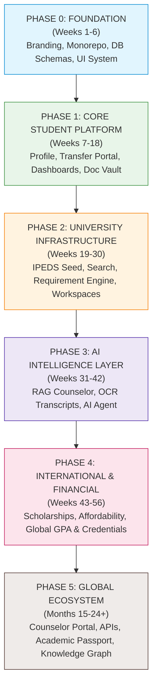

# Development Roadmap

> **Date:** November 23, 2026
> **Status:** Execution Blueprint — Multi-Phase Product Delivery
> **Core Mandate:** Architecture is global from Day 1; releases are phased and prioritized.

---

## 1. Roadmap Architecture & Phased Dependency Matrix

---

## 2. Phase-by-Phase Execution Plan

### Phase 0: Technical & Brand Foundation (Weeks 1–6)
* **Milestone 0.1: Legal & Brand Clearance:** Finalize brand name from the top recommendations (Admio, Talera, Compassia), conduct USPTO/EUIPO clearance, secure domain, and register Delaware C-Corp.
* **Milestone 0.2: Monorepo & Tooling Setup:** Initialize Turborepo with Next.js 15+ (frontend) and FastAPI (backend). Configure ESLint, Prettier, Black, mypy, and GitHub Actions CI/CD pipelines.
* **Milestone 0.3: Database & Migration Framework:** Provision PostgreSQL 16+ with `pgvector`. Apply core Alembic migrations for users, profiles, institutions, and document schemas.
* **Milestone 0.4: Identity & Design System:** Integrate Clerk for authentication. Implement base Tailwind CSS design system with Radix UI accessible primitives.

### Phase 1: Core Student Platform — Focus: Transfer Entry (Weeks 7–18)
* **Sprint 1–2 (Weeks 7–10): Universal Student Profile:**
  * Build the multi-section profile editor (Demographics, Multi-institutional enrollments, Courses, Activities).
  * Implement profile completion percentage calculator and client-side validation.
* **Sprint 3–4 (Weeks 11–14): Transfer Application Portal & Document Vault:**
  * Build transfer-specific coursework builder (tracking credit hours, term GPA, course status).
  * Implement Cloudflare R2 presigned URL upload pipeline with MIME type verification and virus scanning.
* **Sprint 5–6 (Weeks 15–18): Student Dashboard & Application Management:**
  * Interactive student dashboard displaying application progress rings, missing document alerts, and deadline countdowns.
  * Application workspace state machine implementation (Exploring $\rightarrow$ Planning $\rightarrow$ In Progress $\rightarrow$ Submitted).

### Phase 2: University Infrastructure & Requirements (Weeks 19–30)
* **Sprint 7–8 (Weeks 19–22): US University Data Ingestion:**
  * Ingest and clean ~4,000 Title IV accredited institutions from federal IPEDS datasets.
  * Populate verified tuition, room and board, Carnegie classifications, and basic contact info.
* **Sprint 9–10 (Weeks 23–26): Search & Discovery Engine:**
  * Implement PostgreSQL full-text search with faceted filtering (tuition brackets, location, institution type, programs).
  * Build institutional profile pages with side-by-side comparison tables (up to 4 institutions).
* **Sprint 11–12 (Weeks 27–30): Application Requirement Engine:**
  * Structure requirement templates for the top 200 US transfer-receiving institutions.
  * Implement dynamic checklist generation cross-referencing student profiles against institutional requirements.
  * Direct routing to official institutional application portals.

### Phase 3: AI Intelligence Layer (Weeks 31–42)
* **Sprint 13–14 (Weeks 31–34): RAG Conversational AI Counselor:**
  * Chunk and embed verified institutional data and requirements into `pgvector`.
  * Launch streaming multilingual AI counselor with strict source provenance citations.
* **Sprint 15–16 (Weeks 35–38): Document Intelligence & OCR:**
  * Implement Vision OCR pipeline for academic transcript parsing.
  * Build essay review assistant (prompt alignment, clarity, structural feedback; no ghostwriting).
* **Sprint 17–18 (Weeks 39–42): Transfer Articulation Engine:**
  * Integrate ASSIST.org California articulation data (115 Community Colleges $\leftrightarrow$ UC/CSU).
  * Implement Tier 1/2/3 course equivalency explorer with semantic course description matching.

### Phase 4: Financial & International Expansion (Weeks 43–56)
* **Sprint 19–20 (Weeks 43–46): Global Scholarship Engine:**
  * Seed 3,000+ verified institutional, foundation, and government scholarships.
  * Implement deterministic eligibility matching engine.
* **Sprint 21–22 (Weeks 47–50): Affordability & Net Price Calculator:**
  * Build granular out-of-pocket calculator including mandatory fees, insurance, and living costs.
  * Integrate live currency conversion for international applicants.
* **Sprint 23–24 (Weeks 51–56): International Education Intelligence & First-Year Launch:**
  * Deploy grading system conversion and credential recognition database for top 20 countries.
  * Open the First-Year Application Portal utilizing the existing universal data model.
  * Full localization into Spanish, French, and Haitian Creole.

### Phase 5: Global Ecosystem & API Layer (Months 15–24+)
* **Counselor & Advisor Portal:** Multi-student management, caseload monitoring, and progress reporting for school counselors.
* **Confidential Recommender Portal:** Secure upload and tracking of confidential letters of recommendation.
* **Institutional Admissions API:** The "Stripe of Admissions" pilot — authorized institutional ingestion of verified student profiles.
* **Global Academic Passport:** Digital credential verification and portable academic identity.

---

## 3. Team & Resource Allocation Plan

| Phase | Engineering | Product & Design | Data & Operations | Estimated Infrastructure Cost |
|---|---|---|---|---|
| **Phase 0** | 2 Full-Stack | 1 Product Designer | Founder / Domain Advisor | \$200 – \$500 / month |
| **Phase 1** | 2 Full-Stack, 1 Frontend | 1 Product Designer | 1 QA Engineer | \$500 – \$1,000 / month |
| **Phase 2** | 3 Full-Stack, 1 Data Eng | 1 Product Designer | 1 Data Verification Specialist | \$1,500 – \$2,500 / month |
| **Phase 3** | 3 Full-Stack, 1 ML/AI Eng | 1 Product Designer | 2 Data Verification Specialists | \$3,000 – \$5,500 / month |
| **Phase 4** | 4 Full-Stack, 1 ML/AI Eng | 1 Product Designer | 3 Data Specialists (Multilingual) | \$5,500 – \$9,000 / month |
| **Phase 5** | 6 Full-Stack, 2 ML/AI Eng | 2 Designers | Full Institutional Partnerships Team | \$10,000 – \$20,000 / month |

---

## 4. Key Success Metrics & "Definition of Done"

* **Phase 1 Done When:** A community college student can create a profile, input 40+ credits across two institutions, upload transcripts to encrypted vault, and manage 5 active transfer applications with live progress rings.
* **Phase 2 Done When:** 4,000+ US institutions are searchable in $<150\text{ms}$; top 200 transfer destinations have verified requirements; and checklists accurately flag satisfied vs. missing courses.
* **Phase 3 Done When:** The AI counselor answers transfer requirement queries in $<2\text{s}$ with 100% cited sources; OCR parses standard US college transcripts with $>90\%$ accuracy; and California CC-to-UC equivalencies match ASSIST.org data.
* **Phase 4 Done When:** Students receive accurate Net Cost forecasts within 5% of actual institutional Cost of Attendance; scholarships are matched with zero false-positive nationality errors; and international credentials from France, Haiti, India, and the UK can be evaluated against US admissions criteria.
