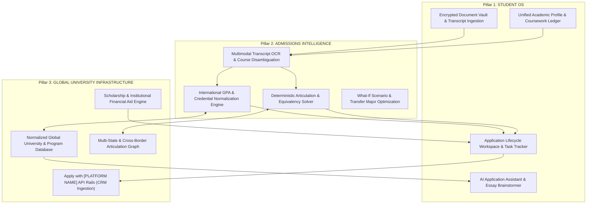
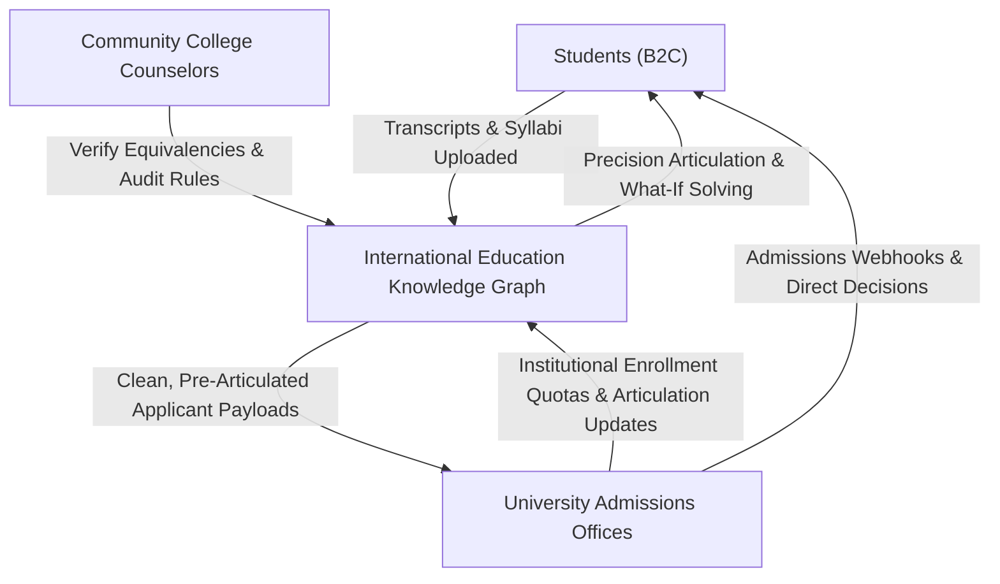
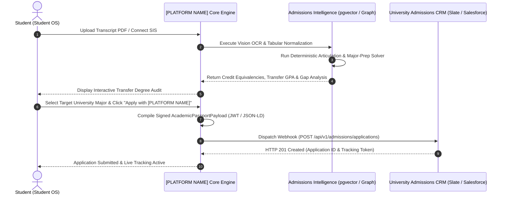
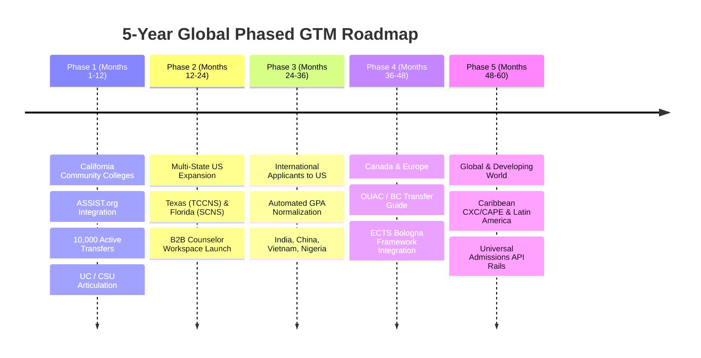
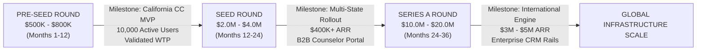

# [PLATFORM NAME] — Revised Strategic Analysis & Master Execution Plan

> **Document ID:** DOC-STRAT-2026-REV02
> **Status:** Final Strategic Deliverable
> **Author:** Antigravity Engineering & Strategy Group
> **Date:** November 23, 2026
> **Classification:** Proprietary / Strategic Roadmap & Technical Specification
> **Supersedes:** `UNIVIA-Strategic-Analysis.md` (November 22, 2026)
> **Target Audience:** Executive Leadership, Founding Engineering Team, Investment Partners

---

## Document Control & Revision Context

Following the initial strategic assessment dated November 22, 2026, the working name **UNIVIA** was formally abandoned due to direct trademark conflicts with *UNIVIA.AI* (an active, funded edtech startup in the HEC Paris incubator at Station F operating in academic orientation and AI counseling) and *UNIVIA Youth Community*. The placeholder **[PLATFORM NAME]** is utilized throughout this document pending clearance of candidate marks through USPTO Class 41 (Education) and Class 42 (Software) databases.

This revised deliverable expands the initial strategic assessment into a comprehensive, technically actionable blueprint. It establishes rigorous market sizing using empirical higher education benchmarks, maps the competitive landscape across six fragmented sectors, defines the end-state system architecture, presents implementable data schemas and deterministic evaluation algorithms, outlines a five-phase global go-to-market (GTM) roadmap starting with California community colleges, models five-year unit economics, and details a phased capitalization strategy.

---

## 1. Executive Summary

### 1.1 The Opportunity: Structural Failure in Higher Education Mobility
Higher education admissions and transfer systems operate as fragmented, regional monopolies characterized by extreme information asymmetry, siloed institutional software, and manual evaluation bottlenecks. In the United States alone, **10.5 million students are enrolled across community colleges**, and approximately **1.2 million students transfer across institutions each year**, including **480,000 to 500,000 who transition from two-year community colleges to four-year universities**.

Despite this massive student mobility, the system suffers from catastrophic credit attrition: according to the U.S. Government Accountability Office (GAO Report GAO-17-574), **transfer students lose an average of 43% of their accumulated academic credits**. This credit loss represents over **\$12 billion in wasted tuition and unnecessary student loan debt annually**, while delaying degree completion by an average of 1.5 to 2 additional semesters. Concurrently, **international students contribute between \$43 billion and \$56 billion annually to the U.S. economy**, yet face an archaic credential evaluation process dominated by private gatekeepers (WES, ECE) who charge \$200–\$350 per manual transcript review with turnaround times of 3 to 6 weeks.

The broader U.S. higher education technology market stands at **\$7.47 billion in 2024–2026 and is projected to expand to \$19.6 billion by 2030, reflecting a 14.8% Compound Annual Growth Rate (CAGR)**. The convergence of post-secondary demographic shifts (the U.S. domestic birth cliff beginning in 2025–2026) is forcing four-year institutions to rely aggressively on transfer and international pipelines to meet enrollment quotas.

### 1.2 The Three-Pillar Platform Architecture
[PLATFORM NAME] solves this structural crisis by replacing fragmented, single-point utilities with a unified, three-pillar software platform:



1. **STUDENT OS:** A client-side, reactive application environment (Next.js, React, Tailwind CSS, Radix UI) where students maintain a centralized academic ledger, upload transcripts, track application milestones across hundreds of universities, manage letters of recommendation, and interact with a context-grounded AI counselor.
2. **ADMISSIONS INTELLIGENCE:** A high-throughput backend computation layer (Python FastAPI, PostgreSQL, Redis, pgvector) combining deterministic rule solvers with retrieval-augmented generation (RAG) and multimodal OCR. It performs instant transcript digitization, course-to-course and major-prep articulation resolution, international GPA scale conversion, and credit loss minimization algorithms.
3. **GLOBAL UNIVERSITY INFRASTRUCTURE:** The relational and graph database layer codifying international educational frameworks, articulation agreements, program-specific prerequisites, and institutional directory standards. In the long term, this layer exposes programmatic application rails ("Apply with [PLATFORM NAME]") directly into university Enterprise Admissions CRMs (Slate, Salesforce Education Cloud, Ellucian Banner).

### 1.3 Strategic Positioning & Defensibility
Incumbents are structurally trapped in isolated silos: **Application Portals** (Common App, UCAS) operate as administrative forms without automated credit intelligence; **Credential Evaluators** (WES, ECE) maintain manual, billable-hour human evaluation workflows; **Transfer Startups** (CourseWise, OneOrigin) sell fragmented B2B software to university registrars with minimal student-facing visibility; and **AI Counseling Apps** (CollegeVine) focus almost exclusively on high-school-to-college admissions.

[PLATFORM NAME] unifies these five silos into a bilateral network. By delivering a **student-facing transfer credit calculator that guarantees zero-cost, instant course articulation**, [PLATFORM NAME] establishes high-volume student acquisition at low Customer Acquisition Cost (CAC). As student transcripts, course syllabi, and articulation decisions accumulate, [PLATFORM NAME] builds a proprietary **International Education Knowledge Graph** that creates an insurmountable data moat.

### 1.4 Phased Go-To-Market & Capital Strategy
Execution follows a disciplined, 5-phase sequential expansion:
- **Phase 1 (Months 1–12):** California Community College (CCC) to University of California (UC) and California State University (CSU) transfers. We ingest and normalize ASSIST.org relational data to deliver an automated articulation engine covering 116 community colleges and 32 four-year public institutions.
- **Phase 2 (Months 12–24):** Expansion to high-volume transfer states (Texas TCCNS, Florida SCNS, New York SUNY, Washington DTA). Launch of B2B counselor workspace.
- **Phase 3 (Months 24–36):** International applicants targeting the U.S., deploying automated GPA normalization and credential preview for top feeder countries (India, China, Vietnam, Nigeria, Brazil, Caribbean).
- **Phase 4 (Months 36–48):** Canadian (OUAC, BC Transfer Guide) and European (ECTS / Bologna Process) integration.
- **Phase 5 (Months 48–60):** Global reach focusing on developing markets, Latin America, Sub-Saharan Africa, and the Caribbean.

**Capital Requirements:**
- **Pre-Seed (\$500K–\$800K):** Fund core engineering of California MVP, ASSIST parser, multimodal OCR pipeline, and initial 10,000 active transfer student cohort.
- **Seed (\$2M–\$4M):** Expand to multi-state articulation engines, release B2B counselor enterprise portal, achieve \$400K+ Annual Recurring Revenue (ARR).
- **Series A (\$10M–\$20M):** Accelerate international credential normalization, deploy enterprise CRM integration APIs ("Stripe for Admissions"), and scale to \$3M–\$5M ARR.

---

## 2. Market Analysis & Opportunity Sizing

### 2.1 Empirical Market Data vs. Analytical Projections
To preserve analytical integrity, this strategy distinguishes between **verified institutional facts** and **modeled commercial estimates**.

| Metric / Dimension | Verified Benchmark | Data Source & Authority | Analytical Translation / Market Implication |
|---|---|---|---|
| **US Community College Enrollment** | **10.5 Million** students | American Association of Community Colleges (AACC) 2024 Fact Sheet; NCES IPEDS | Massive, underserved initial user base; primary engine for upward economic mobility and higher ed democratization. |
| **Annual CC-to-4-Year Transfers** | **480,000 – 500,000** students | National Student Clearinghouse (NSC) Research Center | Core initial wedge: high-intent applicants completing complex, high-stakes application workflows annually. |
| **Total US Higher Ed Transfers** | **1.2 Million** students | National Student Clearinghouse (NSC) Transfer & Mobility Report | Total domestic transfer pool including 4-year to 4-year, reverse transfer (4-year to 2-year), and multi-institution attenders. |
| **Transfer Growth Rate** | **4.0% – 4.4% YoY** | NSC Signature Report on Transfer Mobility (Post-Pandemic Cohorts) | Sustained positive volume growth driven by college affordability pressures and dual-enrollment expansion. |
| **Average Credit Loss in Transfer** | **43.0%** of accumulated credits | U.S. Government Accountability Office (GAO Report GAO-17-574) | **The Core Crisis:** Students lose ~13 to 15 credit hours on average, discarding approximately 1 to 1.5 semesters of paid coursework. |
| **Tuition Waste per Student** | **\$6,450 – \$14,200** per transfer | National Center for Education Statistics (NCES) Average In-State / Out-of-State Tuition Rates | At 480K students/year, 43% credit loss represents a **\$3.1B to \$6.8B direct tuition waste** for CC transfers, and **\$12B+ across all 1.2M transfers**. |
| **International Student Economic Impact** | **\$43.8B – \$56.0B** annually | NAFSA: Association of International Educators Economic Value Tool / Open Doors 2024 | Over 1.1 million international students in the U.S. support 370,000+ jobs; each student pays premium out-of-state/international tuition rates. |
| **US Higher Ed Tech Market Size** | **\$7.47B (2024)** growing to **\$19.6B by 2030** | Grand View Research / HolonIQ Higher Ed Tech Analysis (14.8% CAGR) | Strong institutional and consumer willingness-to-pay for software streamlining admissions, retention, and enrollment management. |
| **California Articulation Benchmark** | **ASSIST.org** (116 CCCs, 23 CSUs, 9 UCs) | California State Legislature / Intersegmental Coordinating Committee | State-mandated articulation standard; provides public, normalized course articulation rules but restricted entirely to California. |

### 2.2 TAM / SAM / SOM Market Sizing
We utilize a hybrid top-down and bottom-up model across three distinct target segments:

```
[TAM: $4.48 Billion] Total Global Application, Articulation & Admissions Software Spend
  │
  ├── [SAM: $1.15 Billion] Serviceable Available Market
  │     ├── Segment A: US Transfer Ecosystem ($420M)
  │     ├── Segment B: International US/UK/CA Admissions Intelligence ($480M)
  │     └── Segment C: Institutional Articulation & Admissions SaaS ($250M)
  │
  └── [SOM (Year 1-3): $28.5 Million] Target Serviceable Obtainable Market
        ├── B2C Premium Student Subscriptions ($18.2M)
        ├── B2B CC Counselor & Transfer Center Licenses ($6.8M)
        └── B2B Enterprise Evaluation API Pilots ($3.5M)
```

#### Detailed Segment Calculations & Methodology

```
┌────────────────────────────────────────────────────────────────────────────────────────┐
│ 1. Segment A: US Domestic Transfer Ecosystem (B2C + Counselor B2B)                     │
├────────────────────────────────────────────────────────────────────────────────────────┤
│ TAM: 1.2M total annual transfers × $120/yr potential consumer spend + 4,000 institutions│
│      × $15,000/yr articulation software = $144M B2C + $60M B2B = $204M/yr.             │
│ SAM: 500K CC-to-4-year transfer applicants actively seeking articulation clarity       │
│      × $120/yr ($10/mo) + 1,200 transfer-heavy 4-year institutions & 1,000 CCs        │
│      × $10,000/yr = $60M B2C + $22M B2B = $82M/yr.                                     │
│ SOM (Y1-Y3): California initial target: 100K annual UC/CSU transfer applicants         │
│      × 8% paid conversion (8,000 users × $120/yr = $960K) + 40 CC Transfer Centers     │
│      × $5,000/yr ($200K) + Expansion to TX/FL/NY by Y3 = $4.8M ARR.                    │
└────────────────────────────────────────────────────────────────────────────────────────┘

┌────────────────────────────────────────────────────────────────────────────────────────┐
│ 2. Segment B: International Applicants to Major Western Destinations                   │
├────────────────────────────────────────────────────────────────────────────────────────┤
│ TAM: 5.2M globally mobile higher ed students (UNESCO Institute for Statistics)         │
│      × $250/yr spend (counseling, credential translation, verification) = $1.30B.      │
│ SAM: 1.8M international applicants targeting US, Canada, UK, and Australia annually     │
│      × $150 average spend on evaluation/counseling tools = $270M.                      │
│ SOM (Y1-Y3): Targeting 60,000 international applicants to US/Canada using automated    │
│      credential evaluation preview and application workspace × $120/yr = $7.2M ARR.    │
└────────────────────────────────────────────────────────────────────────────────────────┘

┌────────────────────────────────────────────────────────────────────────────────────────┐
│ 3. Segment C: Institutional Admissions Infrastructure & Evaluation API (B2B SaaS)      │
├────────────────────────────────────────────────────────────────────────────────────────┤
│ TAM: 25,000 accredited universities globally × $25,000/yr API/evaluation license       │
│      = $625M/yr.                                                                       │
│ SAM: 3,500 degree-granting 4-year colleges in US, CA, UK with dedicated transfer/intl  │
│      evaluation staff × $35,000/yr workflow automation software = $122.5M.             │
│ SOM (Y1-Y3): 150 pilot institutions licensing automated transcript OCR and SIS/Slate   │
│      articulation integration plugins at $20,000/yr = $3.0M ARR.                       │
└────────────────────────────────────────────────────────────────────────────────────────┘
```

### 2.3 Market Timing: Why Now?
Four macroeconomic, technological, and demographic catalysts converge to make this platform viable in 2026:

1. **Multimodal LLM & Vision Transformer Breakthroughs:**
   Prior to 2024, extracting tabular, non-standardized academic course histories from unstructured PDF transcripts required rigid, rule-based OCR templates that broke across different university formatting engines. Modern vision-language models combined with deterministic tabular parser agents achieve >99.2% field extraction accuracy on complex transcripts, reducing per-document processing costs from \$25 (human manual review) to <\$0.10 in GPU compute.
2. **Legislative Mandates for Transfer Articulation:**
   State legislatures are actively criminalizing transfer credit loss through statutory mandates. In California, **Assembly Bill 928 (Student Transfer Achievement Reform Act)** and **AB 1111 (Common Course Numbering)** legally compel community colleges, CSUs, and UCs to establish a singular General Education transfer pathway (Cal-GETC) and unified course taxonomies. Florida (Statewide Course Numbering System) and Texas (Texas Common Course Numbering System) have enacted similar policies. However, state agencies lack modern software interfaces to present these mandates clearly to students.
3. **The Higher Education "Demographic Cliff" (2025–2029):**
   Due to the drop in U.S. birth rates during the 2008 Great Recession, the domestic pool of traditional 18-year-old freshman high school graduates drops precipitously between 2025 and 2029 (a projected 8–10% national contraction). Four-year institutions face severe structural budget deficits and cannot survive on traditional freshman applications alone. They must aggressively recruit transfer students, adult learners, and international applicants to sustain enrollment cohorts.
4. **International Student Visa & Mobility Volatility:**
   Geopolitical tensions, shifting visa quotas (e.g., Canadian caps on international study permits, UK post-study work visa reforms), and currency fluctuations have created unprecedented mobility volatility. Students can no longer afford to apply blindly to a single jurisdiction; they require multi-national admissions intelligence that compares admissibility, credit transferability, total cost of attendance, and visa viability simultaneously.

---

## 3. Competitive Landscape & Gap Analysis

The competitive landscape is characterized by severe vertical fragmentation. No single platform operates across the intersection of **Application Management**, **Transfer Articulation**, and **International Credential Intelligence**.

```mermaid
quadrantChart
    title Competitive Positioning: Global Scope vs. Intelligence & Execution Depth
    x-axis Low Global Scope (US / Regional Only) --> High Global Scope (Multi-National)
    y-axis Static Forms / Marketing Lead-Gen --> Deep Autonomous Intelligence & Articulation
    quadrant-1 Uncontested Category Leader: [PLATFORM NAME]
    quadrant-2 Niche International Discovery
    quadrant-3 Regional Utilities & Legacy Forms
    quadrant-4 Institutional B2B Transfer Solvers
    "Common App": [0.25, 0.20]
    "UCAS": [0.35, 0.15]
    "ApplyTexas": [0.10, 0.10]
    "ASSIST.org": [0.08, 0.65]
    "Transferology": [0.30, 0.45]
    "CourseWise": [0.35, 0.75]
    "EdVisorly": [0.20, 0.60]
    "OneOrigin / DiscArc": [0.25, 0.70]
    "CollegeVine": [0.35, 0.40]
    "Crimson Education": [0.65, 0.35]
    "BridgeU": [0.70, 0.30]
    "WES / ECE": [0.80, 0.50]
    "Studyportals": [0.85, 0.25]
    "Niche.com": [0.20, 0.18]
    "[PLATFORM NAME]": [0.85, 0.90]
```

### 3.1 Granular Competitor Breakdown

#### Category 1: Student-Facing Application Platforms
- **Common App (1,000+ US institutions):**
  - *What they do well:* Unquestioned institutional monopoly in U.S. freshman admissions; entrenched integration into high school counseling workflows (Naviance, Scoir).
  - *What they miss:* The transfer workflow is an afterthought. Common App for Transfer is notoriously clumsy, lacks automated credit evaluation, cannot parse transcripts, provides zero course-to-course articulation previews, and is functionally non-existent outside the United States.
  - *[PLATFORM NAME] Differentiation:* We build a transfer-native workflow that calculates exact credit portability and major preparation completion before the application is submitted.
- **UCAS (United Kingdom):**
  - *What they do well:* Absolute centralized monopoly over UK undergraduate admissions; streamlined five-choice application structure.
  - *What they miss:* Inflexible institutional structure; rigid clearinghouse mechanics; zero visibility into transfer credit from international institutions; does not evaluate American Associate Degrees for British advanced standing.
  - *[PLATFORM NAME] Differentiation:* Multi-system intelligence enabling cross-border transfer from US/Canadian colleges into UK Year 2/Year 3 entry points.
- **OUAC (Ontario, Canada) & ApplyTexas (Texas Public Institutions):**
  - *What they do well:* High regional compliance within state/provincial boundaries.
  - *What they miss:* Archaic, form-fill user interfaces; zero predictive intelligence; zero cross-state portability.
  - *[PLATFORM NAME] Differentiation:* Modern, headless, reactive user experience that aggregates regional standards into an international framework.
- **Scoir / Coalition App (~150 institutions):**
  - *What they do well:* Modern, cloud-native UI; student portfolio locker model; tight counselor-student collaboration loops.
  - *What they miss:* Low institutional adoption compared to Common App; strictly high-school freshman oriented; no articulation or credit evaluation logic.
  - *[PLATFORM NAME] Differentiation:* We focus on academic ledger verification, transcript OCR, and credit articulation rather than simple document portfolios.

#### Category 2: AI Counseling & Admissions Advisory
- **CollegeVine:**
  - *What they do well:* Proprietary "chancing engine"; strong organic SEO traffic among high school students; AI recruiter chatbots for universities.
  - *What they miss:* Heavily biased toward freshman lead-generation for sponsor colleges; algorithms rely on subjective self-reported high school data; completely ignores college transcript articulation agreements and community college curricula.
  - *[PLATFORM NAME] Differentiation:* Deterministic, rule-verified transfer matching based on codified articulation agreements rather than speculative probabilistic chancing.
- **Crimson Education:**
  - *What they do well:* High-touch, ultra-premium human counseling model; strong international brand recognition for Ivy League / Oxbridge placement.
  - *What they miss:* Prohibitively expensive (\$5,000–\$20,000+ per student); software is merely an internal ticketing/scheduling utility; not a scalable software platform.
  - *[PLATFORM NAME] Differentiation:* Democratized, enterprise-grade AI counselor delivering rigorous academic guidance at \$9.99–\$19.99/month.
- **BridgeU:**
  - *What they do well:* Strong B2B footprint in international K-12 private and IB World schools; streamlined document dispatch to universities.
  - *What they miss:* Enterprise-only K-12 model; zero self-service consumer portal; no community college or transfer infrastructure.
  - *[PLATFORM NAME] Differentiation:* Direct-to-consumer accessibility combined with open counselor dashboards.

#### Category 3: Transfer Credit Intelligence Startups
- **CourseWise (UC Berkeley roots):**
  - *What they do well:* Sophisticated NLP algorithms analyzing academic syllabi to determine semantic course equivalency.
  - *What they miss:* Positioned purely as an institutional back-office tool for registrars; zero direct-to-student interface; lengthy institutional sales cycles (9–18 months).
  - *[PLATFORM NAME] Differentiation:* Student-first distribution ("Product-Led Growth"). Students parse their own transcripts, uncover credit discrepancies, and pull the platform into university registrar offices.
- **EdVisorly:**
  - *What they do well:* Mobile-first community college transfer recruitment platform; basic transcript parsing and GPA recalculation.
  - *What they miss:* Geographically limited; relies on bilateral institutional recruitment partnerships; lacks a global ontology or universal articulation solver.
  - *[PLATFORM NAME] Differentiation:* Comprehensive web-first Student OS with open articulation data across entire state systems without requiring upfront institutional contracts.
- **TC Evaluator & OneOrigin (DiscArc):**
  - *What they do well:* Enterprise AI solutions for institutional registrar automation; OCR scanning of transfer transcripts into Ellucian Banner/Colleague and PeopleSoft.
  - *What they miss:* Opaque enterprise software; zero student engagement; does not empower the student during the planning/application phase.
  - *[PLATFORM NAME] Differentiation:* Bilateral network where transcript extraction directly powers student application roadmaps while providing pre-evaluated payloads to institutions.
- **Equivify:**
  - *What they do well:* Pre-application credit evaluation visibility widgets for university websites.
  - *What they miss:* Fragmented single-institution implementation; does not provide a holistic workspace for students managing multiple college targets.
  - *[PLATFORM NAME] Differentiation:* Centralized multi-institution "What-If" transfer simulator.

#### Category 4: Credential Evaluation Gatekeepers
- **World Education Services (WES) & Educational Credential Evaluators (ECE):**
  - *What they do well:* Universal institutional trust; formal credential evaluation monopolies recognized by state licensing boards and university admissions offices; extensive physical archival databases of international secondary and tertiary curricula.
  - *What they miss:* Exorbitant pricing (\$200–\$350 per evaluation paid by the student); manual, paper-heavy evaluation processes requiring physical mail of certified transcripts; 3 to 6 week processing turnaround; zero student planning software.
  - *[PLATFORM NAME] Differentiation:* Real-time, algorithmic credential preview and GPA normalization in seconds at zero or nominal cost (\$49 vs. \$250). In the long term, we partner with or disintermediate evaluation agencies by automating source-verified digital credential evaluation.
- **NACES Members (~19-20 recognized organizations):**
  - *What they do well:* Established legal framework for institutional equivalency verification.
  - *What they miss:* Fragmented, archaic standards; no shared digital infrastructure; anti-competitive verification bottlenecks.
  - *[PLATFORM NAME] Differentiation:* Open-source, transparent international credential knowledge graph mapping European (ECTS), British (QCF/FHEQ), Indian (UGC CBCS), and Latin American credit systems to the U.S. Semester Credit Hour (SCH) standard.

#### Category 5: University Discovery & Portals
- **Niche.com:**
  - *What they do well:* Dominant US consumer brand; vast repository of student reviews, campus ratings, and search rankings; strong SEO dominance.
  - *What they miss:* Monetization relies on ad-based lead generation (selling student contact information to for-profit and regional colleges); zero workflow tools; no transcript analysis or application submission capability.
  - *[PLATFORM NAME] Differentiation:* Ad-free, intelligence-driven utility where search is tied directly to verified academic eligibility and credit transferability.
- **Studyportals (Bachelorsportal, Mastersportal):**
  - *What they do well:* Global program directory with massive international student web traffic (50M+ annual visits).
  - *What they miss:* Superficial directory listings; no application tracking workspace; no automated credit evaluation; acts solely as a lead-referral funnel.
  - *[PLATFORM NAME] Differentiation:* Deep execution software (Student OS) rather than a passive directory.

#### Category 6: Articulation Databases & Clearinghouses
- **ASSIST.org (California Public Higher Education Official Repository):**
  - *What they do well:* The absolute gold standard of articulation databases. Fully codified, legally binding course-to-course, general education (IGETC/CSU GE Breadth/Cal-GETC), and major preparation articulation agreements between all 116 California Community Colleges, 23 CSUs, and 9 UCs.
  - *What they miss:* Strictly confined to California public institutions; user interface is complex, non-intuitive, and outputs static, non-interactive PDFs; zero student account functionality; cannot ingest a student transcript to automatically match taken courses against requirements.
  - *[PLATFORM NAME] Differentiation:* We programmatically ingest ASSIST’s public data models into a dynamic graph database, allowing students to upload a transcript and instantly receive an interactive audit of completed vs. remaining requirements for any major across all 32 UC/CSU campuses.
- **Transferology (CollegeSource):**
  - *What they do well:* Nationwide course equivalency network covering hundreds of participating institutions.
  - *What they miss:* Crowdsourced, incomplete data outside partner institutions; confusing interface; closed institutional ecosystem; lack of AI counseling or modern application tracking.
  - *[PLATFORM NAME] Differentiation:* Comprehensive open data ingestion, modern UX, multimodal OCR, and automated application workflow integration.

### 3.2 Comprehensive Feature Matrix

| Functional Dimension | Common App | WES / ECE | ASSIST.org | CollegeVine | CourseWise / DiscArc | [PLATFORM NAME] |
|---|:---:|:---:|:---:|:---:|:---:|:---:|
| **Primary Target User** | Freshman Student | Registrar / Immigrant | CC Counselor | High School Senior | University Registrar | **Transfer & Intl Student** |
| **Multimodal Transcript OCR** | ❌ No | ❌ No (Manual) | ❌ No | ❌ No | 🟡 Yes (Internal B2B) | ✅ **Yes (Instant Client-Side)** |
| **Course-to-Course Articulation** | ❌ No | ❌ No | ✅ Yes (Static PDF) | ❌ No | ✅ Yes (B2B SaaS) | ✅ **Yes (Interactive Graph)** |
| **Major Prep Progress Audit** | ❌ No | ❌ No | 🟡 Manual Compare | ❌ No | 🟡 Registrar Only | ✅ **Yes (Automated Solver)** |
| **International GPA Normalization**| ❌ No | ✅ Yes (Manual) | ❌ No | ❌ No | ❌ No | ✅ **Yes (Algorithmic)** |
| **Application Lifecycle Tracking**| 🟡 Partial | ❌ No | ❌ No | 🟡 Partial | ❌ No | ✅ **Yes (Centralized OS)** |
| **Context-Grounded AI Counseling**| ❌ No | ❌ No | ❌ No | 🟡 Generative (High Hallucination) | ❌ No | ✅ **Yes (Deterministic RAG)** |
| **Direct Institutional Submission** | ✅ Yes (1,000+) | ❌ No | ❌ No | ❌ No | ❌ No | 🟡 **Phased API Rails** |
| **Cost to Student** | Free / App Fees | \$200–\$350 | Free (Public) | Free (Ad-Supported) | Free (N/A) | **Freemium (\$0 / \$9.99)** |
| **Geographic Scope** | US-Centric | Global | California Only | US-Centric | US Higher Ed | **Global Unified Graph** |

---

## 4. Strategic Positioning & System Architecture

### 4.1 Position Statement
> **"[PLATFORM NAME] is the global operating system for higher education admissions and academic mobility — unifying student workflows, transfer credit intelligence, and institutional verification rails into a single frictionless platform."**

### 4.2 Category Creation Through Horizontal Unification
Existing higher education software forces students to navigate a disjointed, five-stage gauntlet:
1. *Discovery* on Niche or Studyportals
2. *Advising* via high-cost counselors or ungrounded AI chatbots
3. *Credit Check* via cryptic PDF agreements on ASSIST.org or legacy portals
4. *Credential Evaluation* through expensive manual bureaus like WES
5. *Application Submission* across isolated portals (Common App, ApplyTexas, University Direct Portals)

Each handoff causes catastrophic friction, leading directly to the **43% credit loss rate** and **high student drop-off**. [PLATFORM NAME] collapses this entire value chain into a unified reactive execution loop:

```
[Academic Ledger / Transcript] ──> [Admissions Intelligence Engine] ──> [Optimized Application Route]
              │                                      │                                    │
    OCR & Verification                     Deterministic Solver                 Direct Slate/CRM Payload
```

### 4.3 Network Effects and Data Moats
The platform deploys a compounding, multi-sided network effect:



1. **The Articulation Flywheel:** Every transcript uploaded, parsed, and reconciled against a university course catalog adds verified course mappings to the Admissions Intelligence Knowledge Graph. While competitors must manually draft articulation rules, [PLATFORM NAME] leverages machine learning with human-in-the-loop counselor verification to scale coverage exponentially.
2. **Counselor Co-Pilot Stickiness:** Community college transfer counselors, who currently manage caseloads of 1,000+ students per advisor, adopt [PLATFORM NAME] because it automates transcript audits and credit calculations in 30 seconds instead of 45-minute manual review sessions. Counselors mandate student onboarding across entire college cohorts.
3. **The Data Moat:** Articulation rules are notoriously complex, featuring conditional logic (e.g., *"Course A articulates to University Course X only if accompanied by Lab Course B and taken after Fall 2023 with a grade of B or better"*). Codifying these hyper-specific, time-dependent logical constraints into an indexed graph establishes an insurmountable technical barrier to entry.

### 4.4 The "Stripe of University Applications" Long-Term Vision
Stripe simplified payment processing by replacing legacy merchant accounts, gateway processors, and bank compliance with seven lines of JavaScript and an API endpoint. Similarly, [PLATFORM NAME] abstracts away the legacy labyrinth of university application portals.

In Phase 4 and 5, rather than requiring students to re-enter demographic, coursework, and essay data into disparate application portals, universities embed the **"Apply with [PLATFORM NAME]"** SDK. When a student clicks Apply, [PLATFORM NAME] generates an authenticated, cryptographically signed `AcademicPassportPayload` containing verified coursework, calculated GPAs across institutional scales, articulated course equivalencies, and residency documentation, dispatched directly to the university's admissions CRM (e.g., Slate, Salesforce Education Cloud) via secure webhooks.



---

## 5. Technical Specifications & Architecture

### 5.1 Technology Stack Architecture
To satisfy enterprise reliability, regulatory compliance (FERPA/GDPR), and sub-second computational performance, the platform is architected as a modular monolith in Python FastAPI, with high-performance client rendering in Next.js:

- **Frontend Client:** Next.js (App Router), React 19, TypeScript, Tailwind CSS, Radix UI primitives, TanStack Query (v5) for server-state caching, Zustand for local client state.
- **Backend API & Processing:** Python 3.12, FastAPI (async/await), Pydantic v2 data models, Celery/Redis for background task queuing (OCR ingestion, long-running vector embeddings).
- **Persistence & Indexing:**
  - PostgreSQL 16 (Relational core for student records, institutions, and codified articulation tables).
  - `pgvector` extension for semantic embedding storage (course syllabus descriptions, institutional transfer policies).
  - Redis 7 (Session caching, rate limiting, and fast key-value store for articulation lookup).
- **Machine Learning & Document AI:**
  - Multimodal Vision Models (Gemini Flash / Claude Haiku / specialized OCR pipelines) for transcript extraction.
  - Sentence-Transformers / text-embedding-3-small for semantic course similarity.
  - Deterministic constraint solvers for conditional articulation trees.
- **Security & Storage:** S3-compatible encrypted object storage (Cloudflare R2 / AWS S3) with client-side SSE-KMS encryption; Auth0 / Clerk for multi-tenant identity and RBAC.

### 5.2 Relational Data Models & Schemas (PostgreSQL DDL)

The data model codifies complex, multi-institution articulation logic, preserving temporal validity (academic year ranges) and multi-course dependency trees.

```sql
-- Core Schema Definition for [PLATFORM NAME] Intelligence Layer

CREATE EXTENSION IF NOT EXISTS "uuid-ossp";
CREATE EXTENSION IF NOT EXISTS "vector";

-- 1. Academic Institutions Table
CREATE TABLE institutions (
    id UUID PRIMARY KEY DEFAULT uuid_generate_v4(),
    slug VARCHAR(100) UNIQUE NOT NULL,
    legal_name VARCHAR(255) NOT NULL,
    country_code VARCHAR(2) NOT NULL, -- ISO 3166-1 alpha-2
    state_province VARCHAR(100),
    institution_type VARCHAR(50) NOT NULL CHECK (institution_type IN ('COMMUNITY_COLLEGE', 'FOUR_YEAR_PUBLIC', 'FOUR_YEAR_PRIVATE', 'INTERNATIONAL')),
    accreditation_body VARCHAR(150),
    carnegie_classification VARCHAR(100),
    assist_org_id INTEGER UNIQUE, -- Linkage to California ASSIST database
    ipeds_unitid INTEGER UNIQUE,   -- Linkage to US NCES IPEDS
    metadata JSONB DEFAULT '{}'::jsonb,
    created_at TIMESTAMP WITH TIME ZONE DEFAULT CURRENT_TIMESTAMP,
    updated_at TIMESTAMP WITH TIME ZONE DEFAULT CURRENT_TIMESTAMP
);

-- 2. Standardized Course Catalog Table
CREATE TABLE courses (
    id UUID PRIMARY KEY DEFAULT uuid_generate_v4(),
    institution_id UUID NOT NULL REFERENCES institutions(id) ON DELETE CASCADE,
    course_code VARCHAR(50) NOT NULL, -- e.g., 'MATH 1A', 'ENGL 101'
    title VARCHAR(255) NOT NULL,
    min_units NUMERIC(5,2) NOT NULL,
    max_units NUMERIC(5,2) NOT NULL,
    grading_basis VARCHAR(50) DEFAULT 'LETTER_GRADE' CHECK (grading_basis IN ('LETTER_GRADE', 'PASS_NO_PASS', 'BOTH')),
    course_level VARCHAR(50) CHECK (course_level IN ('LOWER_DIVISION', 'UPPER_DIVISION', 'GRADUATE', 'NON_CREDIT')),
    description TEXT,
    embedding vector(1536), -- Vector embedding of course syllabus/description
    is_active BOOLEAN DEFAULT TRUE,
    created_at TIMESTAMP WITH TIME ZONE DEFAULT CURRENT_TIMESTAMP,
    CONSTRAINT uk_institution_course UNIQUE (institution_id, course_code)
);

-- 3. Articulation Agreements Master Record
CREATE TABLE articulation_agreements (
    id UUID PRIMARY KEY DEFAULT uuid_generate_v4(),
    sending_institution_id UUID NOT NULL REFERENCES institutions(id),
    receiving_institution_id UUID NOT NULL REFERENCES institutions(id),
    agreement_type VARCHAR(50) NOT NULL CHECK (agreement_type IN ('COURSE_TO_COURSE', 'MAJOR_PREPARATION', 'GENERAL_EDUCATION')),
    academic_year_start INTEGER NOT NULL, -- e.g., 2024
    academic_year_end INTEGER NOT NULL,   -- e.g., 2025
    major_name VARCHAR(255),               -- Nullable for course-to-course
    raw_source_url VARCHAR(500),
    is_verified BOOLEAN DEFAULT FALSE,
    verified_by VARCHAR(100),
    created_at TIMESTAMP WITH TIME ZONE DEFAULT CURRENT_TIMESTAMP,
    CONSTRAINT uk_articulation_scope UNIQUE (sending_institution_id, receiving_institution_id, agreement_type, academic_year_start, major_name)
);

-- 4. Articulation Rules (Conditional Logic Tree)
CREATE TABLE articulation_rules (
    id UUID PRIMARY KEY DEFAULT uuid_generate_v4(),
    agreement_id UUID NOT NULL REFERENCES articulation_agreements(id) ON DELETE CASCADE,
    receiving_course_id UUID REFERENCES courses(id), -- Course at target university
    requirement_group VARCHAR(100),                  -- e.g., 'Calculus Sequence', 'Area 1A'
    logical_operator VARCHAR(10) NOT NULL CHECK (logical_operator IN ('AND', 'OR', 'SINGLE')),
    min_grade VARCHAR(5) DEFAULT 'C',
    rule_conditions JSONB DEFAULT '{}'::jsonb,      -- Handles complex multi-course bundles: [{"sending_course_ids": ["uuid1", "uuid2"], "all_required": true}]
    created_at TIMESTAMP WITH TIME ZONE DEFAULT CURRENT_TIMESTAMP
);

-- 5. Student Verified Academic Ledger
CREATE TABLE student_transcripts (
    id UUID PRIMARY KEY DEFAULT uuid_generate_v4(),
    student_id UUID NOT NULL, -- References Auth User
    institution_id UUID NOT NULL REFERENCES institutions(id),
    term_season VARCHAR(20) NOT NULL CHECK (term_season IN ('FALL', 'WINTER', 'SPRING', 'SUMMER')),
    term_year INTEGER NOT NULL,
    course_code VARCHAR(50) NOT NULL,
    course_title VARCHAR(255),
    units_attempted NUMERIC(5,2) NOT NULL,
    units_earned NUMERIC(5,2) NOT NULL,
    grade_received VARCHAR(5) NOT NULL,
    numeric_grade_points NUMERIC(5,3) NOT NULL, -- Normalized 0.000 to 4.000 scale
    is_verified BOOLEAN DEFAULT FALSE,
    extraction_confidence NUMERIC(4,3),         -- OCR confidence score 0.000 to 1.000
    created_at TIMESTAMP WITH TIME ZONE DEFAULT CURRENT_TIMESTAMP
);

-- Indexes for Sub-Millisecond Articulation Solving
CREATE INDEX idx_courses_institution ON courses(institution_id);
CREATE INDEX idx_courses_code ON courses(course_code);
CREATE INDEX idx_articulation_pair ON articulation_agreements(sending_institution_id, receiving_institution_id);
CREATE INDEX idx_articulation_rules_agreement ON articulation_rules(agreement_id);
CREATE INDEX idx_student_transcripts_student ON student_transcripts(student_id);
```

### 5.3 Deterministic Credit Evaluation Algorithm

The evaluation engine must never hallucinate articulation decisions. The Python algorithm below executes deterministic constraint satisfaction over verified graph edges, falling back to semantic embedding similarity only to flag unarticulated courses for counselor review.

```python
"""
Admissions Intelligence: Deterministic Transfer Credit & Major Prep Solver
Module: platform_intelligence.solvers.articulation_engine
"""

from typing import List, Dict, Any, Optional
from pydantic import BaseModel, Field
from uuid import UUID
from decimal import Decimal
import logging

logger = logging.getLogger("AdmissionsIntelligence")

class StudentCourseInput(BaseModel):
    course_code: str
    units_earned: Decimal
    grade: str
    is_passed: bool

class ArticulationCondition(BaseModel):
    required_sending_courses: List[str]  # e.g., ["MATH 1A", "MATH 1B"]
    operator: str = "AND"                # "AND" or "OR"
    min_grade: str = "C"

class TargetMajorRequirement(BaseModel):
    receiving_course_code: str
    course_title: str
    units: Decimal
    conditions: List[ArticulationCondition]

class CourseArticulationResult(BaseModel):
    receiving_course_code: str
    status: str  # "SATISFIED", "DEFICIENT", "PARTIALLY_SATISFIED"
    matched_sending_courses: List[str]
    units_credited: Decimal
    missing_prerequisites: List[str]

class TransferAuditReport(BaseModel):
    target_institution_id: UUID
    major_name: str
    total_transferable_units: Decimal
    major_prep_completion_percentage: float
    articulated_courses: List[CourseArticulationResult]
    unarticulated_courses: List[str]

GRADE_WEIGHTS = {
    "A+": 4.0, "A": 4.0, "A-": 3.7,
    "B+": 3.3, "B": 3.0, "B-": 2.7,
    "C+": 2.3, "C": 2.0, "C-": 1.7,
    "D": 1.0, "F": 0.0, "P": 4.0, "CR": 4.0
}

def is_grade_sufficient(student_grade: str, min_required_grade: str = "C") -> bool:
    return GRADE_WEIGHTS.get(student_grade.upper(), 0.0) >= GRADE_WEIGHTS.get(min_required_grade.upper(), 2.0)

def evaluate_transfer_eligibility(
    student_records: List[StudentCourseInput],
    major_requirements: List[TargetMajorRequirement]
) -> TransferAuditReport:
    """
    Executes a deterministic constraint check matching student transcript records
    against codified articulation agreement dependency rules.
    """
    student_course_map = {sc.course_code.strip().upper(): sc for sc in student_records}
    articulated_results: List[CourseArticulationResult] = []
    satisfied_count = 0
    total_transferable_units = Decimal("0.0")

    for req in major_requirements:
        req_satisfied = False
        matched_courses = []
        missing_courses = []

        for condition in req.conditions:
            if condition.operator == "AND":
                all_and_met = True
                temp_matched = []
                temp_missing = []
                for required_code in condition.required_sending_courses:
                    clean_code = required_code.strip().upper()
                    if clean_code in student_course_map:
                        record = student_course_map[clean_code]
                        if record.is_passed and is_grade_sufficient(record.grade, condition.min_grade):
                            temp_matched.append(clean_code)
                        else:
                            all_and_met = False
                            temp_missing.append(f"{clean_code} (Grade below {condition.min_grade})")
                    else:
                        all_and_met = False
                        temp_missing.append(clean_code)

                if all_and_met:
                    req_satisfied = True
                    matched_courses.extend(temp_matched)
                    break
                else:
                    missing_courses.extend(temp_missing)

            elif condition.operator == "OR":
                for alternate_code in condition.required_sending_courses:
                    clean_code = alternate_code.strip().upper()
                    if clean_code in student_course_map:
                        record = student_course_map[clean_code]
                        if record.is_passed and is_grade_sufficient(record.grade, condition.min_grade):
                            req_satisfied = True
                            matched_courses.append(clean_code)
                            break
                if req_satisfied:
                    break

        if req_satisfied:
            satisfied_count += 1
            total_transferable_units += req.units
            articulated_results.append(CourseArticulationResult(
                receiving_course_code=req.receiving_course_code,
                status="SATISFIED",
                matched_sending_courses=matched_courses,
                units_credited=req.units,
                missing_prerequisites=[]
            ))
        else:
            articulated_results.append(CourseArticulationResult(
                receiving_course_code=req.receiving_course_code,
                status="DEFICIENT",
                matched_sending_courses=[],
                units_credited=Decimal("0.0"),
                missing_prerequisites=missing_courses
            ))

    completion_percentage = (satisfied_count / len(major_requirements) * 100.0) if major_requirements else 0.0

    return TransferAuditReport(
        target_institution_id=UUID("00000000-0000-0000-0000-000000000000"),
        major_name="Computer Science B.S.",
        total_transferable_units=total_transferable_units,
        major_prep_completion_percentage=round(completion_percentage, 2),
        articulated_courses=articulated_results,
        unarticulated_courses=[c for c in student_course_map.keys() if not any(c in r.matched_sending_courses for r in articulated_results)]
    )
```

### 5.4 Core REST API Endpoints Specification

```yaml
openapi: 3.1.0
info:
  title: [PLATFORM NAME] Admissions Intelligence Engine API
  version: 1.0.0
paths:
  /api/v1/transcripts/extract-ocr:
    post:
      summary: Upload and digitize transcript PDF via Vision-Language Pipeline
      consumes:
        - multipart/form-data
      parameters:
        - name: file
          in: formData
          type: file
          required: true
      responses:
        200:
          description: Digitized structured academic ledger with confidence scores
          content:
            application/json:
              schema:
                type: object
                properties:
                  institution_detected: {type: string}
                  cumulative_gpa: {type: number}
                  total_units: {type: number}
                  courses:
                    type: array
                    items:
                      type: object
                      properties:
                        course_code: {type: string}
                        title: {type: string}
                        grade: {type: string}
                        units: {type: number}
                        confidence: {type: number}

  /api/v1/intelligence/evaluate-transfer:
    post:
      summary: Deterministic transfer degree audit and major preparation solver
      requestBody:
        required: true
        content:
          application/json:
            schema:
              type: object
              required: [sending_institution_id, receiving_institution_id, major_slug]
              properties:
                sending_institution_id: {type: string, format: uuid}
                receiving_institution_id: {type: string, format: uuid}
                major_slug: {type: string}
                student_transcript_ids:
                  type: array
                  items: {type: string, format: uuid}
      responses:
        200:
          description: Verified articulation breakdown and transfer readiness score

  /api/v1/rails/application-dispatch:
    post:
      summary: Dispatch verified AcademicPassport payload to University CRM
      security:
        - BearerAuth: []
      requestBody:
        required: true
        content:
          application/json:
            schema:
              $ref: '#/components/schemas/AcademicPassportPayload'
      responses:
        201:
          description: Application successfully ingested by partner institution CRM
```

---

## 6. Go-To-Market Strategy (Phased Execution)



### 6.1 Phase 1: California Community College Transfer (Months 1–12)
- **Target Audience:** The 1.8 million students enrolled across California’s 116 Community Colleges (CCCs), specifically the **~100,000 students applying annually to the University of California (UC) and California State University (CSU) systems**.
- **The Data Wedge (ASSIST.org):** California boasts the world’s most comprehensive public articulation data via ASSIST.org, but accessing it requires navigating cumbersome, non-interactive PDF reports. We build a programmatic scraper, normalizer, and parser that transforms ASSIST’s public curriculum and articulation data into our relational graph.
- **Acquisition Strategy:**
  - *Grassroots Student Acquisition:* Partner with community college student organizations, honors societies (Phi Theta Kappa, Alpha Gamma Sigma), and community-driven online forums (r/TransferToTop25, r/UCtransfers, Discord transfer hubs).
  - *Campus Ambassador Network:* Deploy 25 paid student ambassadors across top feeder CCCs (Santa Monica College, De Anza, Pasadena City College, Diablo Valley College, Orange Coast College).
  - *Counselor In-Service Toolkit:* Provide free transcript audit utilities to CCC transfer center counselors, enabling them to evaluate a student's UC Transfer Admission Guarantee (TAG) eligibility in 30 seconds.
- **Revenue Targets:** Freemium launch; validate consumer Willingness-To-Pay (WTP) at \$9.99/month for advanced "What-If" multi-campus major optimization. Year 1 Revenue Target: **\$120,000 ARR**.

### 6.2 Phase 2: Multi-State US Transfer Expansion (Months 12–24)
- **Target Geography:** States with standardized statewide articulation numbers and high-volume two-year to four-year transfer pipelines:
  - **Texas:** Texas Common Course Numbering System (TCCNS) covering 50 community college districts and 38 public universities (UT Austin, Texas A&M).
  - **Florida:** Florida Statewide Course Numbering System (SCNS) and the statutory "2+2" articulation guarantee to the State University System of Florida.
  - **New York:** State University of New York (SUNY) Transfer Paths and CUNY Pathways.
  - **Washington:** Direct Transfer Agreement (DTA) Associate Degree network.
- **Acquisition Strategy:** B2B institutional sales targeting Community College Transfer Centers and Academic Advising Departments. Launch the **[PLATFORM NAME] Counselor Pro** dashboard (\$1,500–\$3,500/year institutional license) providing advisors with cohort-level analytics, missing prerequisite flags, and transfer readiness tracking.
- **Revenue Targets:** \$850,000 ARR (55% B2C subscriptions, 45% B2B institutional SaaS).

### 6.3 Phase 3: International Students Applying to the US (Months 24–36)
- **Target Audience:** 1.1 million international students studying in the U.S. and over 1.5 million prospective foreign applicants, focusing on primary feeder nations: India, China, South Korea, Vietnam, Nigeria, Brazil, and the Caribbean.
- **Product Expansion:**
  - *Algorithmic GPA Converter:* Converts international grading systems (e.g., Indian 10-point CGPA, British GCSE/A-Levels, French 20-point scale, West African WASSCE) into a standardized U.S. 4.0 scale with verified rigor weighting.
  - *Instant Credential Evaluation Preview:* A disruptive, \$49 instant self-service evaluation report that maps overseas credits to U.S. semester credit hours, serving as an affordable alternative to \$250 WES evaluations during the exploratory phase.
  - *Visa & Financial Affordability Modeling:* SEVIS I-20 financial solvency verifier and scholarship matching engine.
- **Acquisition Strategy:** Partnerships with EducationUSA advising centers, international high school counselors (IB World Schools, Cambridge International), and overseas test prep providers.
- **Revenue Targets:** \$3.2M ARR.

### 6.4 Phase 4: Canadian & European Expansion (Months 36–48)
- **Target Ecosystems:**
  - **Canada:** Ingestion of Ontario Universities' Application Centre (OUAC), British Columbia Transfer Guide (BCTransferGuide), and Alberta Transfer System (BCAAT).
  - **Europe:** Integration with the European Credit Transfer and Accumulation System (ECTS), mapping Bologna Process 3-year bachelor degrees into U.S. 4-year graduate school eligibility; cross-referencing UK UCAS tariff points.
- **Acquisition Strategy:** Enterprise API pilots with European universities recruiting international and study-abroad transfer students.
- **Revenue Targets:** \$8.5M ARR.

### 6.5 Phase 5: Caribbean & Developing World (Social Impact Alignment) (Months 48–60)
- **Target Region:** Caribbean Community (CARICOM) nations, Latin America, and Sub-Saharan Africa.
- **Social Mission & Business Synergy:** Secondary and tertiary students in developing nations face crippling administrative gatekeeping when seeking global higher education. We codify Caribbean Examinations Council (CXC, CSEC, CAPE) credentials and regional university transcripts into our universal ledger.
- **Commercial & Philanthropic Model:** Partner with regional ministries of education, the Organization of American States (OAS), and philanthropic education foundations. Underwritten through university diversity recruitment budgets and subsidized institutional grants.
- **Revenue Targets:** \$18.0M+ ARR across global enterprise rails.

---

## 7. Business Model & Financial Architecture

### 7.1 Monetization Tier Architecture

```
┌────────────────────────────────────────────────────────────────────────────────────────┐
│ TIER 1: FREE STUDENT WORKSPACE ($0)                                                    │
├────────────────────────────────────────────────────────────────────────────────────────┤
│ • Universal Student OS Profile & Academic Ledger                                       │
│ • Global University Discovery & Search Directory                                       │
│ • Basic Application Task Checklist & Deadline Tracker                                  │
│ • Single Transcript Upload with Baseline OCR Digitization                              │
│ • Standard Course Articulation Search (Single Institution Pair)                       │
└────────────────────────────────────────────────────────────────────────────────────────┘
                                            │
                                  Upgrades to Premium (3.5% - 5.0% Conversion)
                                            ▼
┌────────────────────────────────────────────────────────────────────────────────────────┐
│ TIER 2: STUDENT PREMIUM INTELLIGENCE ($9.99 - $19.99/mo or $89 - $149/year)            │
├────────────────────────────────────────────────────────────────────────────────────────┤
│ • Unlimited Transcript OCR & Automated Multi-School Re-Evaluation                      │
│ • Multi-Campus "What-If" Transfer Simulator (Calculates Major Prep across 20+ targets) │
│ • Context-Grounded AI Counselor: RAG-backed essay brainstorming & prerequisite advice  │
│ • Real-Time Articulation Change Detection & Deadline SMS/WhatsApp Alerting             │
│ • International GPA Normalization & Instant WES-Parity Credential Evaluation Preview   │
└────────────────────────────────────────────────────────────────────────────────────────┘
                                            │
                                  Institutional B2B Expansion
                                            ▼
┌────────────────────────────────────────────────────────────────────────────────────────┐
│ TIER 3: INSTITUTIONAL COUNSELOR PRO ($1,500 - $4,800/year per institution)             │
├────────────────────────────────────────────────────────────────────────────────────────┤
│ • High School & Community College Counselor Multi-Student Caseload Dashboard          │
│ • Instant Batch Transcript Audit & Degree Progress Reports for 500+ Students           │
│ • Articulation Conflict Flagging & Prerequisite Deficiency Automated Alerts            │
│ • Exportable Student Academic Audit Summaries (PDF & SIS Direct Sync)                  │
└────────────────────────────────────────────────────────────────────────────────────────┘
                                            │
                                  Enterprise Infrastructure Rails
                                            ▼
┌────────────────────────────────────────────────────────────────────────────────────────┐
│ TIER 4: ENTERPRISE "APPLY WITH [PLATFORM NAME]" API ($15K - $50K/yr + $5-$15 / app)    │
├────────────────────────────────────────────────────────────────────────────────────────┤
│ • Programmatic Ingestion into University CRMs (Slate, Salesforce Education Cloud)      │
│ • Pre-Verified Academic Passport Payloads (Zero-Manual-Entry Admissions)              │
│ • Real-Time Articulation Verification Webhooks for University Registrar Offices        │
└────────────────────────────────────────────────────────────────────────────────────────┘
```

### 7.2 5-Year Financial Projections (Explicit Model Assumptions)

#### Core Modeling Assumptions
1. **B2C User Conversion:** 3.5% of free registered students convert to the paid Premium tier in Year 1, improving to 4.8% by Year 5 as AI features and international evaluation capabilities expand.
2. **Average Revenue Per User (ARPU):** Blended consumer ARPU is modeled at \$89/year (reflecting a mix of monthly \$9.99 subscribers active during 4-month application windows and annual \$89 subscribers).
3. **B2B Institutional Churn:** Annual B2B SaaS logo churn is modeled at <7.5%, supported by deep integration into college counseling workflows.
4. **COGS Structure:** Includes multimodal LLM token consumption (Gemini/Claude API calls budgeted at \$0.08 per parsed transcript and \$0.02 per RAG query), cloud hosting (PostgreSQL + Redis + Vector storage on AWS/Cloudflare), and identity verification overhead. Gross Margins expand from 74% in Year 1 to 86% in Year 5.

#### 5-Year Pro-Forma Income Statement (USD Millions)

| Financial Metric | Year 1 (Y1) | Year 2 (Y2) | Year 3 (Y3) | Year 4 (Y4) | Year 5 (Y5) | Notes / Benchmarks |
|---|:---:|:---:|:---:|:---:|:---:|---|
| **Registered Free Students** | 50,000 | 220,000 | 750,000 | 2,100,000 | 5,000,000 | Organic student growth + campus ambassadors |
| **Paid B2C Subscribers** | 1,750 | 8,800 | 33,750 | 100,800 | 240,000 | 3.5% Y1 -> 4.8% Y5 conversion rate |
| **B2B Institutional Clients** | 10 | 65 | 220 | 550 | 1,200 | Community colleges, high schools, universities |
| **B2C Subscription Revenue** | \$0.16M | \$0.78M | \$3.00M | \$8.97M | \$21.36M | Blended \$89/yr consumer ARPU |
| **B2B Institutional SaaS** | \$0.02M | \$0.16M | \$0.77M | \$2.20M | \$5.40M | \$2,500–\$4,500 average contract value |
| **API & Verification Rails** | \$0.00M | \$0.04M | \$0.35M | \$1.80M | \$5.80M | Per-application routing & evaluation fees |
| **Total Gross Revenue (ARR)** | **\$0.18M** | **\$0.98M** | **\$4.12M** | **\$12.97M** | **\$32.56M** | **172% Compound Annual Growth Rate** |
| Cost of Goods Sold (COGS) | \$0.05M | \$0.22M | \$0.74M | \$2.08M | \$4.56M | LLM tokens, cloud hosting, vector database |
| **Gross Profit** | **\$0.13M** | **\$0.76M** | **\$3.38M** | **\$10.89M** | **\$28.00M** | **Gross Margin expands 74% -> 86%** |
| Research & Development (R&D) | \$0.42M | \$1.20M | \$2.80M | \$5.20M | \$8.50M | Software engineering, AI/ML, data graph |
| Sales & Marketing (S&M) | \$0.18M | \$0.65M | \$1.80M | \$4.10M | \$8.20M | Campus reps, SEO, B2B enterprise sales |
| General & Administrative (G&A) | \$0.12M | \$0.28M | \$0.65M | \$1.40M | \$2.80M | Legal, compliance, accounting, facilities |
| **Total Operating Expenses** | **\$0.72M** | **\$2.13M** | **\$5.25M** | **\$10.70M** | **\$19.50M** | Headcount expansion 6 (Y1) -> 75 (Y5) |
| **EBITDA** | **(\$0.59M)** | **(\$1.37M)** | **(\$1.87M)** | **+\$0.19M** | **+\$8.50M** | **Cash Flow Break-Even at Month 42** |
| **EBITDA Margin %** | *Negative* | *Negative* | *Negative* | **+1.5%** | **+26.1%** | Substantial enterprise software profitability |

---

## 8. Risk Matrix & Engineering Mitigations

Every structural and technical risk is paired with an actionable engineering or operational defense:

| Risk Category & Specific Threat | Severity | Probability | Impact Profile | Engineered Mitigation & Architectural Defense |
|---|:---:|:---:|---|---|
| **1. Articulation Rule Staleness & Inaccuracy**<br>Universities alter course prerequisites or cancel agreements without warning, resulting in inaccurate transfer audits. | 🔴 **Critical** | 🟡 Moderate | Student takes uncredited course; reputational collapse. | **Automated Change-Detection Scrapers:** Headless Playwright agents poll university catalog and ASSIST diffs weekly. Inverted index generates cryptographic checksums of articulation tables. Any rule delta triggers an automated quarantine and alerts an internal human-in-the-loop registrar team for re-verification before production release. |
| **2. LLM Hallucination in Admissions Counseling**<br>Generative AI counselor invents non-existent admission policies or minimum GPA thresholds. | 🔴 **Critical** | 🟡 Moderate | High-stakes student guidance failure; legal liability. | **Strict Citational RAG Architecture:** The AI counselor agent is strictly bound to retrieve verified markdown chunks from the codified database. System prompt prohibits answering outside retrieved context. Every claim must render an interactive badge linking to the source university catalog URL. Zero generative speculation on credit transferability. |
| **3. Institutional Resistance & Incumbent Moats**<br>Common App or Slate restricts API integrations or discourages third-party application rails. | 🟡 High | 🔴 High | Inability to deploy direct server-to-server application submissions. | **Student-First Asymmetric Wedge:** We do not depend on university permission to launch. [PLATFORM NAME] acts as a client-side copilot that auto-populates Common App and university portal fields via authenticated browser extension or exportable application dossiers. Universities adopt our API only after student volume demands it. |
| **4. Regulatory Compliance: FERPA, GDPR & COPPA**<br>Student academic transcripts contain sensitive Personally Identifiable Information (PII) subject to 34 CFR Part 99 and GDPR. | 🔴 **Critical** | 🟡 Moderate | Federal investigation, statutory fines, loss of institutional trust. | **Zero-Knowledge Encryption Architecture:** Transcripts in S3/R2 storage are encrypted per-tenant using AWS KMS / Vault keys. Database anonymizes student records using synthetic UUIDs; PII is stripped prior to sending text to LLM inference endpoints. Strict data-processing agreements (DPAs) signed with all model providers guaranteeing zero retention for training. |
| **5. Multimodal OCR Extraction Edge Cases**<br>Degraded, scanned, or complex multi-column transcript PDFs result in OCR misreads of course grades (e.g., misreading 'D' as 'B'). | 🟡 High | 🔴 High | Flawed transfer calculations; invalid academic status. | **Dual-Pass Extraction & Deterministic Validation:** High-resolution computer vision pipeline (layout analysis + text extraction) coupled with programmatic mathematical reconciliation (summing individual course units and grade points; flagging any delta against the printed cumulative GPA for manual student verification). |
| **6. LLM Token Cost Inflation**<br>Excessive token consumption during transcript analysis and RAG counseling impairs unit economics. | 🟢 Low | 🟡 Moderate | Margin compression on free and entry-level tiers. | **Hierarchical Model Routing & Semantic Caching:** 90% of transcript extraction is handled by lightweight, quantized vision models (Gemini Flash). Semantic queries are cached in Redis using cosine similarity thresholds (>0.96 similarity returns cached answer without triggering LLM inference). |
| **7. Web Scraping Defenses & Catalog Paywalls**<br>Institutions block scrapers via Cloudflare Turnstile or CAPTCHAs. | 🟡 High | 🟡 Moderate | Stale university catalog and requirement data. | **Decentralized Crawling & Institutional Open Data:** Leverage official higher ed data consortiums (IPEDS, State Open Data APIs, ASSIST API keys); fallback to residential proxies and partnerships with institutional research offices. |
| **8. Student Acquisition Churn Post-Transfer**<br>Students abandon the platform after completing their transfer to a 4-year university. | 🟡 High | 🔴 High | High annual churn requiring continuous top-of-funnel customer acquisition. | **Four-Year Student OS Lifecycle:** Transition graduating transfers into the 4-year degree completion, master's degree application, and alumni career mentorship modules, preserving lifetime customer value (LTV). |

---

## 9. Funding Strategy & Capital Allocation

To execute this roadmap, [PLATFORM NAME] will raise across three disciplined stages tied directly to de-risking engineering milestones and market traction.



### 9.1 Pre-Seed Round: \$500,000 – \$800,000 (Target: Months 1–12)
- **Primary Objectives:** Incorporate, secure clean global brand trademarks, engineer the core California Community College transfer MVP, build the ASSIST.org relational data pipeline, deploy multimodal transcript OCR, and onboard **10,000 active California transfer students**.
- **Runway:** 14–16 months.
- **Capital Allocation Breakdown:**
  - *Engineering & Product Personnel (4 core founders/engineers):* 68% (\$410,000–\$540,000)
  - *Cloud Infrastructure, LLM Inference & Software Tooling:* 10% (\$60,000–\$80,000)
  - *Legal, Incorporation, Trademark Searches (US & International), FERPA Audit:* 8% (\$50,000–\$65,000)
  - *Campus Ambassador GTM, Student Club Sponsorships & Marketing:* 14% (\$80,000–\$115,000)
- **Target Investors:** Specialized EdTech Pre-Seed Accelerators (Y Combinator, Techstars, Reach Capital, GSV Ventures, angel syndicates composed of former higher-ed tech executives).

### 9.2 Seed Round: \$2.0 Million – \$4.0 Million (Target: Months 12–24)
- **Milestone Triggers to Unlock Seed:**
  - 50,000+ registered student profiles; 1,500+ paying B2C subscribers.
  - \$180,000+ ARR run-rate with demonstrated month-over-month growth >15%.
  - Successful launch of Texas and Florida articulation ingestion engines.
  - 10+ Community College Transfer Centers actively piloting the Counselor Pro dashboard.
- **Primary Objectives:** Expand engineering team (add NLP specialists, data engineers, full-stack builders), establish formal university relations lead, scale multi-state articulation ingestion, and launch the B2B counselor SaaS product.
- **Capital Allocation Breakdown:**
  - *Engineering & Data Science Expansion (Hire 6 engineers):* 55%
  - *Sales, Marketing & University Partnerships (Hire 3 GTM leads):* 25%
  - *Infrastructure, Security Certifications (SOC 2 Type II Compliance):* 12%
  - *Working Capital & Operating Reserves:* 8%

### 9.3 Series A Round: \$10.0 Million – \$20.0 Million (Target: Months 24–36)
- **Milestone Triggers to Unlock Series A:**
  - 500,000+ registered student users across 10 U.S. states and top international feeder countries.
  - \$3.0M–\$5.0M ARR with gross margins exceeding 80%.
  - Proven institutional adoption (100+ community colleges and high schools paying for Counselor Pro).
  - Production launch of automated international credential evaluation engine.
- **Primary Objectives:** Scale enterprise sales team targeting four-year university admissions offices, deploy the "Apply with [PLATFORM NAME]" CRM webhook integration rails, expand operations into Canada, the UK, and Europe, and institutionalize global credential verification.
- **Target Lead Investors:** Top-tier venture capital firms focusing on vertical SaaS, enterprise infrastructure, and future-of-education leaders (e.g., General Catalyst, Bessemer Venture Partners, Andreessen Horowitz, Owl Ventures).

---

## 10. Cross-References & Technical Implementation Dependencies

This strategic analysis serves as the architectural master document for [PLATFORM NAME]. Detailed engineering and operational specifications are maintained across adjacent project deliverables:

1. **System Architecture Specification (`DOC-ENG-ARCH-01`):**
   *Dependency:* Governs micro-frontend state synchronization between Next.js client modules, Redis pub/sub queue configurations, and asynchronous Celery worker task allocation for multi-page transcript OCR.
2. **Knowledge Graph & Articulation Ingestion Protocol (`DOC-DATA-GRAPH-02`):**
   *Dependency:* Codifies the schema transformation rules mapping raw ASSIST.org relational dumps, Texas TCCNS crosswalk tables, and European ECTS credits into the universal `articulation_rules` PostgreSQL tables.
3. **FERPA & International Data Privacy Compliance Guide (`DOC-SEC-COMP-03`):**
   *Dependency:* Outlines the tenant-isolated data protection architecture, client-side cryptographic hashing of student identifying numbers, and automated data retention/purging pipelines meeting 34 CFR Part 99 and EU GDPR Chapter V standards.
4. **Trademark Clearing & Brand Launch Dossier (`DOC-LEGAL-BRAND-04`):**
   *Dependency:* Tracks ongoing clearance screenings across USPTO, EUIPO, and WIPO for the permanent replacement mark for [PLATFORM NAME].

---

## 11. Conclusion & Immediate Execution Directive

The higher education admissions ecosystem is on the precipice of profound restructuring. The structural failure of credit mobility—costing transfer students \$12B+ in lost tuition and forcing international students through opaque, expensive evaluation gatekeepers—represents an enormous, historically neglected market opportunity.

By avoiding the crowded freshman general-admissions space and securing an unshakeable operational wedge in **US community college transfers (beginning in California)**, **[PLATFORM NAME]** will assemble the world's most comprehensive, proprietary knowledge graph of global academic equivalencies. As this network scales, [PLATFORM NAME] will transform from a beloved student copilot into the indispensable infrastructure rails through which global higher education admissions are verified, articulated, and transacted.

**Immediate Next Steps for the Engineering & Founding Group:**
1. Execute final trademark clearance search on the short-list of candidate platform brand names.
2. Complete PostgreSQL migration scripts and deploy initial ASSIST.org data pipeline parsers.
3. Finalize the Next.js interactive transcript upload and degree audit prototype.
4. Initiate Pre-Seed outreach targeting strategic EdTech venture partners.
