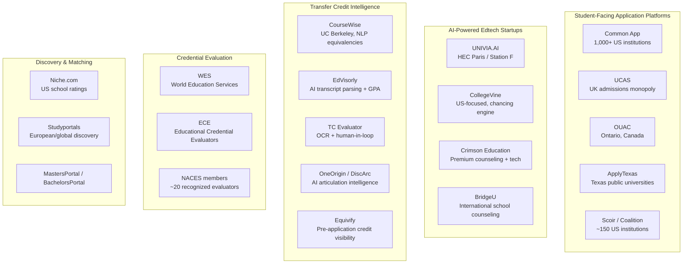

# UNIVIA — Strategic Analysis & Brand Availability Report

> **Date:** November 22, 2026
> **Status:** Pre-Development Strategic Assessment
> **Scope:** Brand viability, competitive landscape, strategic positioning, and launch recommendations

---

## Part I — Brand Availability Assessment

> [!CAUTION]
> **"UNIVIA" has significant naming conflicts that require immediate attention before any development investment.**

### Existing Entities Using "UNIVIA"

| Entity | Domain | Description | Risk Level |
|---|---|---|---|
| **UNIVIA.AI** | univia.ai | HEC Paris / Station F startup. AI-powered international academic orientation platform. Co-founded by Eliot Sberro & Manon Amandio. | 🔴 **Critical** |
| **UNIVIA Youth Community** | univia.world | Student-led platform for study abroad guidance, mentorship, and global education access. | 🔴 **Critical** |
| **Univia Education** | App Store | Counseling & guidance app for teachers and school counselors with AI session summaries. | 🟡 **High** |
| **Univia Global Consultancy** | univiaglobal.com | Tax, accounting, and business advisory (UAE). | 🟢 Low (different sector) |
| **Univia (Agri-input)** | univia.in | Agricultural solutions — seeds, crop nutrition (India). | 🟢 Low (different sector) |
| **Univia NL** | — | Technology and AI solutions group (Netherlands). | 🟡 Moderate |
| **Univia (Personal Care/MLM)** | — | Former multi-level marketing brand. | 🟢 Low (likely defunct) |

### Domain Availability

| Domain | Status | Notes |
|---|---|---|
| `univia.com` | ❌ **Likely registered** | Referenced in Yale academic documents; not resolving to a live site but held |
| `univia.ai` | ❌ **Taken** | Active — HEC Paris startup |
| `univia.world` | ❌ **Taken** | Active — Youth community platform |
| `univia.io` | ❓ **Unknown** | Requires WHOIS check |
| `univia.app` | ❓ **Unknown** | Requires WHOIS check |
| `univia.edu` | ❓ **Unknown** | Restricted to accredited institutions |

### Social Media Handles

The name "univia" is used across multiple social platforms by the entities listed above. Securing clean, uncontested handles on X, Instagram, LinkedIn, TikTok, and YouTube would likely be difficult or impossible.

### Critical Conflict: UNIVIA.AI

This is the most dangerous conflict. **UNIVIA.AI is an active, funded startup in the HEC Paris incubator at Station F**, operating in the *exact same space*:

- AI-powered international academic orientation
- University shortlisting and matching
- Student guidance and application support
- Integration with school counselors and teachers

They are building a French/European-focused version of a subset of your vision. Using the same name would create:

1. **Trademark infringement risk** (especially in the EU/France)
2. **Market confusion** in the exact target audience
3. **SEO competition** that disadvantages a new entrant
4. **Potential legal action** from an incubator-backed startup with resources

### Recommendation

> [!IMPORTANT]
> **Do not proceed with the name "UNIVIA."** The brand is already occupied by multiple entities in education technology, including one building an overlapping product with institutional backing. Choose a new name before any development begins.

---

## Part II — Alternative Name Exploration

Before investing in development, consider names that:

1. Are globally pronounceable across major languages
2. Evoke universality, education, and opportunity
3. Have clean `.com` / `.io` / `.app` availability
4. Have no existing trademark conflicts in Class 41 (Education) or Class 42 (Software)
5. Can be verified through USPTO TESS, EUIPO, and WIPO Global Brand Database

**Naming directions to explore:**

| Direction | Examples to Investigate | Rationale |
|---|---|---|
| **Latin/Neo-Latin roots** | Orbis, Meridian, Lumina, Praxis | Universal, academic feel |
| **Path/Journey metaphors** | Wayfare, Traverse, Pathwise | The student's journey across systems |
| **Compound neologisms** | ApplyGlobe, UniRoute, EduBridge | Descriptive, SEO-friendly |
| **Abstract constructions** | Verida, Nexara, Edura, Aethon | Clean trademark potential |
| **Portmanteau** | Scholara (Scholar + Era), Admira (Admissions + Era) | Category-defining |

> [!TIP]
> Run final candidates through: [USPTO TESS](https://tmsearch.uspto.gov/), [EUIPO eSearch](https://euipo.europa.eu/), [WIPO Global Brand Database](https://www.wipo.int/branddb/), Namecheap/GoDaddy domain search, and social handle checkers like Namechk.com.

---

## Part III — Competitive Landscape

### Direct Competitors & Adjacent Players

### Key Takeaways

1. **No single platform does what you're describing.** The vision is genuinely unprecedented in scope.
2. **The market is fragmented** — which is both the opportunity and the difficulty. Each fragment has entrenched players.
3. **Transfer credit intelligence is an active, well-funded space** with 5+ startups, but none are student-facing at global scale.
4. **Common App has enormous institutional inertia** — 1,000+ member institutions. Displacing it is a decade-long project.
5. **Credential evaluation is dominated by WES and NACES members** — these are potential partners, not competitors.
6. **UNIVIA.AI is a direct overlap** in the AI guidance layer, reinforcing the need for a different name.

---

## Part IV — Strategic Assessment of the Vision

### What Makes This Vision Different

Your vision is not incrementally better than existing products. It proposes a **category-creating platform** that unifies five currently separate industries:

| Current Industry | Your Replacement |
|---|---|
| Application platforms (Common App, UCAS) | Student OS — centralized application workspace |
| College counseling (Crimson, BridgeU) | AI College Counselor + Application Agent |
| Credential evaluation (WES, ECE) | International Academic Credential Engine |
| Transfer articulation (CourseWise, Equivify) | Transfer Credit Intelligence System |
| Scholarship databases (Fastweb, Scholarships.com) | Global Scholarship & Financial Aid Engine |

This is strategically powerful but operationally enormous. The document describes a product that would take **\$50M–100M+ and 5–7 years** to fully realize.

### Strongest Strategic Ideas

1. **Transfer students as the entry point** — This is your best strategic insight. Transfer is underserved, complex, and sticky. No one owns this globally.
2. **The "Stripe of University Applications" API layer** — This is the long-term moat. If universities integrate with your infrastructure, you become the rails, not just the interface.
3. **Global Academic Passport** — Portable, verified credentials. This intersects with the broader digital credential movement (Europass, Open Badges, Verifiable Credentials).
4. **International Education Knowledge Graph** — This becomes a defensible data asset that improves with every student interaction.

### Highest Risk Areas

| Risk | Severity | Mitigation |
|---|---|---|
| Data accuracy at global scale | 🔴 Critical | Start with verified subset; build ingestion + verification infrastructure before scaling |
| University partnership acquisition | 🔴 Critical | Begin with open data; earn partnerships through student volume |
| Regulatory complexity (GDPR, FERPA, minor protections) | 🟡 High | Hire specialized legal counsel early; design privacy-first architecture |
| Revenue before scale | 🟡 High | B2B revenue from counselor/institutional tools can precede B2C scale |
| AI hallucination in high-stakes advice | 🔴 Critical | RAG-only architecture; never generate unsourced institutional facts |
| Engineering complexity | 🟡 High | Modular monolith → services; avoid premature microservices |

---

## Part V — Recommended Launch Strategy

### Phase 0: Foundation (Months 1–3)

- [ ] **Finalize brand name** — trademark search, domain acquisition, social handles
- [ ] **Incorporate** — Delaware C-Corp (if targeting US VC) or jurisdiction-appropriate entity
- [ ] **Assemble founding team** — Full-stack engineer, AI/ML engineer, product designer, edtech domain expert
- [ ] **Legal foundation** — Privacy policy framework, terms of service, FERPA/GDPR preliminary review
- [ ] **Define MVP scope** — ruthlessly narrow

### Recommended MVP: Transfer Application Intelligence

> [!IMPORTANT]
> **Do not build the full vision as an MVP.** Launch with the most differentiated, most underserved vertical: transfer students.

**MVP Feature Set:**

| Feature | In MVP? | Notes |
|---|---|---|
| Student profile (transfer-focused) | ✅ | Academic history, coursework, GPA |
| Transfer portal | ✅ | Core product |
| University discovery (US + Canada, 500 institutions) | ✅ | Verified data only |
| Transfer eligibility checker | ✅ | Key differentiator |
| Course equivalency explorer | ✅ | Partnership with CourseWise or build lightweight version |
| AI counselor (transfer-focused) | ✅ | RAG over verified university data |
| Application tracker | ✅ | Basic workspace per application |
| Document upload + organization | ✅ | PDF, DOCX, images |
| First-year portal | ❌ | Phase 2 |
| Global scholarship engine | ❌ | Phase 3 |
| International credential engine | ❌ | Phase 3 |
| Knowledge graph | ❌ | Phase 4 |
| Counselor/recommender portals | ❌ | Phase 4 |
| University API (Stripe model) | ❌ | Phase 5+ |

### Phase 1: MVP Build (Months 3–9)

**Tech stack (aligned with your spec):**
- Frontend: Next.js + TypeScript + Tailwind CSS + Radix UI
- Backend: Python FastAPI (modular monolith)
- Database: PostgreSQL + Redis
- AI: OpenAI/Anthropic API with RAG (pgvector or Pinecone)
- Storage: S3-compatible (Cloudflare R2 or AWS S3)
- Auth: Clerk or Auth0
- Hosting: Vercel (frontend) + Railway/Render/Fly.io (backend)

### Phase 2: Expand to First-Year + International (Months 9–18)

- First-year application portal
- International credential intelligence (top 20 education systems)
- GPA conversion engine
- Expand university database to 2,000+ institutions
- Multilingual support (English, French, Spanish, Haitian Creole)

### Phase 3: Intelligence Layer (Months 18–30)

- Global scholarship engine
- Financial affordability calculator
- Advanced AI application agent
- Document intelligence (OCR, transcript parsing)
- University matching engine

---

## Part VI — Financial Model Sketch

### Pre-Seed / Seed Requirements

| Item | Estimated Cost |
|---|---|
| Founding team (4 people, 12 months) | \$400K–600K |
| Infrastructure & tooling | \$30K–60K/year |
| Legal (incorporation, IP, privacy) | \$30K–50K |
| Design & branding | \$15K–30K |
| Data acquisition & verification | \$20K–40K |
| **Total pre-seed range** | **\$500K–800K** |

### Revenue Timeline

| Milestone | Timeline | Revenue Source |
|---|---|---|
| Free launch, user acquisition | Month 9 | None (growth) |
| Premium subscriptions (\$9.99–19.99/mo) | Month 12 | B2C |
| Counselor/advisor subscriptions | Month 15 | B2B |
| Institutional partnerships pilot | Month 18 | B2B |
| Aggregated analytics product | Month 24+ | B2B |

---

## Part VII — Immediate Next Steps

### Decision Points for You

1. **Brand name** — Do you want me to generate and validate a list of 10–15 alternative names (checking trademarks, domains, and social handles for each)?

2. **MVP scope** — Do you agree with the transfer-first strategy, or do you want to launch with both first-year and transfer from day one?

3. **Build approach** — Are you planning to:
   - (a) Build this yourself / with a co-founder?
   - (b) Hire a development team?
   - (c) Use AI-assisted development (e.g., build the frontend prototype now)?

4. **Funding** — Are you planning to:
   - (a) Bootstrap initially?
   - (b) Seek pre-seed/seed funding?
   - (c) Apply to accelerators (Y Combinator, Techstars, etc.)?

5. **Target market for launch** — Where do you want to start?
   - (a) US community college → 4-year transfer students?
   - (b) International students applying to US universities?
   - (c) Caribbean/Haitian students applying globally?
   - (d) Multiple markets simultaneously?

---

> [!NOTE]
> This analysis is based on publicly available information as of November 2026. Trademark availability should be formally verified through legal counsel before filing. Domain availability changes in real-time. Competitive landscape information reflects what was discoverable through web research.
