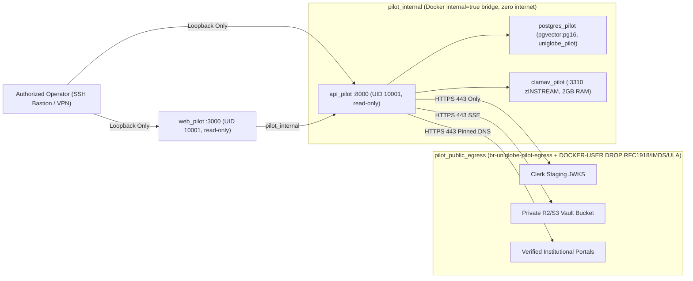

# UniGlobe — Phase 4.6 Isolated Staging Infrastructure Plan

**Date:** November 26, 2026  
**Baseline:** `main` after `470da8c` (Alembic head `a3c7e9f1b420`)  
**Provisioning Status:** **Blueprint Only — Zero paid cloud services provisioned or purchased**

---

## 1. Architecture Comparison & Selection

### A. Linux VM (Docker Compose) vs. Managed Kubernetes (`EKS`/`GKE`)
| Dimension | Single Hardened Linux VM (Recommended) | Managed Kubernetes (`NetworkPolicy` CNI) |
|---|---|---|
| **Control Plane Cost** | **$0/mo** (host OS only) | **~$73/mo** EKS/AKS control plane fee + node VMs |
| **Network Enforcement (Gate B)** | Host `iptables`/`ip6tables` (`UNIGLOBE_API_EGRESS`) attached to both host worker UID and `DOCKER-USER` for `br-uniglobe-pilot-egress` | Pod `NetworkPolicy` (`k8s-api-worker-egress-networkpolicy.yaml`) requiring Calico or Cilium CNI |
| **Ops Complexity** | Low (`docker compose -f infra/pilot/docker-compose.pilot.yml up -d`) | High (cluster Terraform, CNI policy agent, ingress controller) |
| **Selection Verdict** | **Selected for Minimum Viable Staging & Initial Controlled Pilot** | Deferred until production multi-node horizontal scaling |

### B. Cloudflare R2 vs. AWS S3 (Private Document Vault)
| Dimension | Cloudflare R2 (Primary) | AWS S3 (Drop-in Alternative) |
|---|---|---|
| **Free Tier** | **10 GB/mo storage**, 1M Class A ops, **zero egress charges** | **5 GB storage** (12-mo free tier only; egress charged beyond free tier) |
| **Encryption & Private ACL** | Default encryption at rest + S3 SSE-AES256 API, private bucket, zero public URL, short-lived V4 pre-signed URLs | `AES256` or explicit customer-managed `aws:kms` CMK (`STORAGE_KMS_KEY_ID`), Block Public Access + CloudTrail |
| **UniGlobe Provider** | `STORAGE_PROVIDER=cloudflare_r2` (`S3CompatibleVaultStorageProvider`) | `STORAGE_PROVIDER=s3` (`S3CompatibleVaultStorageProvider`) |

### C. Identity & Antivirus Services
- **Clerk Staging Tenant:** Dedicated non-production Clerk instance (`Development` / `Staging` mode, RS256 JWKS) supporting up to **10,000 MAU free tier**.
- **ClamAV Daemon:** Official `clamav/clamav:stable` container running `clamd` (`TCP 3310`) on `pilot_internal`. Requires **`~1.5–2.0 GB RAM`** dedicated for virus signatures (`clamav_db_pilot`).

---

## 2. Minimum Viable Staging Topology



### Minimum VM Resource Requirements
- **OS:** Ubuntu 24.04 LTS x86_64/ARM64 (Linux kernel >= 6.8 with `ip_tables`, `ip6_tables`, `xt_owner`, `xt_conntrack`).
- **Compute & Memory:** **2 vCPU / 4 GB RAM minimum** (`~2 GB` ClamAV, `~1 GB` PostgreSQL + FastAPI + Next.js, `~1 GB` OS headroom; `<= 2 GB` VMs will OOM-kill `clamd`).
- **Disk:** 30 GB encrypted root volume (database + `clamav_db_pilot` + local backup staging).

---

## 3. Estimated Monthly Cost & Free-Tier Matrix

| Service | Free-Tier Option | Estimated Cost (Paid VM Staging) | Limits / Notes |
|---|---|---|---|
| **Clerk Staging Tenant** | **$0/mo** (Free tier <= 10,000 MAU) | $0/mo | Use separate dev/staging instance; never share prod keys |
| **Cloudflare R2 Private Bucket** | **$0/mo** (<= 10 GB/mo storage) | $0/mo | Zero egress fees; card on file may be required by Cloudflare |
| **ClamAV Container** | **$0/mo** (Open Source GPL) | $0/mo | Consumes ~1.8 GB RAM inside staging VM |
| **Linux VM (2 vCPU / 4 GB RAM)** | Oracle Always-Free ARM or AWS `t4g.medium` trial (varies) | **~$12–$30/mo** (Hetzner/DO/Lightsail/EC2) | **Requires explicit approval before creating paid VM** |
| **Private Access (WireGuard / SSH Bastion / Cloudflare Zero Trust)** | **$0/mo** (OpenSSH / Zero Trust <= 50 users) | $0/mo | Ports `8000` and `3000` bound to `127.0.0.1` only |

---

## 4. Security Boundaries & Required Environment Configuration

| Variable Name | Purpose | Confidentiality |
|---|---|---|
| `ENVIRONMENT` | Set strictly to `staging` (disables mock & heuristic fallback) | Config |
| `AUTH_PROVIDER` | Must equal `clerk` | Config |
| `ALLOW_DEV_MOCK_DEFAULT_USER` | Must equal `false` | Config |
| `CLERK_ISSUER`, `CLERK_JWKS_URL`, `CLERK_AUDIENCE` | Clerk staging tenant issuer & JWKS endpoint | Internal |
| `CLERK_SECRET_KEY`, `NEXT_PUBLIC_CLERK_PUBLISHABLE_KEY` | Clerk backend secret & frontend publishable key | **Secret (Inject via Secret Manager)** |
| `POSTGRES_PASSWORD`, `DATABASE_URL` | Isolated `uniglobe_pilot` DB credentials | **Secret (Never prod DB)** |
| `STORAGE_PROVIDER`, `STORAGE_BUCKET_NAME`, `STORAGE_ENDPOINT` | Private `cloudflare_r2` / `s3` bucket location | Internal |
| `STORAGE_ACCESS_KEY_ID`, `STORAGE_SECRET_ACCESS_KEY` | Bucket-prefix scoped IAM/R2 keys (`Private` ACL only) | **Secret** |
| `VAULT_SIGNING_SECRET`, `VAULT_ENCRYPTION_KEY` | HMAC download URL signing + optional client-layer encryption | **Secret (64-char random)** |
| `SCANNER_BACKEND`, `CLAMAV_HOST`, `CLAMAV_PORT` | Must equal `clamav`, `clamav_pilot`, `3310` | Config |
| `ALLOW_EXTERNAL_AI_DOCUMENT_EGRESS` | Must equal `false` | Config |

---

## 5. Setup, Validation & Rollback Instructions

### Setup (After Infrastructure Approval)
1. Provision Ubuntu 24.04 VM (`2 vCPU / 4 GB RAM`) with inbound firewall blocking ports `8000`, `3000`, `5432`, `3310` from the internet (SSH `22` / VPN access only).
2. Populate `.env.pilot` securely on host from [`.env.pilot.example`](file:///Users/jonathangermain/.gemini/antigravity/scratch/Global-University-Application-Platform/infra/pilot/.env.pilot.example) (mode `0600`).
3. Apply egress firewall before starting worker traffic:
   ```bash
   export UNIGLOBE_WORKER_UID=10001
   export DOCKER_EGRESS_BRIDGE=br-uniglobe-pilot-egress
   sudo -E bash infra/firewall/egress-iptables.sh --apply
   ```
4. Launch isolated staging stack (runs Alembic `a3c7e9f1b420` automatically via `migrate_pilot` and waits for `clamav_pilot` health):
   ```bash
   docker compose -f infra/pilot/docker-compose.pilot.yml --env-file infra/pilot/.env.pilot up -d --build
   ```
5. Execute [`verify_staging_gates.py`](file:///Users/jonathangermain/.gemini/antigravity/scratch/Global-University-Application-Platform/infra/pilot/verify_staging_gates.py) and E2E workflow tests over SSH tunnel (`-L 18000:127.0.0.1:18000`).

### Teardown & Firewall Rollback
```bash
# Stop and remove staging containers (preserves backups cleanly)
docker compose -f infra/pilot/docker-compose.pilot.yml down
# Roll back custom iptables egress chains
sudo bash -c '
  iptables -D OUTPUT -m owner --uid-owner 10001 -j UNIGLOBE_API_EGRESS || true
  iptables -D DOCKER-USER -i br-uniglobe-pilot-egress -j UNIGLOBE_API_EGRESS || true
  iptables -F UNIGLOBE_API_EGRESS || true; iptables -X UNIGLOBE_API_EGRESS || true
  ip6tables -D OUTPUT -m owner --uid-owner 10001 -j UNIGLOBE_API_EGRESS_V6 || true
  ip6tables -F UNIGLOBE_API_EGRESS_V6 || true; ip6tables -X UNIGLOBE_API_EGRESS_V6 || true
'
```

### Risks & Dependencies
- **ClamAV Warm-up Latency:** Initial `freshclam` database sync takes 60–120 seconds (`start_period: 120s` configured in `docker-compose.pilot.yml`). Any upload during startup fails closed (`503` / `scan_failed`), never `scan_clean`.
- **Docker Bridge Firewall Attachment:** Host `OUTPUT --uid-owner` rules alone do not catch NATted Docker container traffic unless `DOCKER_EGRESS_BRIDGE=br-uniglobe-pilot-egress` (`DOCKER-USER` chain) is passed when applying `egress-iptables.sh`.
